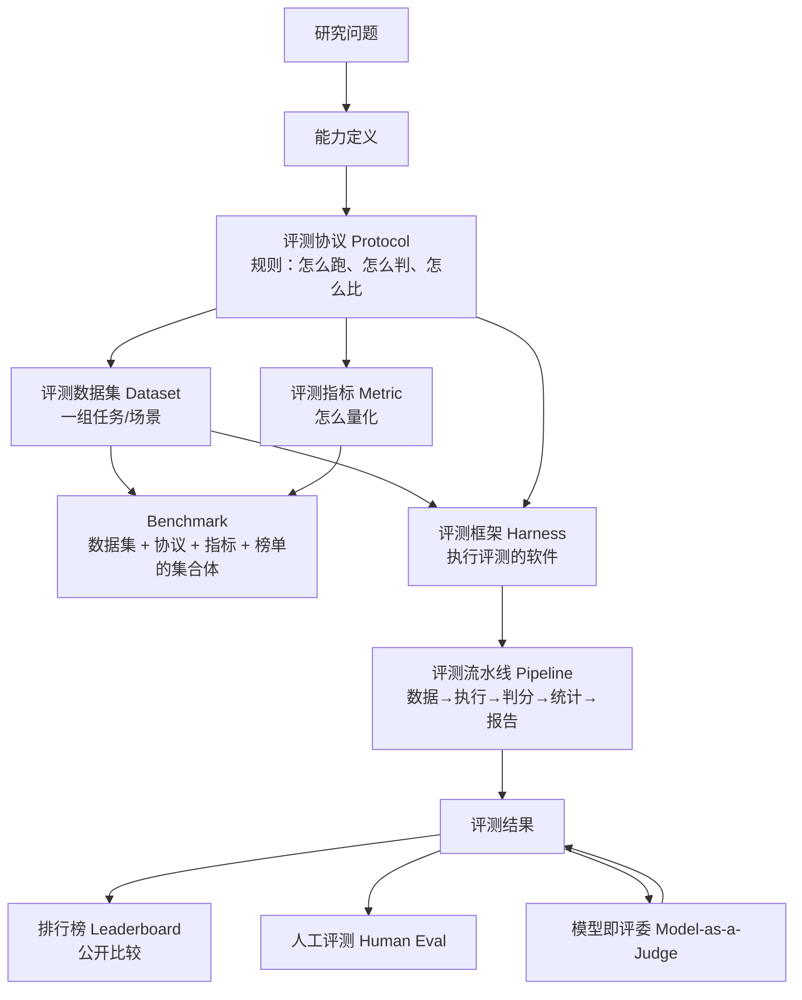
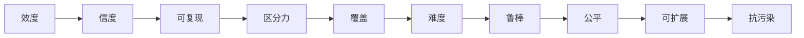
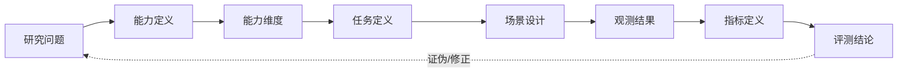

# 01 · 大模型评测的基础方法论

> 本文的目标是让一个没有评测经验的开发者，能够**独立判断一份评测方案是否合理**。
>
> 读法：§1.1 建立概念地图（十个术语的区别与关系）；§1.2 给出十项质量标准与检验方法；§1.3 讲"从抽象能力到可测量指标"的推导；§1.4 列出十类常见错误。
>
> 后续：[02](02-classic-benchmarks.md) 看真实 benchmark 怎么做的；[03](03-agent-benchmark-design.md) 学怎么自己设计；[04](04-metrics-and-statistics.md) 学怎么算与怎么下结论。

---

## 1.1 什么是大模型评测

### 1.1.1 一句话定义

**评测（evaluation）是用一套可重复的程序，对模型在特定任务上的表现进行观测、量化，并据此做出有边界的推断。**

拆开看，这句话有四个关键词：

| 关键词 | 含义 | 如果缺失 |
|---|---|---|
| **可重复的程序** | 别人按同样步骤能得到同样结果 | 结论不可信，只是轶事 |
| **特定任务** | 测的是什么必须明确 | 结论无法解释（"它很聪明"） |
| **观测与量化** | 有数据、有指标 | 只能是主观印象 |
| **有边界的推断** | 结论只在一定范围内成立 | 过度外推（"它在所有任务上都强"） |

第四点最容易被忽略。**评测不是"给模型打分"，而是"在限定条件下做可证伪的推断"。**

### 1.1.2 十个术语：区别与关系

先给一张关系图，再逐个解释。

#### （1）Model Evaluation（模型评测）

- **是什么**：对模型能力/行为进行系统观测与推断的整个过程。
- **为什么需要**：没有评测，模型改进无法判断方向；部署无法评估风险。
- **解决什么**：回答"这个模型在什么条件下、能做到什么程度"。
- **怎么用**：它是**总称**，下面所有术语都是它的组成部分。
- **例子**："评测 Qwen3-4B 在 Balatro 子集上的单步决策质量"是一个 model evaluation。

#### （2）Benchmark（基准）

- **是什么**：一套**标准化**的评测资产，通常包含：任务集 + 评测协议 + 指标 + （可选）公开榜单 + 维护机制。
- **为什么需要**：让不同团队的结果**可比**。没有标准，A 说 80 分、B 说 90 分，可能测的不是一件事。
- **解决什么**：降低比较成本，提供公共参照。
- **怎么用**：引用时必须写清**版本**（benchmark 会变），并说明你用的是官方协议还是改过的。
- **例子**：MMLU 是 benchmark；"我用 MMLU 的 500 题子集"是"基于 benchmark 的自建评测"，不能直接叫 MMLU 分数。

> **常见混淆**：把"数据集"叫成"benchmark"。数据集只是题库；benchmark 还包含"怎么判分、怎么报告"的约定。

#### （3）Evaluation Dataset（评测数据集）

- **是什么**：一组任务实例（题目/场景/对话），每个实例含输入、（可选）参考答案/判定条件、元数据。
- **为什么需要**：评测的"样本"。样本决定结论能覆盖什么。
- **解决什么**：把"能力"具体化为可执行的输入输出对。
- **怎么用**：关注**来源、划分、去重、污染、版本**五件事（见 [03](03-agent-benchmark-design.md) §3.4）。
- **例子**：60 个"初始局面 + 合法动作 + oracle"的决策点。

#### （4）Evaluation Harness（评测框架/执行器）

- **是什么**：把数据集喂给模型、收集输出、调用判分器、汇总结果的**软件系统**。
- **为什么需要**：手工跑不可复现、不可扩展、容易出错。
- **解决什么**：把"评测协议"变成可执行代码，保证每次跑的条件一致。
- **怎么用**：选框架时看四点：是否支持你的环境、是否记录 trace、是否可断点续跑、判分是否可插拔。
- **例子**：本报告 [05](05-evaluation-framework-engineering.md) 描述的 runner + evaluator + metrics 架构；工业界的 lm-evaluation-harness、HELM 工具包。

> **harness 与 benchmark 的区别**：harness 是"跑评测的程序"，benchmark 是"跑什么、怎么算"的约定。同一个 harness 可以跑多个 benchmark。

#### （5）Evaluation Protocol（评测协议）

- **是什么**：一组**规则**：prompt 怎么写、few-shot 给几个、温度多少、最大步数多少、非法动作怎么处理、超时怎么算、统计怎么做。
- **为什么需要**：同一模型、同一数据集，协议不同，分数可以差很多。
- **解决什么**：保证"比较的是模型，不是提示词或预算"。
- **怎么用**：把协议写进配置并**预注册**（跑之前定死），报告里附上。
- **例子**："每步 max_tokens=1024，最多 12 步，非法动作允许重试 2 次，超时不计入能力分母"。

#### （6）Evaluation Metric（评测指标）

- **是什么**：把观测映射成数字的函数（准确率、成功率、regret、延迟……）。
- **为什么需要**：没有数字就无法比较、无法统计。
- **解决什么**：把"行为"压缩成可分析的信号。
- **怎么用**：每个指标必须带**定义、方向、单位、精确性、适用条件**（见 [04](04-metrics-and-statistics.md) §4.2）。
- **例子**：`Local Regret = (oracle分 − 实际分) / oracle分`，仅在 `play` 决策上定义，方向越低越好。

#### （7）Evaluation Pipeline（评测流水线）

- **是什么**：从数据到报告的**端到端流程**：加载 → 执行 → 记录 → 判分 → 统计 → 出报告。
- **为什么需要**：单点工具无法保证一致性；流水线让每一步可复现、可审计。
- **解决什么**：把"一次实验"变成"可重复的工程过程"。
- **怎么用**：流水线要有**版本快照**（数据/代码/模型/配置）与**失败隔离**。
- **例子**：`load → run 90 episodes → score → aggregate → report.md`。

#### （8）Leaderboard（排行榜）

- **是什么**：公开的模型排名表，通常按某个指标排序。
- **为什么需要**：提供公共参照，推动竞争。
- **解决什么**：降低"哪个模型好"的信息成本。
- **怎么用**：看榜要问五件事：数据是否公开、判定是否程序化、是否控制成本、是否有隐藏集、提交是否可复现。
- **例子**：Chatbot Arena（人类偏好）、SWE-bench 榜单（% Resolved）。

> **排行榜的固有缺陷**：一旦公开，就会被针对性优化（Goodhart 定律）。所以强 benchmark 都保留 hidden set 或定期换题。

#### （9）Model-as-a-Judge（模型即评委）

- **是什么**：用另一个（通常更强的）模型来评判输出质量或偏好。
- **为什么需要**：人工评测贵、慢；很多任务没有唯一答案。
- **解决什么**：把"主观判断"规模化。
- **怎么用**：必须做**校准**：与人类一致性、位置偏差、冗长偏差、自我偏好（见 [02](02-classic-benchmarks.md) §2.3）。
- **例子**：MT-Bench 用 GPT-4  pairwise 评判两个回答；AlpacaEval 用长度控制消除冗长偏差。

#### （10）Human Evaluation（人工评测）

- **是什么**：由人（专家或众包）判断质量/偏好/正确性。
- **为什么需要**：它是"人类想要什么"的最终标准；也是校准自动指标的锚。
- **解决什么**：提供构念效度的最终依据。
- **怎么用**：要有**标注指南、多人标注、一致性统计（κ）、抽检**。
- **例子**：GPQA 用 PhD 级承包商出题并验证；WebArena 报告人类成功率 78.24%。

### 1.1.3 它们如何组成一个完整体系

| 层 | 组件 | 回答的问题 |
|---|---|---|
| **定义层** | 研究问题、能力定义 | 测什么？ |
| **资产层** | 数据集、benchmark | 用什么测？ |
| **规则层** | 协议、指标 | 怎么测、怎么算？ |
| **执行层** | harness、pipeline | 谁来跑、怎么保证一致？ |
| **推断层** | 统计、报告 | 结论是什么、边界在哪？ |
| **社会层** | leaderboard、人工评测、judge | 别人怎么信、怎么比？ |

**常见失败模式**：只做"资产层"（造了数据集）和"执行层"（跑出分数），跳过"规则层"（没定协议）与"推断层"（没做统计）。结果就是"我们跑了很多模型，分数如下"——这不是评测，是测量记录。

### 1.1.4 一个完整例子：从研究问题到结论

> **数字为教学构造**，用于演示流程；不代表任何真实实验。

**Step 0：研究问题**
"在 Balatro 子集的单步决策上，让模型先写推理再给动作（CoT），是否比直接给动作得分更高？"

**Step 1：能力定义**
能力 = "在给定手牌与 Joker 的情况下，选出接近即时最优的出牌组合"。
注意：这里刻意限定为**单步**。如果写成"规划能力"，就需要另一套任务（见 [03](03-agent-benchmark-design.md) §3.1）。

**Step 2：任务与场景**
60 个决策点，每个含初始状态、218 个合法动作、O1 oracle（精确 argmax）。
场景分层：L1 无 Joker、L2 单/双 Joker、L3 盲注内多步、L4 高风险。

**Step 3：数据集**
- 来源：程序生成 + 人工抽检（真实项目会用真游戏捕获，此处简化）；
- 划分：40 train / 10 dev / 10 test（按模板分组，防泄漏）；
- 版本：`v0.1.0` + manifest（含 hash）。

**Step 4：协议**
- 三组：A 直答、B CoT、C 云端 CoT；
- 同 prompt 模板、同工具 schema、同 max_tokens、同温度 0；
- 非法动作：允许重试 1 次；
- 超时：单步 120s，超时不计入 regret 分母，单列。

**Step 5：指标**
- 主：Local Regret（越低越好），仅 play 决策；
- 次：Action Optimality、Legality Rate；
- 诊断：首次失败步、每步延迟、token 数。

**Step 6：执行**
harness 跑 3 组 × 10 test 场景 = 30 局，每局 1 次决策（单步场景）；记录 trace（含原始输出、解析动作、状态哈希、延迟、token）。

**Step 7：统计**
- 配对键 = scenario_id；
- 主比较 A vs B（配对 Wilcoxon，报中位差、95% CI、rank-biserial）；
- 次比较加入 C 时做 Holm 校正；
- 样本量 10，**事前声明只能检测大效应**（用 [04](04-metrics-and-statistics.md) §4.4.7 的公式：σ_d=0.2、Δ=0.2 → n≈8，勉强够；若 Δ=0.1 则需 32）。

**Step 8：结论（示范"有边界"的写法）**

> 在 10 个配对测试场景上，B（CoT）的 Local Regret 中位数为 0.18，A（直答）为 0.31；配对差值中位数 −0.09（95% CI [−0.20, −0.02]）。该差异方向与假设一致，但样本量仅支持"中等以上效应"，且**只适用于单步决策**，不能外推到多步或规划能力。

**Step 9：报告**
附上：数据集版本、协议快照、代码 commit、模型版本、每场景原始 trace、失败案例分析、局限性。

**这个例子里每一步都可能出错**：
- 若把"单步"说成"规划"→ 构念效度错误；
- 若 10 个场景还做 3 次比较不校正 → 假阳性；
- 若样本是程序生成且高度模板化 → 结论只适用于该模板；
- 若 oracle 用错目标函数 → 指标方向错。

---

## 1.2 一份合格评测集的十项标准

> 用法：把这张表当成**检查清单**。每项都给出"定义 / 为什么重要 / 常见失败案例 / 如何检验 / 工程如何实现"。

### 速查表

| # | 标准 | 一句话检验 | 本项目的状态（详见 [06](06-project-specific-analysis.md)） |
|---|---|---|---|
| 1 | Validity 效度 | 测的是不是它声称的能力？ | ⚠️ 单步指标被用于长程主张 |
| 2 | Reliability 信度 | 重复测是否稳定？ | ⚠️ 单次运行，无方差估计 |
| 3 | Reproducibility 可复现 | 别人能否复现？ | ✅ 引擎内确定；❌ 无 code hash |
| 4 | Discriminative Power 区分力 | 能否区分强弱模型？ | ⚠️ 未验证（无 pilot） |
| 5 | Coverage 覆盖度 | 是否覆盖能力关键面？ | ❌ 四支柱三缺 |
| 6 | Difficulty 难度 | 是否有合理梯度？ | ⚠️ 有 L1–L4 标签，无实测分布 |
| 7 | Robustness 鲁棒性 | 是否受无关因素影响？ | ❌ 未测 |
| 8 | Fairness 公平性 | 条件是否相同？ | ⚠️ 有配对设计，无预算控制 |
| 9 | Scalability 可扩展 | 能否持续加数据/模型？ | ⚠️ 有生成器思路，无实现 |
| 10 | Contamination Resistance 抗污染 | 是否会背答案？ | ❌ 无 hidden set / canary |

---

### 1.2.1 Validity（效度）

**定义**：评测测量的确实是它声称要测量的构念（construct）。分三类：

| 类型 | 问题 | 例子 |
|---|---|---|
| **构念效度** | 指标是否对应能力本身 | 用"单步 argmax 准确率"代表"规划能力" → 无效 |
| **内部效度** | 因果推断是否成立 | 模型 A 分数高，是因为 prompt 更好还是模型更强？ |
| **外部效度** | 结论能否外推到别的分布 | 在自建子集上强，能否外推到真游戏？ |

**为什么重要**：效度是评测的**第一性问题**。一个效度错误的评测，跑得再精确、统计再严谨，结论也是错的。

**常见失败案例**：
1. 用"知识问答"代表"推理能力"（模型可能只是记住了）；
2. 用"单步决策"代表"长期规划"（本报告反复强调的例子）；
3. 用"代码通过单测"代表"软件工程能力"（可能只是模式匹配）；
4. 用"人类偏好"代表"正确性"（偏好可能被冗长/格式操纵）。

**如何检验**：
- **判别任务对**：构造两个只在一个能力上不同的任务，看分数是否只在预期维度分化；
- **消融**：移除该能力的关键机制，看分数是否下降；
- **与人类对照**：人类专家在同一任务上的表现是否符合预期；
- **推翻假设**：问"如果模型用了完全不同的策略也拿到高分，我的指标还能区分吗"。

**工程实现**：
- 在数据集里为每个场景标注 `capability` 与 `confounders`；
- 在报告里为每个指标写"它能/不能支持什么结论"；
- 禁止跨能力复用同一指标而不加限定。

---

### 1.2.2 Reliability（信度）

**定义**：重复测量得到一致结果的程度。包括：

- **重测信度**：同一模型、同一配置，多次运行结果是否一致；
- **评分者信度**：多个 judge/标注者是否一致（κ）；
- **内部一致性**：同一能力的多个题目是否一致（Cronbach's α，慎用）。

**为什么重要**：如果同一配置两次跑出不同结论，任何比较都无意义。

**常见失败案例**：
- 温度 0.7、只跑 1 次 → 把采样噪声当能力差异；
- 判分器不稳定（如 LLM judge 换一次提示就变）；
- 环境有隐藏随机性（时间、并发、字典顺序）。

**如何检验**：
- 同配置跑 2–3 次，比较分数差异与排序是否稳定；
- 计算"同一场景多次运行的动作一致率"；
- 让两个 judge 评同一批，算 κ。

**工程实现**：
- 记录 seed 与采样参数；
- 至少 3 次重复（若预算允许）；
- 报告方差或 CI，而不是单点。

---

### 1.2.3 Reproducibility（可复现性）

**定义**：他人用你提供的信息，能重现你的结果。分三级：

| 级别 | 要求 | 例子 |
|---|---|---|
| **重复（repeat）** | 你自己再跑一次能得到同样结果 | 同 seed 同结果 |
| **复现（reproduce）** | 别人按你的描述能跑出同样结果 | 提供代码 + 数据 + 配置 |
| **复算（replicate）** | 别人用独立实现能得到同向结论 | 换环境仍成立 |

**为什么重要**：不可复现的结论无法被检验，也就无法被信任。

**常见失败案例**：
- 只写"我们用了 GPT-4"，没写具体版本/日期；
- 数据没版本，三个月后自己都不知道用的是哪版；
- 随机种子没记录；
- 依赖 live API，服务一变结果就变。

**如何检验**：
- 让一个没参与的人按 README 跑一遍；
- 用归档的 trace 重放，比较 state_hash；
- 检查结果文件是否含完整版本头。

**工程实现**（四条缺一不可）：
1. 数据 manifest（含 hash）；
2. 代码 commit + 关键模块内容 hash；
3. 模型标识（provider + model_id + 日期/指纹）；
4. 配置快照（prompt/tools/温度/预算）。

---

### 1.2.4 Discriminative Power（区分能力）

**定义**：能否把不同能力水平的模型/策略区分开。数学上就是"分数对真实能力差异的敏感度"。

**为什么重要**：如果所有模型都考 95 分（天花板）或都考 5 分（地板），这个评测对当前模型群体没有信息量。

**常见失败案例**：
- 任务太简单：所有模型都满分；
- 任务太难：所有模型都 0 分；
- 指标饱和：二值指标在中间难度区分度最高，但两端都饱和；
- 场景 margin 太小：最优与次优只差 1 分，选错几乎无代价。

**如何检验**：
- **Pilot**：跑 3 个不同水平的模型/策略（random、弱模型、强模型），看分数是否单调分开；
- **负对照**：random 策略应显著低分；oracle 策略应满分；
- **难度分布**：按成功率分箱，看是否每箱都有场景。

**工程实现**：
- 保留一组"已知强弱"的基线（random / greedy / oracle）；
- 上线前先跑 pilot，不达标就调难度；
- 报告"分数 vs 难度"曲线，不只报总分。

---

### 1.2.5 Coverage（覆盖度）

**定义**：评测是否覆盖目标能力的关键方面（维度 × 难度 × 场景类型）。

**为什么重要**：覆盖不全的评测会给出**片面但看起来完整**的结论。典型："我们在 57 个学科上测了知识"——但全是选择题，没测"用知识解决问题"。

**常见失败案例**：
- 只覆盖"常见情况"，不覆盖边界（空输入、超长、非法动作）；
- 只覆盖一个难度层；
- 维度标签是事后贴的，不是设计时保证的。

**如何检验**：
- 建**覆盖矩阵**：行 = 能力维度，列 = 难度/场景类型，格 = 场景数；空格就是缺口；
- 检查是否有"只出现在一个维度"的场景（说明维度设计有问题）。

**工程实现**：
- 场景元数据强制含 `capability` / `difficulty` / `scenario_type`；
- CI 里检查覆盖矩阵无空格（或明确标注"故意不覆盖"）。

---

### 1.2.6 Difficulty（难度设计）

**定义**：任务难度是否有梯度，且难度是可解释、可控制的。

**为什么重要**：难度决定区分度；难度不可控意味着无法针对弱/强模型调整。

**常见失败案例**：
- 难度靠"感觉"（"这个看起来难"）；
- 难度与能力混淆（"难"是因为需要更多知识，而不是更多规划）；
- 难度分布双峰（两类完全不同的任务混在一起）。

**如何检验**：
- 用 pilot 模型的成功率作为**经验难度**；
- 检查难度与设计标签是否一致（L4 应显著难于 L1）；
- 检查难度是否随"前瞻深度需求"单调上升（这是规划类任务的关键）。

**工程实现**：
- 难度由**参数**控制（手牌数、约束数、margin、前瞻深度），不由人工主观标注；
- 每个难度层有最小场景数；
- 报告分难度层的结果。

---

### 1.2.7 Robustness（鲁棒性）

**定义**：当施加与目标能力无关的变化时，结果是否稳定。常见扰动源：

| 扰动 | 例子 | 是否应影响结果 |
|---|---|---|
| Prompt 措辞 | 换同义表达 | 不应 |
| 选项顺序 | 打乱动作列表 | 不应 |
| 随机种子 | 换采样 seed | 不应（大样本下） |
| 无关上下文 | 加一段无关说明 | 不应 |
| 格式 | JSON vs 自然语言 | 视协议而定（需固定） |

**为什么重要**：如果换个说法分数就掉一半，那测的是"提示词敏感度"，不是能力。

**常见失败案例**：
- 只用一个 prompt 模板；
- 动作列表顺序固定，模型靠位置猜；
- 评测环境对格式极度敏感（多一个空格就解析失败）。

**如何检验**：
- 构造 3–5 个语义等价的 prompt 变体，看分数方差；
- 打乱选项顺序，看是否影响选择；
- 报告"扰动下的分数区间"。

**工程实现**：
- prompt 模板参数化，变体作为实验因子；
- 解析器容错（去空格、允许多种格式），但要记录"原始格式"；
- 报告 robustness 指标（[04](04-metrics-and-statistics.md) §4.2.8）。

---

### 1.2.8 Fairness（公平性）

**定义**：不同模型处于**相同的测试条件**。包括：

- 相同 prompt / 工具 schema；
- 相同 token/步数/时间预算；
- 相同环境版本；
- 相同重试策略；
- 相同上下文长度（或明确承认差异是能力的一部分）。

**为什么重要**：不公平的比较会得出"模型 A 更强"，而实际上只是 A 拿到更多预算。

**常见失败案例**：
- A 用 3 次重试，B 用 1 次；
- A 有 128k 上下文，B 只有 8k，却直接比分数；
- A 用 CoT，B 用直答，却不说明；
- 云端模型有网络波动，本地没有，延迟直接比。

**如何检验**：
- 写一张"条件对照表"，逐项确认相同；
- 用配对设计（同场景、同顺序）；
- 报告预算（token/步数/时间）与成本。

**工程实现**：
- 配置里把预算设为显式参数，不允许"默认"；
- 结果文件头记录预算；
- 报告里给"预算 vs 分数"的 Pareto 图。

---

### 1.2.9 Scalability（可扩展性）

**定义**：能否低成本地增加数据、任务、模型、重复次数，而不破坏一致性。

**为什么重要**：benchmark 会饱和、会泄漏，需要持续更新；不能扩展的 benchmark 两年后就死了。

**常见失败案例**：
- 场景靠手工编写，加 100 个要一个月；
- 加新模型要改代码；
- 加新任务要复制整个流水线。

**如何检验**：
- 问"如果场景数 ×10，需要多少人天"；
- 问"接入一个新模型需要改几处代码"；
- 问"加一个新能力维度，是否需要重写判分"。

**工程实现**：
- 场景生成器（参数化 + 约束采样）；
- 模型 adapter（统一接口）；
- 判分器插件化（按任务类型注册）。

---

### 1.2.10 Contamination Resistance（抗污染）

**定义**：测试数据（及其答案）没有出现在模型训练数据中，或即使出现也无法直接获益。

**为什么重要**：污染会让分数虚高，且**无法从分数本身看出来**。

**常见失败案例**：
- 题目来自公开网络，模型训练时见过；
- 答案在题目里（格式泄漏）；
- few-shot 示例就是测试题；
- 排行榜公开后，社区针对题目微调。

**如何检验**：
- **canary 字符串**（GPQA 做法）：在数据里嵌入唯一串，事后检测模型是否"见过"；
- **n-gram 重叠**：与已知训练语料比对（只能查公开语料）；
- **时间切分**：用模型训练截止之后的新题；
- **扰动测试**：改数字/改名字后分数是否骤降（若骤降，说明在背）。

**工程实现**：
- 保留 hidden test（不公开）；
- 定期换题；
- 记录数据来源与时间；
- 报告里写"污染风险与缓解"，不要写"无污染"（无法证明）。

---

### 1.2.11 十项标准之间的关系

这不是严格因果，而是**检查顺序**：效度错了，后面都没意义；信度不足，区分力就是噪声；不可复现，公平无从谈起。

**最重要的一句话**：

> **Benchmark 分数高，不代表 Benchmark 设计得好；模型在 Benchmark 上表现好，也不必然意味着它具备对应的真实能力。**

两个独立的断言：
1. **分数高 ≠ 设计好**：可能任务简单、判定宽松、被捷径利用；
2. **表现好 ≠ 有能力**：构念效度问题；可能只是记住了、猜对了、或利用了评测漏洞。

---

## 1.3 从研究问题到可测量能力

### 1.3.1 为什么抽象能力不能直接测

"长程规划能力"不是一个可观测量。它是**一组行为的概括**。你无法直接观测"规划"，只能观测：

- 是否为了未来收益放弃当前收益；
- 是否在多步后仍朝同一目标；
- 是否在资源约束下合理分配；
- 是否在失败后改变策略。

**每一步都是一次"翻译"**：把抽象词翻译成行为，把行为翻译成任务，把任务翻译成指标。

### 1.3.2 八步链条

| 步 | 输入 | 输出 | 检验问题 |
|---|---|---|---|
| 1 研究问题 | 兴趣 | 可证伪的假设 | 能否说出"什么结果会推翻它"？ |
| 2 能力定义 | 假设 | 可观测行为 | 这个行为能被录像/记录吗？ |
| 3 能力维度 | 行为 | 维度清单 | 每个维度有判别任务吗？ |
| 4 任务定义 | 维度 | 任务族 + 参数 | 任务的难点是目标能力吗？ |
| 5 场景设计 | 任务 | 具体场景 + 判定 | 能否用程序判对错？ |
| 6 观测结果 | 场景 | trace | 记录了足够信息吗？ |
| 7 指标定义 | trace | 数字 | 指标方向与假设一致吗？ |
| 8 结论 | 数字 | 有边界的推断 | 边界写清了吗？ |

### 1.3.3 完整案例：把"长程规划"翻译成可测任务

**Step 1 研究问题**
"我想测试 Agent 的长期规划能力。"
→ 改写："在存在跨阶段复利资源的环境中，模型是否会在前期放弃即时收益以提高后期通关概率？"

**Step 2 能力定义**
能力 = "跨阶段资源分配"：在资源可累积、且当前消费会减少未来收益的结构下，选择使长期目标最大化的动作。

**Step 3 能力维度**
拆成三个可分别观测的子维度：
- D1 **延迟满足**：是否放弃即时高分以保留资源；
- D2 **复利意识**：是否理解"保留资源 → 未来收益"；
- D3 **风险平衡**：是否在"稳拿小分"与"搏大分"之间做合理选择。

**Step 4 任务定义**
任务族：商店决策（买/不买/买哪个），参数 = 金钱、价格、利息率、下一盲注目标、Joker 效果。
难点必须是 D1–D3，而不是"算分"或"读规则"。

**Step 5 场景设计**
见 [03](03-agent-benchmark-design.md) §3.3.5 的完整示例（含初始状态、动作、规则、目标、约束、预期行为、失败条件、评测结果、测了什么）。

**Step 6 观测结果**
记录：选择了什么、当时金钱、利息、下一目标、后续 3 个盲注的结果。

**Step 7 指标定义**
- 主：`Regret_long = (V*_long − V_agent) / V*_long`，其中 $V^*_{\text{long}}$ 是"最大化通关概率"的最优策略值（需近似）；
- 辅：**前瞻率** = 选择"只有看 ≥1 步才最优"的动作的比例（这个指标直接对应 D1）；
- 诊断：金钱轨迹、利息损失。

**Step 8 结论**
"在 30 个商店决策点上，模型的前瞻率为 0.23（95% CI [0.12, 0.37]），显著低于脚本化前瞻策略的 0.81。"

**这个案例的关键**：**指标（前瞻率）直接对应行为（放弃即时收益），行为直接对应能力（延迟满足）**。链条上没有跳跃。

### 1.3.4 反例：链条断在哪里

| 断点 | 表现 | 后果 |
|---|---|---|
| 1→2 | "测规划"但没定义行为 | 无法设计任务 |
| 2→3 | 行为与维度不对应 | 维度测不到行为 |
| 3→4 | 任务难点不是目标能力 | 测了别的东西（如算分） |
| 4→5 | 场景无法程序判定 | 只能人工看，不可扩展 |
| 5→6 | trace 记不全 | 无法算指标 |
| 6→7 | 指标方向与假设相反 | 结论反向 |
| 7→8 | 没有置信区间/边界 | 过度解释 |

**最常见的断点是 3→4**：任务看起来像目标能力，实际难点在别处。检验方法：**做一次"能力消融"**——如果去掉目标能力，任务仍然可解，那它就没测到该能力。

---

## 1.4 常见评测设计错误

> 每条给：表现 / 为什么错 / 怎么发现 / 怎么修。

### 错误 1：指标与研究目标不一致

- **表现**：想测"规划"，指标是"单步与最优的差距"。
- **为什么错**：单步指标的参照是"当前状态最优"，定义上不含未来；平均再多次也不变成规划指标。
- **怎么发现**：问"如果模型每步都选即时最优，这个指标会怎样"——如果答案是"满分"，那它测的就是短视。
- **怎么修**：换指标（前瞻率、跨期 regret、通关率），或改主张（只说单步战术）。

### 错误 2：任务过于简单，无法区分模型

- **表现**：所有模型 90%+。
- **为什么错**：天花板效应，没有信息量。
- **怎么发现**：pilot 跑 random 与最强模型，差距 <10 个百分点。
- **怎么修**：加难度（更大搜索空间、更小 margin、更长时域），或换任务。

### 错误 3：只测单步能力，却宣称测量长期规划

- **表现**：60 个单决策点，标题写"long-horizon benchmark"。
- **为什么错**：构念效度错误；读者会外推到不存在的能力。
- **怎么发现**：检查"场景是否含跨阶段累积资源""贪心是否近似最优"。
- **怎么修**：改标题/主张，或补机制与 episode 级场景。

### 错误 4：数据集模板化与答案泄漏

- **表现**：1000 条数据只有 20 个模板；oracle 字段被渲染进 prompt。
- **为什么错**：前者让"覆盖"是假的；后者让任务变成抄答案。
- **怎么发现**：模板指纹统计（[03](03-agent-benchmark-design.md) §3.4.4）；`agent_view()` 白名单检查。
- **怎么修**：参数化生成 + 去重；类型层面隔离 oracle。

### 错误 5：评测环境与真实应用不一致

- **表现**：自建简化环境，声称代表真实场景。
- **为什么错**：外部效度不足；简化可能去掉关键难点。
- **怎么发现**：列出"环境排除了哪些机制"，逐条问"这会不会改变最优策略"。
- **怎么修**：真实环境做小样本终验；报告明确"仅在本环境成立"。

### 错误 6：Judge 模型自身存在偏差

- **表现**：用 LLM 打分，不校准。
- **为什么错**：位置偏差（换顺序结论反转）、冗长偏差、自我偏好。
- **怎么发现**：交换顺序看一致性；与人工标注比 κ；长度控制后看排名是否变。
- **怎么修**：多 judge 投票、位置平衡、长度控制、人工抽检（[02](02-classic-benchmarks.md) §2.3）。

### 错误 7：只报告平均分，掩盖失败模式

- **表现**："平均成功率 61%"，不说分布。
- **为什么错**：均值相同可以对应完全不同的分布；失败集中在哪里才是关键。
- **怎么发现**：要求看中位数、IQR、分难度/分维度表。
- **怎么修**：报告分布 + 分层 + 失败类型分布。

### 错误 8：样本数量不足，却得出强结论

- **表现**：n=12 报 p 值；n=30 说"显著优于"。
- **为什么错**：功效不足时"不显著"不能解释为"无差异"；"显著"可能是假阳性。
- **怎么发现**：用 [04](04-metrics-and-statistics.md) §4.4.7 算所需 n。
- **怎么修**：降级为描述统计 + CI；或扩样本；或明确写"只能检测大效应"。

### 错误 9：模型使用不同工具/上下文/推理预算

- **表现**：A 有 5 个工具、B 有 3 个；A 用 CoT、B 直答，却不说明。
- **为什么错**：比较的不是模型，是配置。
- **怎么发现**：条件对照表逐项核对。
- **怎么修**：固定预算与工具；若必须不同，分开报告并说明。

### 错误 10：只展示成功案例，不分析失败案例

- **表现**：论文里放 3 个漂亮 trace。
- **为什么错**：失败模式才是能力边界的证据；只展示成功等于选择性报告。
- **怎么发现**：要求"失败案例 ≥ 成功案例"或至少等量。
- **怎么修**：固定报告结构：失败率、失败类型、典型失败 trace、反例分析。

### 补充：三个更隐蔽的错误

| 错误 | 表现 | 为什么危险 |
|---|---|---|
| **捷径（shortcut）** | 模型不解题，利用环境规律拿分（如总是选第一个） | 分数高但能力假；需 `cheat()` 式自检 |
| **规则判定漏报** | 程序化判定把成功判成失败 | AgentRewardBench 发现规则检查会系统性低报成功 |
| **聚类当独立** | 同模板的多个变体当独立样本 | CI 偏窄，虚假显著 |

---

## 1.5 本章应该掌握什么

1. 用自己的话区分 benchmark / dataset / harness / protocol / metric / pipeline，并各举一例。
2. 说明为什么"分数高"既不能证明 benchmark 好，也不能证明模型有能力。
3. 对十项标准，各说出一个失败案例与一种检验方法。
4. 把"我想测 X 能力"改写成"可观测行为 + 可判定任务 + 指标"的链条。
5. 指出"单步指标 → 长程结论"这个跳跃错在哪。
6. 列出至少 6 类常见评测错误，并说明如何发现。
7. 解释为什么"样本量不足"时正确的做法是降级主张，而不是换个检验方法。

### 常见误区（本章范围）

| 误区 | 纠正 |
|---|---|
| "Benchmark 就是数据集" | benchmark 还含协议、指标、维护机制 |
| "Harness 跑出来的分数就是模型能力" | 还取决于协议、预算、判定、环境 |
| "排行榜第一就是最强" | 取决于榜单测什么、怎么判、是否控制成本 |
| "LLM judge 和人类 85% 一致就够" | 一致率是均值；单条可能因位置偏差完全反转 |
| "人类基线不重要" | 没有它，无法解释分数的含义 |
| "可复现就是固定 seed" | 还需要数据/代码/模型/配置四个版本 |
| "覆盖度就是题目数量" | 是"维度 × 难度 × 场景类型"的矩阵覆盖 |
| "污染无法检测所以不用管" | 可以用 canary、时间切分、扰动测试降低风险 |

---

## 导航

- 下一篇：[02 经典 Benchmark 与 Agent 评测集案例研究](02-classic-benchmarks.md)
- 方法论核心：[03 从研究问题到可执行评测](03-agent-benchmark-design.md)
- 指标与统计：[04 指标、统计与失败分析](04-metrics-and-statistics.md)
- 返回：[README](README.md)
