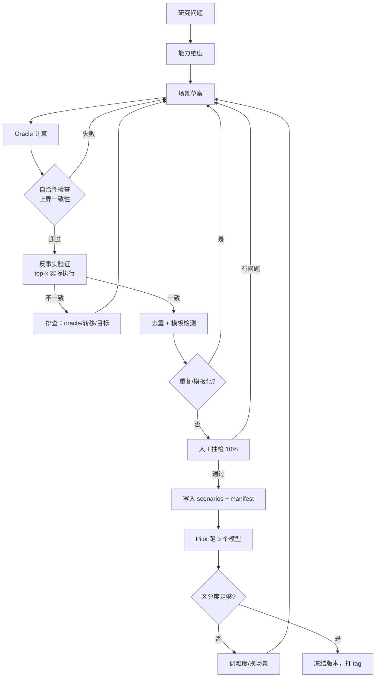

# 03 · 从研究问题到可执行评测：Agent Benchmark 设计方法论

> 本文是整份报告的核心方法论。它回答：**一个模糊的研究兴趣，如何一步步变成"可执行、可判定、可解释"的评测任务、数据集和评测协议？**
>
> 指标公式与统计检验在 [04](04-metrics-and-statistics.md)；代码架构在 [05](05-evaluation-framework-engineering.md)；本项目的具体映射在 [06](06-project-specific-analysis.md)。
>
> **阅读建议**：§3.1–§3.3 是"想清楚"，§3.4–§3.5 是"造出来"，§3.6 是"接上评测协议"。如果你只有 30 分钟，读 §3.1、§3.3.3（完整场景示例）、§3.5.4（Oracle 的保证范围）。

---

## 3.1 第一步：把研究兴趣变成可验证的研究问题

### 3.1.1 为什么"我想测长期规划"不是研究问题

"长期规划"是一个**心理学/认知科学词汇**，不是可观测行为。它至少有五种互不相同的含义：

| 你真正想说的 | 可观测行为 | 需要的环境 |
|---|---|---|
| 会为未来牺牲现在 | 主动放弃即时收益，换取后续更大收益 | 有"存储/投资"机制的环境 |
| 能做多步推演 | 动作序列与远期目标一致，而非每步局部最优 | 有明确远期目标 + 可枚举分支 |
| 能维持长期目标 | 多轮后仍记得目标，不漂移 | 长 episode（>20 步）+ 干扰 |
| 能从失败中恢复 | 失败后改变策略并挽回 | 允许失败且可继续的环境 |
| 能管理有限资源 | 跨阶段分配预算，不提前耗尽 | **资源跨阶段累积**的环境 |

这五者需要**完全不同的任务设计**。如果你不区分，最后做出来的很可能是"单步决策准确率"，然后在论文里写"我们评测了长期规划"——这是该领域最普遍的效度错误。

### 3.1.2 从兴趣到假设：六步收敛

```mermaid
flowchart LR
    A[研究兴趣<br/>"长期规划"] --> B[可观测行为<br/>"为未来放弃即时收益"]
    B --> C[可判定事件<br/>"在第 k 步选择低收益动作<br/>且第 k+n 步累计收益更高"]
    C --> D[任务族<br/>"预算跨阶段累积的<br/>资源分配任务"]
    D --> E[对照设计<br/>"贪心策略必然失败<br/>前瞻策略必然成功"]
    E --> F[假设<br/>"模型 A 的前瞻率高于 B"]
```

关键在 **E 步**：你必须能说出"**什么策略在这个任务上必然失败，什么策略必然成功**"。如果说不出来，这个任务就没有区分力，无论它看起来多复杂。

### 3.1.3 研究问题模板

把下面这个模板填满，你就得到了一个可执行的研究问题：

```text
在【环境 E：状态空间 S，动作空间 A，转移 T，时域 H】
中，考察【能力 C：可观测行为 B 的出现频率/质量】，
通过【任务族 D：由参数 θ 生成的场景集合】，
以【指标 M：定义、取值范围、方向】度量，
并与【基线策略 π_base：贪心/随机/脚本】对照，
控制【混淆因素 Z：知识、工具、上下文、预算】，
预期【效应方向与最小可检测效应 Δ】。

假设 H1：模型 M1 在 D 上的 M 显著高于 M2（配对，α=0.05，power=0.8，Δ=…）。
证伪条件：若 M1−M2 的 95% CI 包含 0，或方向与预期相反，则 H1 不成立。
```

模板里每个空都必须能填。填不出来的地方，就是设计还没想清楚的地方。

### 3.1.4 用模板拆解"长期规划"

以"我想测试 Agent 的长期规划能力"为例，逐项追问（这些追问本身就是设计工作）：

| 追问 | 为什么问 | 如果答不上来 |
|---|---|---|
| 什么叫"长期"？多少步？ | "长期"必须变成步数/决策数，否则无法设计 episode 长度 | 任务会退化成单步 |
| 是否存在资源约束？ | 没有稀缺资源，就没有"取舍"，也就没有规划 | 任务变成"每步选最大" |
| 资源是否跨阶段累积？ | **不累积 ⇒ 贪心近似最优 ⇒ 测不出规划** | 见 §3.3.4 的反例 |
| 是否存在延迟反馈？ | 规划的典型特征是"现在吃亏、以后收益" | 任务变成即时反馈优化 |
| 是否需要跨回合记忆？ | 决定是否需要长上下文/外部记忆 | 任务变成马尔可夫决策 |
| 是否允许犯错后恢复？ | 决定 episode 是否可终止、是否要恢复率指标 | 一错即死，测的是稳健性不是恢复 |
| 如何区分短期贪心与长期规划？ | 需要"贪心必然次优"的对照 | 指标无法归因 |
| 如何排除知识不足、工具误用？ | 这些是混淆变量，会污染"规划"结论 | 把知识错误算成规划失败 |

**这张表最重要的一行是第三行**。很多"长程 Agent benchmark"的环境里，资源每回合重置、目标只是"本回合拿最高分"，此时**贪心策略就是最优策略**，任务测的是"单步决策质量"，不是规划。这一点在当前项目里有直接对应（见 §3.3.4 与 [06](06-project-specific-analysis.md) 的 P0-2）。

### 3.1.5 常见误区

| 误区 | 表现 | 后果 |
|---|---|---|
| 用形容词代替行为 | "评测推理能力/规划能力/智能水平" | 无法判定对错，只能靠人感觉 |
| 用任务名代替能力定义 | "我们用了 Balatro，所以测规划" | 环境 ≠ 能力，同一环境可测很多能力，也可能一个都测不到 |
| 假设已经成立 | "Agent 需要长期规划，所以我们测长期规划" | 跳过了"这个环境是否真的需要规划"的验证 |
| 只设计成功路径 | 没有"贪心必然失败"的对照 | 任务可能被简单策略刷满 |

---

## 3.2 第二步：定义能力维度（Taxonomy）

### 3.2.1 为什么需要 Taxonomy

一份 benchmark 报"总分 62.3"几乎没有信息量：读者不知道模型强在哪、弱在哪、这个分数能不能外推。Taxonomy 的作用是**把总分拆成可解释的分量**，并且让"某个维度低"能对应到"某类任务/某类错误"。

但 Taxonomy 也是最容易变成"名词堆砌"的地方。判断一个 Taxonomy 是否成立，只有一条标准：**每个维度是否对应一组"只有该维度高低会改变结果"的任务**。

### 3.2.2 一个可操作的构建流程

```mermaid
flowchart TD
    A[列出候选维度<br/>从失败模式反推] --> B[为每个维度写<br/>操作性定义]
    B --> C[为每个维度设计<br/>最小判别任务]
    C --> D{两个能力水平<br/>不同的策略<br/>在此任务上<br/>结果不同?}
    D -- 否 --> E[删除或合并该维度]
    D -- 是 --> F[检查与其他维度<br/>的相关性]
    F --> G{|r| > 0.8 ?}
    G -- 是 --> H[维度冗余<br/>合并或重新定义]
    G -- 否 --> I[保留，进入验证]
```

**从失败模式反推**比"从能力名词正推"可靠得多。做法：先让几个模型跑一批任务，人工看 50 条失败 trace，把失败归成 5–8 类，再给每类起名字。这样得到的维度天然有任务对应。

### 3.2.3 示例 Taxonomy（仅作结构参考，不是标准答案）

| 维度 | 操作性定义（可观测） | 最小判别任务 | 常见混淆 |
|---|---|---|---|
| 任务理解 | 能否复述目标与约束，且动作不违反显式约束 | 给一个含"禁止动作 X"的任务，看是否避开 | 知识不足会被误判为不理解 |
| 状态理解 | 能否正确读出关键状态量（分数、剩余资源、目标） | 问"当前还差多少分" | 上下文截断 |
| 单步决策 | 在给定状态下选出高价值动作 | 单决策点，与 oracle 比 | 与"规划"混为一谈 |
| 多步一致性 | 连续 k 步动作是否朝同一目标 | 目标需 3+ 步达成 | 环境太简单，一步就完成 |
| 资源管理 | 跨阶段资源不提前耗尽且不闲置 | 资源跨阶段累积 | 环境资源每阶段重置（则无法测） |
| 工具使用 | 工具选择正确率、参数合法率 | 多工具、需选对工具 | 工具描述不清导致误用 |
| 反馈利用 | 收到错误后是否改变行为 | 注入一次可恢复错误 | 错误信息本身不可读 |
| 错误恢复 | 失败后能否回到可行路径 | 允许失败并继续 | 一错即终止（则无法测） |
| 长期目标维持 | 长 episode 后仍朝原目标 | >20 步 + 干扰 | 上下文长度限制 |

### 3.2.4 维度之间重叠怎么办

重叠不可避免，处理原则：

1. **正交化优先**：如果两个维度在 90% 的任务上同高同低，它们实际上是一个维度。
2. **允许层级**：`规划 = 多步一致性 + 资源管理 + 目标维持`，此时"规划"是**复合指标**，不应与子维度并列报告（否则重复计数）。
3. **明确"条件维度"**：某些维度只在特定任务上可测（如"错误恢复"只在允许失败的场景）。报告时要写"该维度仅在 n=… 的场景上可测"。

### 3.2.5 如何证明维度确实对应不同能力

这是审稿人最常问、也最难答的问题。可行的证据：

| 证据类型 | 做法 | 强度 |
|---|---|---|
| **判别效度** | 构造两个只在一个维度上不同的任务对，看模型分数是否只在该维度上分化 | 强 |
| **聚合效度** | 同一维度的多个任务之间应高相关（r>0.5） | 中 |
| **区分效度** | 不同维度之间应低相关（r<0.7） | 中 |
| **消融** | 移除该维度的关键机制（如去掉资源累积），看分数是否按预期变化 | 强 |
| **人类对照** | 让人类专家做同一批任务，看维度分数是否区分专家与新手 | 中（成本高） |

**注意**：相关性分析需要足够样本。n=30 的场景算维度间相关，置信区间会宽到无法下结论（见 [04](04-metrics-and-statistics.md) §4.5）。小样本时优先用"消融"和"判别任务对"，而不是相关系数。

### 3.2.6 常见误区

| 误区 | 为什么错 |
|---|---|
| 维度越多越全面 | 每增加一个维度就多一次比较，多重检验问题爆炸；且多数维度无法被单独验证 |
| 维度名用大词（"智能""通用性"） | 不可观测，无法设计判别任务 |
| 维度与难度混用 | "简单/中等/困难"是难度轴，不是能力轴；两者应正交（见 §3.4.5） |
| 先定维度再找任务 | 容易得到"为了填维度而造的任务"，缺乏真实失败模式支撑 |

---

## 3.3 第三步：设计任务与场景

### 3.3.1 十个必备构件

一个可执行的场景（scenario）必须能回答下面十个问题。缺任何一个，评测都会在某个环节变成"人肉判断"。

| # | 构件 | 要回答的问题 | 工程表示 |
|---|---|---|---|
| 1 | **Task Template** | 这类任务的参数化结构是什么？ | 带占位符的生成器 + 参数域 |
| 2 | **Scenario** | 这一次具体是什么局面？ | `scenario_id` + 全部初始数据 |
| 3 | **Initial State** | 环境从什么状态开始？ | 可重建的状态对象（不是描述） |
| 4 | **Goal State** | 什么算完成？ | 可判定的谓词（不是自然语言） |
| 5 | **Constraints** | 什么不允许？ | 可检查的约束列表 |
| 6 | **Action Space** | Agent 能做什么？ | 动作 schema + 合法性谓词 |
| 7 | **Observation** | Agent 能看到什么？ | 渲染函数（文本/图像/结构化） |
| 8 | **Transition** | 动作如何改变状态？ | 确定性函数（或带 seed 的随机函数） |
| 9 | **Terminal Condition** | 什么时候结束？ | 谓词 + 终止原因枚举 |
| 10 | **Difficulty Level** | 有多难？ | 由参数控制的难度标签 |

### 3.3.2 场景设计的三条原则

**原则 1：单一能力原则（尽量）**

一个场景最好只让一个能力成为"瓶颈"。如果场景同时需要"读懂规则 + 算对分数 + 规划 5 步 + 会用工具"，失败了无法归因。

现实做法：**主场景 + 消融变体**。主场景测综合能力，变体逐个移除混淆因素：
- 变体 A：给出分数计算结果（移除"算分"负担）→ 若成绩大幅提升，说明瓶颈在算分；
- 变体 B：只有 1 步（移除"规划"负担）→ 若成绩不变，说明主场景根本没测到规划。

**原则 2：可判定原则**

"目标达成"必须能用一个**程序**判断，而不是"看起来合理"。三种可接受的判定：
1. 状态断言（`final_score >= target`）；
2. 与参考解对比（动作序列等价 / 分数不低于阈值）；
3. 单元测试（代码类任务）。

不可接受：LLM Judge 判"这个计划好不好"作为**主指标**（可作辅助诊断，见 [04](04-metrics-and-statistics.md) §4.7）。

**原则 3：反事实可构造原则**

同一个初始状态，必须能构造"不同选择导致不同结果"的对照。否则你无法证明"这个动作是对的"，只能证明"这个动作没崩"。

### 3.3.3 完整场景示例 A：单决策点（可落地，用于讲清机制）

> 这个例子用当前项目的规则子集（8 张手牌、218 个合法动作）。它测量的是"单步战术"，不是规划。
>
> **规则版本提醒（重要）**：2026-11-17 22:40 的工作树正在从"自定义计分"迁移到"vanilla 子集计分"（牌型基础 chips + 只计计分牌）。本示例的数值按**迁移后**的实测结果给出；同一手牌在两套规则下的最优动作不同（见本例末尾的对照），这正是"必须写清规则版本"的活例证。

**1. 场景背景**
第一个盲注，目标 300 分，剩余 4 次出牌、4 次弃牌。手牌 8 张，无 Joker。Agent 需要选择打哪几张牌。

**2. 初始状态**（示例状态；`hand` 为便于讲解手工指定，其余字段与开局一致）

```json
{
  "blind_idx": 0,
  "blind_kind": "small",
  "target": 300,
  "total_score": 0,
  "hands_left": 4,
  "discards_left": 4,
  "jokers": [],
  "hand": ["c7h", "c7d", "c3s", "c9c", "c11s", "c2d", "c13h", "c5c"]
}
```

**3. 可用动作**
`play_cards(card_ids: 1..5 个互不相同的当前手牌 id)`，共 $C(8,1)+C(8,2)+C(8,3)+C(8,4)+C(8,5)=218$ 个；`discard_cards` 同理，但受 `discards_left` 限制。

**4. 环境规则**（工作树 22:40 的 vanilla 子集）

```text
chips = 牌型基础 chips + Σ 计分牌的 rank chips（A=11, J/Q/K=10, 其余=点数）
mult  = 牌型基础 mult（对子 2、高牌 1、两对 2、三条 3、顺子 4、同花 4、葫芦 4、四条 7、同花顺 8）
final = floor(chips × mult)
只有"计分牌"（如对子只算那两张）计入 rank chips；打出的其它牌不加分。
```

**5. 目标**
本场景不是"打完一局"，而是"在这一次决策上取得尽可能高的单手得分"。目标谓词：`score(play) == max over 218 actions`。

**6. 约束**
- 必须选 1–5 张；
- 卡牌 id 必须互不相同且属于当前手牌；
- 一次决策，不涉及后续。

**7. 预期行为**
选择 `c7h + c7d`（对子：基础 10 chips + 7 + 7 = 24，mult 2，得分 **48**）。
注意两个反直觉之处：
- 打 3 张 kicker 并不会加分（只有计分牌计入），所以 `7♥7♦` 与 `7♥7♦ K♥ J♠ 9♣` **同分**；
- 单张最高筹码的 `c11s`（J，高牌：5 + 10 = 15）远低于对子。

**8. 失败条件**
- 选了非最优组合 → 记 `regret > 0`；
- 选了非法动作 → 记非法动作（F1 类诊断）；
- 未在步数预算内给出动作 → 记超时。

**9. 评测结果**（三态，都要报）

| 量 | 值 | 类型 |
|---|---|---|
| oracle 最优分 | 48 | exact（218 个动作全枚举） |
| 并列最优动作数 | 42（所有包含 `7♥7♦` 的 2–5 张组合） | exact |
| Agent 得分（只打 `c11s`） | 15 | exact |
| Local Regret | (48−15)/48 = 0.6875 | exact |
| Action Optimality | 0 | exact（未命中并列最优） |
| 合法动作率 | 1.0 | exact |

> **并列最优是常态，不是异常**：42/218 个动作同分。如果 `Action Optimality` 只承认"枚举顺序第一个"，会把 41 个正确动作判错。这就是 [04](04-metrics-and-statistics.md) §4.2.5 强调"并列算命中"的原因。

**10. 这个场景究竟测量了什么**

它测量"**在当前手牌上选出最高分组合**"的能力。它**不**测量：
- 是否会用弃牌改善手牌（因为目标只定义了一次出牌）；
- 是否理解跨回合资源（没有跨回合）；
- 是否会为未来投资（没有未来）。

> ⚠️ **这是本报告最重要的提醒之一**：一个 218 选 1 的 argmax 任务，其难度主要来自"算分规则理解"和"组合搜索"，而不是"规划"。如果一份 benchmark 由大量此类场景组成，它能有效区分"规则理解/战术计算"，但**不能**支撑任何关于长期规划的结论。当前项目的 60 个决策点中，40 个属于此类（L1+L2），另 15 个是"同一盲注内多步"（L3），见 [06](06-project-specific-analysis.md) §6.2。

> **同一手牌，两套规则，最优动作不同**（实测对照）：
>
> | 规则版本 | `7♥7♦` 得分 | 最优动作 | 最优分 |
> |---|---|---|---|
> | 旧自定义公式（无基础 chips，所有打出的牌都计 chips） | 28 | `7♥7♦ + K♥ + J♠ + 9♣`（5 张，多打多得分） | 86 |
> | 新 vanilla 子集（基础 chips + 只算计分牌） | 48 | `7♥7♦`（kicker 不加分，42 个并列） | 48 |
>
> 这意味着：**同一份 Oracle 代码，在规则版本变化后会给出不同的"最优"，甚至把原来正确的动作判错**。报告里不写规则版本，读者无法判断这些数字属于哪一套规则。这就是 [04](04-metrics-and-statistics.md) §4.2 要求每个指标标 `exact` 并写明口径的原因之一。

### 3.3.4 为什么"盲注内多步"仍然测不到规划（一个必须讲清的反例）

直觉上，"4 次出牌 + 4 次弃牌，怎么分配到 3 个盲注"听起来像资源管理。但把这些规则写成目标函数后会发现：

- 目标：`total_score >= target`（阈值，不是最大化）；
- 出牌次数每盲注重置为 4；
- 弃牌次数每盲注重置为 4；
- 分数超出 target 没有额外收益；
- 跨盲注不保留任何资源（除了 Joker，而 Joker 是商店免费三选一）。

在这个结构下：

1. 每次出牌都选"当前最高分"不会比任何其他策略更差——因为超出部分不惩罚、不保留；
2. 弃牌的收益只体现在"改善后续手牌"，而后续手牌的改善最终仍服务于"本盲注达标"；
3. 没有任何"现在少拿分，以后多拿分"的机制。

**因此，贪心策略在这个环境里近似最优，单步 regret 也就近似等于"整体表现"。** 这不是实现 bug，而是**机制设计**的结果。

要让规划成为瓶颈，必须引入至少一个"跨阶段可累积的稀缺资源"，例如：

| 机制 | 为什么能制造规划 | 代价 |
|---|---|---|
| 金钱/利息（跨盲注累积） | 现在不买 → 以后有利息 → 复利决策 | 需要商店价格、利息规则 |
| 可保留的出牌/弃牌次数 | 省下来给 BOSS 盲注 | 需要"次数可跨盲注携带" |
| 卡组改造（加牌/删牌） | 现在弱化当前牌组，换取后期一致性 | 需要卡牌获取/删除机制 |
| Joker 槽位有限且可出售 | 买哪个、卖哪个、何时换 | 需要价格与出售机制 |

**这四种机制在当前项目的 `scenarios/RULES_VERSION` 中都列在 `excluded`**（`money`/`interest`/`shop_money`/`deck_mod` 等）。所以当前环境**原理上**无法测跨回合资源分配。这一点项目文档已经如实登记（README 的"定位与当前实现差距"表），本报告确认该判断在代码层面成立。

### 3.3.5 完整场景示例 B：跨阶段资源分配（设计示意，当前引擎不支持）

> 这个例子**不能**在当前引擎上运行（缺 money/interest/价格）。它的作用是展示"真正测规划的场景长什么样"，供 W3 机制改造参考。**不得**把本示例写成"已实现"。

**1. 场景背景**
Ante 1 结束，进入商店。持有 12 金钱，利息规则为"每 5 金钱 +1 利息，上限 5"。商店有 3 个选项：一个 6 金钱的 +Mult Joker、一个 4 金钱的 +Chips Joker、一个 3 金钱的"删掉一张废牌"服务。下一个盲注目标 450。

**2. 初始状态**

```json
{
  "ante": 1, "blind_idx": 1, "money": 12,
  "interest_rate": 0.2, "interest_cap": 5,
  "shop": [
    {"id": "j_mult4", "price": 6, "effect": "add_mult", "value": 4},
    {"id": "j_chips30", "price": 4, "effect": "add_chips", "value": 30},
    {"id": "svc_remove", "price": 3, "effect": "remove_card"}
  ],
  "jokers": [{"id": "j_pair", "effect": "add_mult", "value": 2}],
  "next_target": 450
}
```

**3. 可用动作**
`buy(item_id)`、`skip()`、`reroll(cost=2)`、`sell(joker_id)`。

**4. 环境规则**
- 购买后金钱减少，利息按"结算时金钱"计算；
- 未花完的钱在下一盲注开始时按 `floor(money/5)` 产生利息（上限 5）；
- Joker 槽位上限 5；
- 目标分数随盲注递增。

**5. 目标**
在 3 个盲注内尽可能走得更远（`blinds_cleared` 最大化）；本场景的**局部目标**是"选择能最大化期望通关概率的商店动作"。

**6. 约束**
- 不能负债；
- 购买后槽位不得超限；
- 决策必须在 1 次工具调用内完成（不给多轮试探）。

**7. 预期行为**
若距 450 还差约 200 分，`j_mult4`（+4 mult，对子基础 mult=2，即 3 倍提升）的边际收益高于 `j_chips30`（+30 chips 在 chips≈70 时约 40% 提升）；但花 6 金钱会损失 1 点利息（12→6，利息从 2 降到 1），且剩 6 金钱仍可买 `svc_remove`（3）……这是一个**多步权衡**：即时战力 vs 复利 vs 卡组质量。

正确的"预期行为"不是一个固定动作，而是**一组可接受动作 + 一组不可接受动作**，并用"前瞻深度"区分：
- 深度 0（贪心）：买最贵的 → `j_mult4`；
- 深度 1（看下一盲注）：算利息损失后可能选 `j_chips30` + 保留 8 金钱；
- 深度 2（看整局）：可能选 `svc_remove` 先优化卡组。

**8. 失败条件**
- 买了但导致下一盲注无法达标（可回放验证）；
- 金钱 < 0 或槽位超限（非法动作）；
- 不做决策直到超时。

**9. 评测结果**

| 量 | 值 | 类型 |
|---|---|---|
| Oracle（深度 2 穷举） | 期望 `blinds_cleared` = 3 | exact（需可枚举）或 approx |
| Agent 选择 | 期望 `blinds_cleared` = 2 | 模拟 1000 次（若环境随机） |
| **Regret** | 用"期望通关数"而非"即时分数"定义 | approx（带 CI） |
| **前瞻率** | 选择"深度≥1 才最优"的动作的比例 | exact（动作标签） |

**10. 这个场景究竟测量了什么**

它测量"**在存在跨阶段复利时，是否为未来收益放弃即时收益**"。这个能力**无法**用单步得分衡量：贪心动作在单步上得分最高。

它也暴露了一个设计难点：**Oracle 不再是一个数字，而是一个策略的期望值**。这就引入了"Oracle 本身需要被验证"的问题（见 §3.5.4）。

### 3.3.6 难度设计

难度不是"看起来复杂"，而是**可测量的成功率梯度**：

| 难度维度 | 如何调节 | 验证方法 |
|---|---|---|
| 搜索空间 | 手牌数 / 可选动作数 | 动作数 vs 成功率曲线 |
| 前瞻深度 | 需要看几步才能最优 | 与"深度 k 贪心"对比 |
| 约束密度 | 禁止动作数量 | 合法动作率随难度下降 |
| 信息不完整 | 隐藏部分状态 | 最优策略与完全信息策略的差距 |
| 时间/预算压力 | 步数上限、token 上限 | 预算 vs 成功率曲线 |
| 反事实接近度 | 最优动作与次优动作的差距（margin） | margin 越小越难 |

**最后一行最有用也最常被忽略**：如果最优动作得 100 分、次优 99 分，那么"选错"几乎无代价，这个场景的区分力接近 0。设计时应保证 **margin 显著**（例如 ≥10%），或者专门设计"margin 很小"的场景来测精细度——但这两类场景要分开报告，不能混在一个均值里。

### 3.3.7 Counterfactual Scenario（反事实场景）

同一个初始状态，只改一个动作，观察结果差异。作用：

1. **验证 Oracle**：如果 oracle 说动作 A 更好，实际执行 A 与 B 应得到符合预期的结果；
2. **测量局部 vs 全局**：某动作单步最优但 3 步后更差 → 说明"单步指标"与"长期目标"冲突；
3. **构造难例**：把"贪心陷阱"明确标出来。

工程上，反事实场景必须记录 `parent_scenario_id` + `perturbation`（改了什么），否则会变成一堆无法解释的孤立场景。

---

## 3.4 第四步：设计数据集

### 3.4.1 六种数据来源及其取舍

| 来源 | 做法 | 优势 | 风险 | 适用 |
|---|---|---|---|---|
| **人工构造** | 专家手写场景 | 质量高、可控 | 慢、贵、规模小、可能有作者偏见 | 核心场景、边界案例 |
| **程序生成** | 参数化生成器 + 约束采样 | 快、可扩展、可控制难度 | 模板化、分布窄、容易"生成器偏差" | 大规模训练/开发集 |
| **真实任务采样** | 从生产日志/真实对局抓取 | 生态效度高 | 隐私、许可、不可复现、分布漂移 | 终验、外部效度 |
| **真实任务改造** | 在真实状态上做反事实 | 兼顾真实与可控 | 改造成本高、需验证改造后仍合法 | 对齐锚点 |
| **合成数据** | 用模型生成场景/答案 | 极快 | 污染、错误传播、自举偏差 | 辅助、压力测试 |
| **难例挖掘** | 从失败 trace 中提取 | 区分度高 | 过拟合到特定模型、选择偏差 | 补充集（需单列） |

**关键原则**：不同来源的数据**不要混在一个均值里**。报告时应按来源分层，否则"真实采样 30 条 + 合成 300 条"的均值会被合成数据主导，而读者以为是真实分布。

### 3.4.2 一个 Benchmark 需要多少样本

**没有固定数字。** 样本量由四件事决定：

1. **效应大小 Δ**：你想检测的最小差异（如 regret 差 0.1）；
2. **方差 σ**：指标在场景间的波动；
3. **显著性水平 α 与功效 1−β**（常用 0.05 / 0.8）；
4. **比较的次数**（多重检验会要求更大样本）。

配对设计的近似公式：

$$
n \approx \left(\frac{(z_{1-\alpha/2} + z_{1-\beta}) \cdot \sigma_d}{\Delta}\right)^2
$$

其中 $n$ 是**每组的配对数**，$\sigma_d$ 是**配对差值**的标准差，$\Delta$ 是想检测的差值，$z$ 是标准正态分位数（α=0.05 双侧时 $z_{0.975}\approx1.96$；β=0.2 时 $z_{0.8}\approx0.84$）。

**算例**：若 $\sigma_d=0.25$、$\Delta=0.10$，则

$$
n \approx \left(\frac{(1.96+0.84)\times0.25}{0.10}\right)^2 = (7)^2 = 49
$$

即每组约 49 个配对场景。

这个算例值得记住，因为它解释了一个常见困境：**30 个场景只够检测 Δ≈0.13 以上的差异**（同样 σ_d 下）。如果实际效应是 0.08，30 个场景大概率得到"不显著"，而这**不代表没有差异**。

**因此，正确做法不是"凑 30 个"，而是**：
1. 先跑 10–20 个场景的 pilot，估 $\sigma_d$；
2. 用公式算所需 n；
3. 如果 n 超过可承受规模，**在预注册里把主张降级**为"描述统计 + 置信区间"，不承诺显著性；
4. 报告里写清"本实验只能检测 Δ≥X 的差异"。

### 3.4.3 难度分布

不要追求"平均难度"，要追求**可用的分数分布**：

| 分布形态 | 含义 | 问题 |
|---|---|---|
| 全部很简单（成功率 >90%） | 天花板效应 | 无法区分强模型 |
| 全部很难（成功率 <10%） | 地板效应 | 无法区分弱模型，且方差大 |
| 双峰 | 两类任务混合 | 均值无意义，需分层 |
| 平滑梯度 | 理想 | 需要按难度分层报告 |

**工程做法**：
1. 用 pilot 模型跑一遍，得到每个场景的成功率；
2. 按成功率分箱（如 0–20%、20–40%、…、80–100%）；
3. 目标是让**每个箱都有足够场景**，而不是让总体均值好看；
4. 报告时给"成功率 vs 难度"曲线，而不只给总分。

### 3.4.4 去重与模板化检测

程序生成最大的风险是"看起来有 1000 条，实际只有 20 个模板"。

| 检测 | 方法 | 阈值建议 |
|---|---|---|
| 精确重复 | 内容哈希 | 0 容忍 |
| 近似重复 | MinHash / SimHash / 编辑距离 | 相似度 >0.9 视为重复 |
| 模板化 | 把变量替换为占位符后哈希（`{card}` 代替具体牌） | 同一模板占比 >5% 需人工检查 |
| 答案泄漏 | 检查 `init_state` 是否包含 `goal`/`oracle` 字段 | 0 容忍 |
| 分布偏移 | 与目标分布做 KS 检验 / 直方图对比 | 显著则重新采样 |

**模板化检测的具体做法**（针对本项目这类结构化场景）：

```python
import re
import hashlib
from collections import Counter


def template_key(scenario: dict) -> str:
    """把具体数值抽象掉，得到"模板指纹"。同一模板过多 => 数据多样性不足。"""
    blob = repr(scenario["init_state"])
    blob = re.sub(r"c\d+[shdc]", "CARD", blob)        # 卡牌 id
    blob = re.sub(r"\b\d+\b", "N", blob)              # 所有数字
    return hashlib.sha256(blob.encode()).hexdigest()[:12]


def template_histogram(scenarios: list[dict], top: int = 10) -> list[tuple[str, int]]:
    counts = Counter(template_key(s) for s in scenarios)
    return counts.most_common(top)
```

如果 top-1 模板占了 40%，那这份"1000 条数据集"实际上只有 1 个任务。

### 3.4.5 Train / Dev / Test 划分

| 划分 | 用途 | 谁能看 | 典型比例 |
|---|---|---|---|
| **Train** | 开发 Agent、调 prompt（不是训练模型） | 开发者 | 50–60% |
| **Dev** | 选超参、早停、调试 | 开发者 | 15–20% |
| **Test（public）** | 报告主结果 | 所有人 | 15–20% |
| **Hidden Test** | 防止过拟合/污染，定期换 | 只有评测方 | 10–20% |

规则：

1. **按"任务族"划分，不按样本随机划分**。同一模板生成的两个场景，一个进 train 一个进 test，等于泄漏。应按 `template_key` 或"来源 capture_id"分组划分（grouped split）。
2. **Hidden test 要有更换机制**：每次发布新版本时轮换一部分，避免长期被针对性优化。
3. **划分必须写进 manifest**，并且有脚本可验证"无重叠"。

```python
def grouped_split(keys: list[str], ratios: tuple[float, float, float], seed: int) -> dict[str, list[int]]:
    """按 key 分组划分，保证同一模板不出现在两个 split。"""
    import random
    uniq = sorted(set(keys))
    random.Random(seed).shuffle(uniq)
    n = len(uniq)
    n_train = int(n * ratios[0])
    n_dev = int(n * ratios[1])
    groups = {"train": set(uniq[:n_train]),
              "dev": set(uniq[n_train:n_train + n_dev]),
              "test": set(uniq[n_train + n_dev:])}
    return {name: [i for i, k in enumerate(keys) if k in g] for name, g in groups.items()}
```

### 3.4.6 污染（Contamination）与泄漏

三类污染，处理方式完全不同：

| 类型 | 例子 | 检测 | 缓解 |
|---|---|---|---|
| **训练数据污染** | 模型训练语料里已有 test 题与答案 | 成员推断、n-gram 重叠、canary 字符串 | 用新构造/私有 test；换 hidden set |
| **Prompt 泄漏** | few-shot 示例里出现 test 题 | 检查示例与 test 的重叠 | 示例只用 train |
| **Oracle 泄漏** | 场景文件里 oracle 字段被渲染进观测 | 代码审查 + 运行时断言 | `agent_view()` 白名单 |

**对本项目的具体风险**：Balatro 是公开游戏，模型很可能在预训练中见过大量"Balatro 攻略/最优打法"。但本项目用的是**自定义子集规则**（自定义倍率表、合成 Joker），所以"背攻略"不能直接得分。然而仍有两类残留污染：
1. 模型可能知道"对子/同花/顺子的相对强弱"（这在自定义表中恰好也成立），从而"猜对"牌型选择；
2. 若场景来自真实游戏捕获，模型可能见过相同的局面截图/描述（概率低但非零）。

**结论**：当前项目的污染风险主要在"通用扑克/牌型知识"，而不是"记住了这道题"。报告时应把这写成"知识先验"，而不是"污染"——两者对结论的影响不同。

### 3.4.7 数据版本管理

最小要求（与 [05](05-evaluation-framework-engineering.md) §4.2.6 一致）：

1. `dataset_id + version`（语义化版本）；
2. `manifest.json` 含每个文件的 sha256、记录数、schema_version、rules_version；
3. `changelog` 写"改了什么、为什么"；
4. `rejected.jsonl` 记录未入集的数据与原因（可审计）；
5. 每次发布打 git tag，tag 名与 version 一致。

---

## 3.5 第五步：Oracle 与 Ground Truth

### 3.5.1 六种"正确答案"，别混用

| 类型 | 定义 | 何时用 | 保证范围 |
|---|---|---|---|
| **Ground Truth** | 客观事实（如"这手牌是顺子"） | 有唯一正确答案 | 完全 |
| **Reference Answer** | 专家给出的参考答案（可能不唯一） | 开放任务 | 专家水平，非最优 |
| **Rule-based Evaluator** | 用程序规则判定（状态断言、单测） | 可形式化的目标 | 规则覆盖范围内 |
| **Exact Oracle** | 穷举动作空间得到的最优 | 动作空间可枚举且小 | **当前状态、当前动作空间内的全局最优** |
| **Approximate Oracle** | 采样/启发式估计的最优 | 空间过大 | 有误差界，需报区间 |
| **Human Annotation** | 人工标注质量/偏好 | 主观任务 | 标注者一致性范围内 |
| **LLM Judge** | 用模型判定 | 大规模主观评估 | 需校准，存在系统性偏差 |

**最容易被误用的是 Exact Oracle**：它只在你定义的 MDP、动作空间、目标函数内是"最优"。换了目标函数（比如从"最大化本手得分"换成"最大化通关概率"），同一个 Oracle 就不再最优——**它甚至可能把正确动作标成错误**。

### 3.5.2 交互式环境的 Oracle 设计

交互式环境里，"正确答案"至少有三层，必须分开：

| 层 | 问题 | 方法 | 输出 |
|---|---|---|---|
| **合法性** | 这个动作能不能执行？ | 动作空间的合法性谓词 | bool + 原因 |
| **完成度** | 任务是否达成？ | 终局状态断言 / 单测 | bool + 证据 |
| **最优性** | 这个动作有多好？ | 穷举 / 搜索 / 参考策略 | 数值 + 保证范围 |

**只做前两层**（合法 + 完成）的 benchmark 很多（如"任务是否完成"型 Agent benchmark），它们能回答"能不能做"，不能回答"做得好不好"。
**只做第三层**（与 oracle 比）的风险是：oracle 错了，全盘皆错。

### 3.5.3 部分成功与奖励设计

真实任务常常"做了一半"。三种处理：

| 方案 | 定义 | 优点 | 缺点 |
|---|---|---|---|
| 二值 | 成功=1，否则 0 | 简单、无争议 | 方差大、区分度低 |
| 分级 | 按子目标完成数给分（0, 1/3, 2/3, 1） | 方差小 | 子目标权重主观 |
| 连续 | 用与目标的距离（如 `score/target`） | 最平滑 | 可能奖励"刷分"而非"完成任务" |

**建议**：主指标用二值（可解释、可比），辅助指标用分级/连续（诊断用）。报告里两者都给，但**不要用连续指标替代二值指标来让结果好看**。

**部分成功的一个陷阱**：如果 `score/target` 可以靠"重复无意义动作"刷高，那它就不是能力指标。设计时要检查"单调性"：多做一步合法但无益的动作，分数不应上升。

### 3.5.4 Oracle 的保证范围（本节最重要）

以当前项目的 O1（`bench/oracle.py::best_play`）为例，逐条说明它保证了什么、没保证什么：

| 它保证 | 它不保证 |
|---|---|
| 在**当前手牌**的 218 个合法组合中，`final_score` 最大 | 这是**整局**最优（不看后续抽牌、弃牌、商店） |
| 计分使用与引擎**同一个** `score_hand()` | 计分规则符合原版 Balatro（自定义公式，`fidelity_status: NOT_VERIFIED`） |
| 同分时取枚举顺序第一个（确定性） | "最优动作"在**长期目标**下仍最优 |
| 全枚举，无采样误差（`exact`） | 若目标改成"最大化通关概率"，该 argmax 可能次优甚至错误 |

**由此得到三条报告纪律**：

1. 写 `Local Regret` 时，必须同时写"**相对于当前状态的即时得分最优**"，不能简写成"最优"。
2. 不能用 Local Regret 支撑"长期规划"结论——它衡量的是"这一步选得好不好"。
3. 若 `oracle.exact=false`（只验证了部分动作），只能报"**已验证子集内的最优**"，并给出 `evaluated/total`。

**一个具体的反例（思想实验）**：假设某状态下"打对子得 84 分"是即时最优，但"打单张 10 分 + 保留对子"能在下一手配合即将抽到的 Joker 得 300 分。O1 会判定"打对子"最优，于是把真正正确的动作记为 regret=0.88。这不是 O1 的实现错误，而是**目标函数不匹配**。

> 这个反例说明：**Oracle 只能在其定义的状态空间、动作空间和优化目标范围内提供保证。** 把局部最优结果解释为全局规划能力，是把"目标函数的假设"偷换成了"能力的结论"。

### 3.5.5 Oracle 自身如何验证

四道检查，按成本从低到高：

| 检查 | 做法 | 能发现什么 |
|---|---|---|
| **自洽性** | 用独立实现重算（如暴力枚举 vs 优化实现） | 实现 bug（本项目 `verify` 命令即此） |
| **上界一致性** | `best_value >= 任意合法动作的实际值` | oracle 算低了 |
| **反事实一致性** | 对 top-k 动作逐个实际执行，比较结果 | 状态转移与 oracle 假设不一致 |
| **人工抽检** | 人工看 20 个局面的 oracle 选择 | 目标函数设计错误（机器查不出） |

**注意**：本项目 `verify` 是"两条路径共用 `score_hand()`"，所以它只能证明"搜索一致"，**不能证明计分正确**。这是项目文档已经写明的限制，报告引用时必须保留这个限定。

---

## 3.6 第六步：把场景接成"评测协议"

指标定义在 [04](04-metrics-and-statistics.md)，这里只说**协议层**的三件事，因为它们属于"场景设计"而不是"指标计算"。

### 3.6.1 Episode 结构决定指标能否定义

| 结构 | 一次评测是什么 | 可定义的指标 | 不可定义 |
|---|---|---|---|
| **单决策点**（contextual bandit） | 一个状态 + 一次动作 | 单步 regret、optimality、legality | 恢复率、进度、Pass^k |
| **固定长度 episode** | H 步后结束 | 累计奖励、平均步奖励 | 通关率（无"通关"概念） |
| **终止型 episode** | 达成/失败即止 | 成功率、进度、效率 | 固定步数比较（步数不同） |
| **多 episode 任务** | 多次尝试 | Pass@k、Pass^k | 单次成功率（需说明 k） |

**当前项目的关键问题**：它把"场景"定义为**单个决策点**（`plan/详细版/03` §1.1："一个固定的初始局面 + 合法动作集 + oracle，是评测的最小单位"）。在这个定义下：

- 可以定义：Local Regret、Action Optimality、Legality；
- 无法定义：Episode Progress、失败恢复率、Pass^k（因为一次评测只有一步）。

要测"多步"，必须把场景升级为"初始状态 + 终止条件 + 步数上限"的 **episode 级场景**。这不是指标问题，是**数据结构问题**。详见 [06](06-project-specific-analysis.md) P0-2。

### 3.6.2 评测协议必须预注册的六件事

| # | 项 | 为什么必须事前定 |
|---|---|---|
| 1 | 主指标与次指标 | 事后换主指标 = p-hacking |
| 2 | 场景子集与选取规则 | 事后挑场景 = 选择性报告 |
| 3 | 非法动作处理策略（重试次数） | 改变策略会改变排名 |
| 4 | 预算（步数、token、时间） | 预算不同 = 比较不公平 |
| 5 | 统计方法与 α、是否校正 | 事后选检验 = 假阳性 |
| 6 | 失败/超时/环境错误如何计入 | 决定分母，直接影响分数 |

模板：

```markdown
# 预注册（跑实验前打 tag）
- 数据集版本：<id>@<version>，主表使用 N 个场景，选取规则：<…>
- 主指标：<name>（定义见 04 §4.x），方向：越高越好
- 次指标：<…>
- 对照：A vs C 为主，A vs B 为次；共 2 次比较，Holm 校正
- 非法动作：Retry-2，超过则终止并记为失败（F1）
- 预算：每步 max_tokens=1024，每局 max_steps=12，单步超时 120s
- 超时/环境错误：不计入能力指标分母，单列 rate
- 统计：配对 Wilcoxon（连续）/ McNemar（二值），α=0.05，bootstrap 10k 次
- 功效：n=30 只能检测 Δ≥0.13（基于 pilot σ_d=0.25），不承诺更小效应
- 禁止：跑后换主指标、加场景、只报显著结果
```

### 3.6.3 一个场景从设计到入库的流水线



**这条流水线里有两个回退点最容易被跳过**：`M --> N`（区分度不足就换）和 `J`（人工抽检）。跳过它们，数据集就会"看起来完整但测不出东西"。

---

## 3.7 本章应该掌握什么

读完本章，你应当能够：

1. 把"我想测 X 能力"改写成包含环境、行为、指标、基线、混淆因素、效应量的研究问题。
2. 判断一个环境**是否真的需要规划**：检查是否存在跨阶段累积的稀缺资源，以及贪心策略是否近似最优。
3. 为一个场景写出十个构件（模板/场景/初始状态/目标/约束/动作/观测/转移/终止/难度），并说明每个构件的工程表示。
4. 解释为什么"盲注内 4 次出牌"在当前规则下测不到跨回合资源分配。
5. 用配对公式估算样本量，并说明 30 个场景能检测的最小效应。
6. 区分 Ground Truth / Reference / Exact Oracle / Approximate Oracle，并写出一个 Oracle 的"保证范围"清单。
7. 说明为什么"单步最优"可能把"长期正确"标成错误。
8. 列出评测协议必须预注册的六件事。

### 常见误区（本章范围）

| 误区 | 为什么错 | 正确做法 |
|---|---|---|
| "环境复杂 = 测到了复杂能力" | 复杂度不等于目标函数需要该能力 | 用"贪心是否最优"检验 |
| "有 218 个动作 = 任务很难" | 动作多只增加搜索成本，不增加规划深度 | 看"需要看几步才能最优" |
| "用了真实游戏 = 外部效度高" | 真实但不可复现、不可控，且可能只测了操作 | 真实环境用于终验，不用于主表 |
| "Oracle 是穷举的，所以一定对" | 穷举只保证在给定目标函数下最优 | 同时报告目标函数的假设 |
| "样本不够就多跑几次" | 重复同一场景不增加独立样本 | 增加场景数，或降级主张 |
| "数据越多越好" | 模板化数据只增加计算量，不增加覆盖 | 先做模板检测与难度分层 |

---

## 导航

- 上一篇：[02 经典 Benchmark 案例研究](02-classic-benchmarks.md)
- 下一篇：[04 指标与统计](04-metrics-and-statistics.md)
- 相关：[06 当前项目方法论映射](06-project-specific-analysis.md)
- 返回：[README](README.md)
