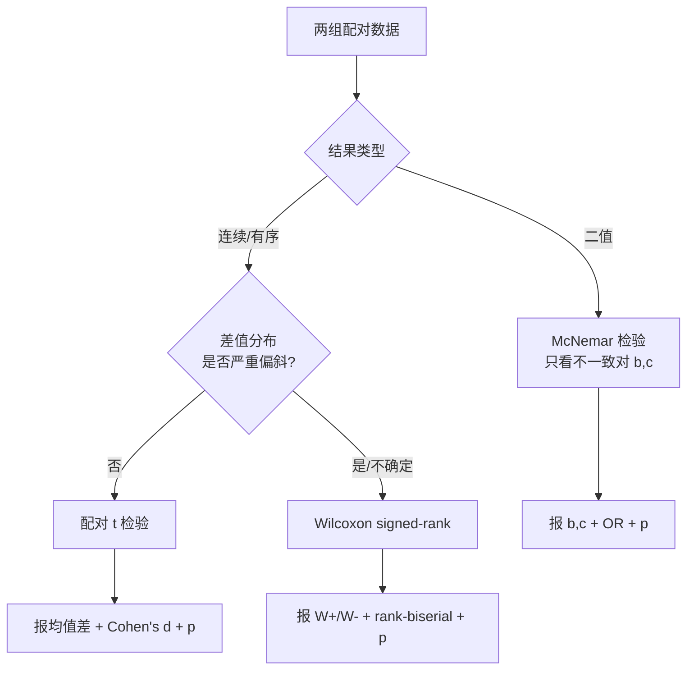

# 04 · 指标、统计与失败分析

> 本文回答三个问题：**一个能力应该用什么数来衡量？这个数能不能支撑"谁更强"的结论？结论到哪里就必须停？**
>
> 前置：[03](03-agent-benchmark-design.md) 定义了场景与 Oracle；本文假设你已经有了 episode 与 trace（结构见 [05](05-evaluation-framework-engineering.md) §4.5）。
>
> **本文所有代码均为 stdlib-only 可运行实现**（与当前项目 `pyproject.toml` 的 `dependencies = []` 一致），§4.5 的数字由文末脚本在固定 seed 下真实运行得到，可复现。

---

## 4.1 指标设计的三条原则

### 原则 1：指标由"测量目标"决定，不由"能算什么"决定

反面案例：因为能算出 token 数，就把"平均 token"列为主指标之一。它能算，但它不回答任何研究问题。

正确顺序：

```text
研究问题 → "哪个能力" → "什么行为能证明它" → "什么量能刻画该行为" → 指标
```

如果某个指标无法回溯到第二、三步，它就不该出现在主表里（可以作为附录的诊断量）。

### 原则 2：每个指标必须带"适用条件"与"精确性标签"

一个数字没有适用条件，就等于没有定义。最少要标三件事：

| 标签 | 取值 | 含义 |
|---|---|---|
| **方向** | 越高越好 / 越低越好 | 避免读者误读 |
| **精确性** | `exact` / `approx` / `heuristic` | 是否枚举得出、是否有采样误差、是否是经验规则 |
| **单位** | episode / step / decision | 分母是什么 |

当前项目 `plan/详细版/03` 已经有 `exact/approx` 标注与"三态输出 `{mean,min,max}`"的要求，这是很好的实践；本文把它形式化为每个指标定义的必填字段。

### 原则 3：主指标最多两个

主指标超过两个，读者无法判断结论依赖哪一个；而且多重比较的负担会指数上升。推荐结构：

- **1 个主指标**（回答核心研究问题）；
- **1 个可靠性指标**（回答"稳不稳"，如 pass^k 或 consistency）；
- **若干诊断指标**（解释"为什么"，不进显著性检验或单独校正）。

---

## 4.2 指标定义卡

> 每张卡固定六栏：数学定义 / 直观含义 / 适用 / 不适用 / 常见误用 / 代码。
> 记号统一：$N$ 为样本数，$x_i$ 为第 $i$ 个样本的观测，$\mathbb{1}[\cdot]$ 为指示函数（条件成立取 1）。

### 4.2.1 Accuracy / Success Rate / Completion Rate

**数学定义**

$$
\text{Accuracy} = \frac{1}{N}\sum_{i=1}^{N}\mathbb{1}[\hat y_i = y_i]
\qquad
\text{SuccessRate} = \frac{1}{N}\sum_{i=1}^{N}\mathbb{1}[\text{goal}_i \text{ reached}]
\qquad
\text{CompletionRate} = \frac{1}{N}\sum_{i=1}^{N}\mathbb{1}[\text{episode}_i \text{ terminated normally}]
$$

- $\hat y_i$：模型给出的答案；$y_i$：标准答案；
- $\text{goal}_i$ reached：终局状态满足目标谓词；
- terminated normally：正常结束（非超时、非环境崩溃、非非法动作超限）。

**直观含义**：三个都是"比例"，但分母的含义完全不同。

| 指标 | 回答的问题 | 分母里的"失败"包括什么 |
|---|---|---|
| Accuracy | 答案对不对 | 答错 |
| Success Rate | 任务完成没有 | 答错 + 没做完 + 做错方向 |
| Completion Rate | 流程走完没有 | 超时 + 崩溃 + 非法动作超限（**不包含答错**） |

**为什么必须分开**：如果只看 Success Rate，你无法区分"模型不会做"与"框架把它弄崩了"。Completion Rate 是**基础设施健康度**指标，不属于能力指标。

**不适用**：Completion Rate 不适用于"允许提前终止"的任务（Agent 主动说"我完成了"是合法的）。

**常见误用**：
- 把超时算进 Success Rate 分母却不单列 → 环境问题被记成能力问题；
- 用 Accuracy 描述多步任务 → 多步任务没有"一个答案"。

**代码**

```python
from __future__ import annotations


def success_rate(flags: list[bool]) -> float:
    """比例指标。空列表返回 nan，而不是 0——0 会让'没有数据'看起来像'全失败'。"""
    if not flags:
        return float("nan")
    return sum(flags) / len(flags)


def completion_rate(termination_reasons: list[str]) -> float:
    """正常终止的比例。超时/崩溃/非法超限都算未完成，但它们是不同的诊断类。"""
    if not termination_reasons:
        return float("nan")
    normal = {"goal_reached", "max_steps", "agent_stop"}
    return sum(r in normal for r in termination_reasons) / len(termination_reasons)
```

### 4.2.2 Pass@k 与 Pass^k

**数学定义**（两者都来自原始论文，不要互换）

pass@k（Chen et al. 2021, §2.1，代码生成）：

$$
\text{pass@}k = \mathbb{E}_{\text{problem}}\left[1 - \frac{\binom{n-c}{k}}{\binom{n}{k}}\right]
$$

pass^k（Yao et al. 2024, §3，τ-bench）：

$$
\text{pass}^k = \mathbb{E}_{\text{task}}\left[\frac{\binom{c}{k}}{\binom{n}{k}}\right]
$$

- $n$：每个问题/任务的独立试验次数；
- $c$：其中成功的次数；
- $k$：关注的次数（$k \le n$）；
- $\binom{\cdot}{\cdot}$：二项系数。

**直观含义**

| | pass@k | pass^k |
|---|---|---|
| 白话 | 给 k 次机会，**至少一次**成功 | 跑 k 次，**全部**成功 |
| 随 k 增大 | 单调**上升** | 单调**下降** |
| 测什么 | 发现能力/上限（"能不能做到"） | 可靠性（"能不能一直做到"） |
| 典型场景 | 代码生成（采样多个，有对的就行） | 生产部署（每次都必须对） |

**为什么不能混**：同一个 $(n,c)=(8,3)$ 下，pass@4=0.93，pass^4=0.00。一个说"几乎肯定能做到"，一个说"连续 4 次全对做不到"。**两个都对，问的是不同问题。**

> **一个常见的简化写法（易错点）**：很多入门材料（包括一些很好的中文教程）用
> $\text{Pass@}k = 1-(1-p)^k$、$\text{Pass}^k = p^k$ 来讲直觉，其中 $p$ 是单次成功率。
> 这两个式子是**把估计值 $p$ 代进去的近似**，用来理解方向很好，但**不能当作论文的估计量**：
> 原始论文用的是超几何形式（上面的 $\binom{\cdot}{\cdot}$），目的是消除小样本偏差。
> 当 $n$ 很大时两者接近；当 $n=8$ 这种小样本时，差别很大（$p=3/8$ 时 $p^2=0.141$，而 pass^2 的无偏估计是 $0.107$）。
> **引用时必须写清用的是哪一种。**

**不适用**：
- $k > n$ 时两者都无定义（不是 0）；
- 任务本身有学习效应（第 2 次比第 1 次容易）时，"独立同分布"假设不成立。

**常见误用**：
- 用 $1-(1-\hat p)^k$ 代替无偏估计（小样本有偏）；
- 报 pass@k 却不报 $n$；
- 用 pass@k 论证"可靠性"（方向反了）。

**代码**

```python
import math


def pass_at_k(n: int, c: int, k: int) -> float | None:
    if k > n:
        return None
    if n - c < k:
        return 1.0
    return 1.0 - math.comb(n - c, k) / math.comb(n, k)


def pass_hat_k(n: int, c: int, k: int) -> float | None:
    if k > n:
        return None
    if c < k:
        return 0.0
    return math.comb(c, k) / math.comb(n, k)
```

### 4.2.3 Reward

**数学定义**

$$
R(\tau) = \sum_{t=0}^{T-1}\gamma^t r_t
$$

- $\tau$：一条轨迹（episode）；
- $r_t$：第 $t$ 步的环境奖励；
- $\gamma\in[0,1]$：折扣因子（$\gamma=1$ 表示不折扣）；
- $T$：步数。

**直观含义**：把"过程好坏"压缩成一个标量，供强化学习或排序使用。

**关键区别**：Reward 是**环境给的**，Regret 是**与 oracle 比出来的**。二者不可互相替代：

- Reward 高不一定是好策略（可能刷分）；
- Regret 低一定接近 oracle（在 oracle 有效的范围内）。

**不适用**：当奖励是稀疏的（只在终局给 1/0）时，$R$ 退化为 success rate，此时不要假装它是连续信号。

**常见误用**：把不同任务的 reward 直接相加（量纲不同）；用 $\gamma<1$ 却不说明（会让"早完成"看起来更好）。

### 4.2.4 Regret（局部与全局）

**数学定义**

局部（单步）：

$$
\text{Regret}_{\text{local}}(s) = \frac{V^*(s) - V^{\pi}(s)}{V^*(s)}
$$

全局（整局）：

$$
\text{Regret}_{\text{global}}(\tau) = \frac{V^*(\tau_0) - R(\tau)}{V^*(\tau_0)}
$$

- $s$：当前状态；$V^*(s)$：该状态在**给定目标函数**下的最优值；$V^\pi(s)$：策略 $\pi$ 实际取得的值；
- $\tau_0$：初始状态；$V^*(\tau_0)$：从初始状态出发的最优总回报（需要全局最优策略）。

**直观含义**：还差多少才到最优。0 = 与最优持平；1 = 一分没拿；负值 = 超过了 oracle（说明 oracle 不是最优或环境有 bug）。

**局部 vs 全局的区别（必须讲清）**

| | 局部 Regret | 全局 Regret |
|---|---|---|
| 参照 | 当前状态的即时最优 | 整局最优策略 |
| 需要什么 | 单步枚举 | 全局搜索/动态规划 |
| 能否加总 | **不能**（每步分母不同） | 不适用 |
| 能回答 | "这一步选得好不好" | "整局策略好不好" |
| 典型误用 | 用来论证"长程规划" | 用不可行的 oracle 硬算 |

**边界处理（三条，缺一不可）**

1. $V^*(s)=0$ → 返回 `None`（无定义），**不是 0**；
2. agent 选择合法但零收益的动作 → `actual=0`，regret=1；
3. 未做任何动作即终止 → 记 `premature_stop`，**不进 regret 均值**，单列比例。

**为什么不能截断到 [0,1]**：截断会抹掉"超过 oracle"这个信号，而它恰恰是发现 oracle bug 的最强线索。

**代码**

```python
def regret(best: float, actual: float) -> float | None:
    """best <= 0 时无定义。允许负值：负 regret 说明 oracle 不是最优。"""
    if best <= 0:
        return None
    return (best - actual) / best
```

### 4.2.5 Action Optimality

**数学定义**

$$
\text{Optimality} = \frac{1}{M}\sum_{j=1}^{M}\mathbb{1}[a_j \in A^*_j]
$$

- $M$：决策点数量；
- $a_j$：agent 在第 $j$ 个决策点选的动作；
- $A^*_j$：该点的最优动作集合（**允许并列**，这是关键）。

**直观含义**：有多少次"选对了"。它对"次优但接近"不敏感，因此常与 regret 一起报：regret 看差距大小，optimality 看命中率。

**不适用**：当最优动作不唯一且数量差异很大时（有的点 1 个最优，有的点 10 个并列），optimality 会被"并列多的点"主导。

**常见误用**：并列只算第一个 → 系统性低估；用 optimality 代替 regret → 无法区分"差一点"和"差很多"。

**代码**

```python
def action_optimality(chosen: list[str], best_sets: list[set[str]]) -> float:
    if len(chosen) != len(best_sets):
        raise ValueError("chosen and best_sets must align")
    if not chosen:
        return float("nan")
    return sum(c in b for c, b in zip(chosen, best_sets)) / len(chosen)
```

### 4.2.6 Legality Rate

**数学定义**

$$
\text{Legality} = \frac{\#\{\text{legal tool calls}\}}{\#\{\text{all tool calls}\}}
$$

**直观含义**：协议层合规率。它**不是能力指标**，是门禁指标：legality 低到一定程度，后面的能力分数没有解释意义（因为模型根本没在玩这个游戏）。

**不适用**：不适合作为"规则理解"的唯一证据——模型可能因为保守而只调用最简单的工具，从而 legality 很高但什么也没做。

**常见误用**：把 legality 高当成"懂规则"；把非法动作算进 regret（非法动作没有分数，不能算 regret）。

**代码**

```python
def legality_rate(is_error_flags: list[bool], total_calls: int) -> float:
    """is_error_flags 只针对工具调用；total_calls 含所有调用（含未解析出工具的）。"""
    if total_calls <= 0:
        return float("nan")
    illegal = sum(is_error_flags)
    return max(0.0, (total_calls - illegal) / total_calls)
```

### 4.2.7 Efficiency / Cost / Latency

**数学定义**

$$
\text{StepEfficiency} = \frac{T^*}{T}
\qquad
\text{CostPerSuccess} = \frac{\sum_i \text{cost}_i}{\#\{\text{successes}\}}
\qquad
\text{Latency}_{p} = \text{quantile}_p(\{\ell_i\})
$$

- $T^*$：参考策略（如 oracle）所需步数；$T$：实际步数；
- $\text{cost}_i$：第 $i$ 局的 token 费用或墙钟时间；
- $\ell_i$：单步延迟；$p$ 常用 50/95。

**直观含义**：效率是"用多少资源达到同样结果"。它必须与成功率**一起**报，否则没有意义（0 成功率下"很快"是坏事）。

**不适用**：跨不同硬件/网络比较 latency 无意义；跨不同 tokenizer 比较 token 数也无意义。

**常见误用**：
- 只报平均延迟，不报 p95（尾部延迟才是用户体验）；
- 用"平均步数"比较两个成功率不同的模型（应该比"成功案例的步数"或做 Pareto 分析）。

**代码**

```python
from statistics import mean


def step_efficiency(reference_steps: int, actual_steps: int) -> float | None:
    if actual_steps <= 0:
        return None
    return reference_steps / actual_steps


def cost_per_success(costs: list[float], successes: list[bool]) -> float | None:
    n_ok = sum(successes)
    if n_ok == 0:
        return None          # 无成功 => 每成功成本无定义，不是 0 也不是 inf
    return sum(costs) / n_ok


def percentile(values: list[float], p: float) -> float:
    """线性插值分位数（p in [0,1]）。"""
    if not values:
        raise ValueError("empty")
    xs = sorted(values)
    pos = (len(xs) - 1) * p
    lo = int(pos)
    hi = min(lo + 1, len(xs) - 1)
    frac = pos - lo
    return xs[lo] * (1 - frac) + xs[hi] * frac


assert abs(percentile([1, 2, 3, 4], 0.5) - 2.5) < 1e-9
```

### 4.2.8 Robustness / Recovery / Consistency / Calibration

这四个指标经常被混为一谈，其实测的是四种不同的"稳定"。

| 指标 | 数学定义 | 测什么 | 典型构造 |
|---|---|---|---|
| **Robustness** | $\frac{1}{N}\sum_i \text{score}(s_i \oplus \delta_i)$，$\delta$ 为无关扰动 | 对**无关变化**是否稳定 | 换 prompt 措辞、换随机种子、换无关上下文 |
| **Recovery Rate** | $\frac{\#\{\text{失败后可恢复的 episode}\}}{\#\{\text{发生失败的 episode}\}}$ | 出错后能否**挽回** | 注入一次可恢复错误，看后续是否成功 |
| **Consistency** | $\frac{1}{N}\sum_i \mathbb{1}[a_i^{(1)} = \cdots = a_i^{(k)}]$ 或 $1-\text{归一化熵}$ | 同输入多次是否**一致** | 同场景跑 k 次，比较动作/结果 |
| **Calibration** | $\text{ECE}=\sum_{b}\frac{|B_b|}{N}\left|\text{acc}(B_b)-\text{conf}(B_b)\right|$ | 置信度是否**可信** | 分箱比较"自称把握"与"实际正确率" |

- $\delta_i$：对第 $i$ 个样本施加的无关扰动；
- $a_i^{(j)}$：第 $j$ 次运行的动作；
- $B_b$：置信度落在第 $b$ 个区间的样本集合；$\text{conf}(B_b)$：该区间平均置信度。

**为什么必须分开**：
- Robustness 低但 Consistency 高 = 模型很稳定，但换个说法就不会了（提示词敏感）；
- Consistency 低但 Accuracy 高 = 结果靠运气；
- Calibration 差 = 模型不知道自己不知道（这会让"置信度过滤"策略失效）。

**常见误用**：
- 用"同 seed 结果一致"证明 robustness（那只证明确定性，不证明抗扰动）；
- 用 accuracy 代替 calibration（一个 90% 准确但全说"100% 确定"的模型，calibration 很差）。

**代码（ECE）**

```python
def expected_calibration_error(confs: list[float], corrects: list[bool], n_bins: int = 10) -> float:
    if not confs:
        return float("nan")
    bins: list[list[int]] = [[] for _ in range(n_bins)]
    for i, c in enumerate(confs):
        idx = min(n_bins - 1, max(0, int(c * n_bins)))
        bins[idx].append(i)
    total = len(confs)
    ece = 0.0
    for idx, members in enumerate(bins):
        if not members:
            continue
        acc = sum(corrects[i] for i in members) / len(members)
        conf = sum(confs[i] for i in members) / len(members)
        ece += (len(members) / total) * abs(acc - conf)
    return ece
```

---

## 4.3 五组必须区分的概念

### 4.3.1 单步指标 vs 长程指标

| | 单步 | 长程 |
|---|---|---|
| 观测单位 | 一个决策点 | 一条 episode |
| 参照 | 当前状态最优 | 整局最优策略 |
| 能否相加 | **不能**（分母不同、状态不同） | 不适用 |
| 受什么影响 | 规则理解、局部搜索 | 资源分配、目标维持、恢复 |
| 典型指标 | Local Regret、Optimality | Success、Progress、pass^k |

**最危险的错误**：把多个单步 regret 平均，然后说"这衡量了长程规划"。
理由：单步 regret 的参照是"当前状态即时最优"，它**在定义上就不包含未来**。平均值再精确，也只是"平均每步的即时最优性"。

### 4.3.2 平均值 vs 分布

同一均值可以有完全不同的分布：

| 场景 | 均值 | 分布 | 结论 |
|---|---|---|---|
| X | 0.5 | 全部 0.5 | 稳定中等 |
| Y | 0.5 | 一半 0，一半 1 | 极不稳定 |

只看均值会把 X 和 Y 判成一样。**必须同时报**：中位数、IQR、最小/最大、以及"失败集中在哪些场景"。

### 4.3.3 成功率 vs 效率

两个模型成功率都是 60%，但：

- A：成功案例平均 8 步，失败案例平均 20 步（耗尽预算）；
- B：成功案例平均 20 步，失败案例平均 8 步（早早放弃）。

它们的"能力画像"完全不同。只看成功率会得出"一样强"的错误结论。正确做法：**Pareto 分析**（成功率 vs 成本），并报告"成功案例的资源消耗"。

### 4.3.4 相关性 vs 因果关系

- "模型在 A 任务上分数高，在 B 任务上也高" → 相关；
- "因为模型会 A，所以 B 也好" → 因果，需要**干预**（ablation / counterfactual）才能说。

评测天然是观察性的：你只能看到"分数"，看不到"原因"。所以：

- 描述性结论（"X 比 Y 高 0.1"）→ 观察即可；
- 机制性结论（"因为 X 会规划，所以高"）→ 必须做干预实验，或者明确标记为"假设"。

### 4.3.5 局部 Regret vs 全局 Regret

见 §4.2.4。再强调一次工程后果：

- 局部 regret 可以**精确计算**（枚举当前动作）；
- 全局 regret 通常**不可精确计算**（需要整局最优），只能用近似或参考策略；
- 因此**用局部 regret 冒充全局 regret** 是最常见的"看起来严谨"的错误。

---

## 4.4 统计实验设计

### 4.4.1 五条前置条件（不满足就别谈显著性）

| # | 条件 | 为什么 | 怎么检查 |
|---|---|---|---|
| 1 | **相同任务条件** | 不同场景不可比 | 配对键 = scenario_id |
| 2 | **相同预算** | token/步数/时间不同 = 不同任务 | 配置快照比对 |
| 3 | **相同工具权限** | 多一个工具就是另一个 Agent | 工具清单哈希 |
| 4 | **相同环境版本** | 规则一改，分数不可比 | rules_version + commit |
| 5 | **相同 prompt 版本** | 措辞影响巨大 | prompt_hash |

任何一条不满足，正确做法是**分开报告**，而不是"尽量控制"。

### 4.4.2 配对设计

同一场景下比较两个配置，得到配对差值 $d_i = x_i^{(A)} - x_i^{(B)}$。配对的好处是**消掉场景难度带来的方差**：

$$
\mathrm{Var}(d) = \mathrm{Var}(x_A) + \mathrm{Var}(x_B) - 2\mathrm{Cov}(x_A,x_B)
$$

当同一场景下两个模型的分数高度相关（$\mathrm{Cov}$ 大）时，$\mathrm{Var}(d)$ 远小于各自方差，于是同样样本量下更容易检出差异。

**这就是为什么"配对"不是可选项**：不分配对而做两独立样本检验，会浪费大量统计功效。

### 4.4.3 多随机种子 / 多重复

LLM 采样有随机性。三种处理：

| 方案 | 做法 | 代价 | 适用 |
|---|---|---|---|
| 单次 | 每场景跑 1 次 | 便宜 | 只做描述统计，不做强结论 |
| 重复 k 次取均值 | 每场景 k 次 | k 倍成本 | 主表 |
| 多种子 + 分层 | 每个 seed 一套完整实验 | 最贵 | 需要报告方差分解 |

**Miller 的警告**（§2.3.7）：重复采样只降低**条件方差**，收益递减（k=2 降 1/3，上限 2/3）；**不能把 k·N 个答案混在一起当独立样本**，那会违反独立性假设、把 CI 算窄。

### 4.4.4 置信区间：CLT 还是 Bootstrap

| 情形 | 推荐 | 理由 |
|---|---|---|
| 独立同分布、n 较大、均值 | **CLT 解析式** $\mathrm{SE}=\sqrt{s^2/n}$ | 稳、快、无需随机数 |
| 成簇（同模板/同 capture） | **聚类标准误** | CLT 的独立性假设被破坏 |
| 复杂估计量（比值、分位数、AUC） | Bootstrap | 解析式难推 |
| 配对差值 | 对**差值**做 CI（CLT 或 bootstrap） | 不是对两个均值分别做 |

**聚类的实际影响**：在 §4.5 的算例中，同一批数据用"朴素 SE"是 0.0170，用"按簇 SE"是 0.0307，**差 1.81 倍**。这意味着如果忽略聚类，你会把 CI 算窄近一半，从而过度自信。

本项目尤其要注意：60 个决策点里，30 个锚点 + 30 个反事实变体，**变体与锚点共享同一局面**，它们不是独立样本，而是"簇"。把 60 个当 60 个独立样本做检验，会系统性高估显著性。

### 4.4.5 检验选择



| 检验 | 适用 | 关键公式 | 注意 |
|---|---|---|---|
| **McNemar** | 配对二值 | $\chi^2=(b-c)^2/(b+c)$，连续性校正 $(|b-c|-1)^2/(b+c)$；小样本用精确二项 | 只用不一致对；必须报 $b,c$ |
| **Wilcoxon signed-rank** | 配对连续/有序 | 对 $|d_i|$ 排秩，比较 $W^+$ 与 $W^-$；大样本正态近似 | 假设差值分布对称；零差值需处理 |
| **配对 t 检验** | 配对连续、近似正态 | $t=\bar d/(s_d/\sqrt n)$ | 对异常值敏感 |
| **Holm** | 多重比较 | 升序 $p_{(k)}$，与 $\alpha/(m-k+1)$ 比较，遇不显著即停 | 控制 FWER，任意依赖下有效 |

**为什么默认 Wilcoxon 而不是 t**：regret/成功率这类指标常有界、偏斜、含极端值（0 或 1），正态假设不可靠。Wilcoxon 只要求对称性，更稳健。

**为什么用 Holm 而不是 Bonferroni**：Holm 是 step-down 过程，在同样控制 FWER 的前提下**一致地更有功效**（不会更差）。

### 4.4.6 效应量

p 值只回答"有没有差异"，效应量回答"差异多大"。两者必须同时报。

| 场景 | 效应量 | 公式 | 经验解读 |
|---|---|---|---|
| Wilcoxon / Mann-Whitney | rank-biserial $r$ | $r=\dfrac{W^+-W^-}{W^++W^-}$ | 0.1 小 / 0.3 中 / 0.5 大 |
| 配对连续 | Cohen's $d_z$ | $d_z=\bar d/s_d$ | 0.2 / 0.5 / 0.8 |
| 两比例 | Cohen's $h$ | $h=2\arcsin\sqrt{p_1}-2\arcsin\sqrt{p_2}$ | 0.2 / 0.5 / 0.8 |
| McNemar | 不一致对 OR | $\mathrm{OR}=b/c$（并报 $b,c$） | 偏离 1 越大越强 |

> 这些阈值是 Cohen 的经验约定，不是物理定律。在评测里更重要的是**"这个差异对决策有没有意义"**（例如 regret 差 0.02 可能统计显著但实际无感）。

### 4.4.7 功效分析与样本量

$$
n \approx \left(\frac{(z_{1-\alpha/2}+z_{1-\beta})\,\sigma_d}{\Delta}\right)^2
$$

- $n$：每组的**配对数**；
- $\sigma_d$：配对差值的标准差（用 pilot 估）；
- $\Delta$：想检测的最小差值；
- $z_{1-\alpha/2}$：双侧 α=0.05 时 1.96；$z_{1-\beta}$：power=0.8 时 0.84。

**算例（真实计算，见 §4.5 输出）**：

| $\sigma_d$ | $\Delta$ | 所需 $n$ |
|---|---|---|
| 0.25 | 0.10 | 50 |
| 0.25 | 0.13 | 30 |
| 0.15 | 0.10 | 18 |

**这解释了当前项目最尖锐的一个约束**：每组 30 个场景，只能检测 $\Delta \gtrsim 0.13$（在 $\sigma_d=0.25$ 时）。如果真实差异是 0.08，30 个场景大概率"不显著"——**这不能写成"没有差异"**。

### 4.4.8 Ablation Study（消融）

消融回答"是哪个因素造成了差异"。三种做法：

| 类型 | 做法 | 能回答 | 不能回答 |
|---|---|---|---|
| **移除** | 去掉某能力（如不给弃牌） | 该能力是否必要 | 该能力是否充分 |
| **替换** | 把 CoT 换成直答 | 某组件贡献多少 | 交互效应 |
| **加回** | 从最简配置逐步加回组件 | 边际贡献 | 顺序依赖 |

**关键纪律**：消融必须**一次只改一个因素**，且改完后要重新验证"任务仍然有效"（例如去掉弃牌后，某些场景可能变成不可解）。

---

## 4.5 从数据到结论：一个完整算例

> **数据性质声明**：以下数据由固定 seed（20261117）合成，**不是任何真实模型的实验结果**。目的是演示计算流程与结论写法。代码与输出一致，可自行复现。

### 4.5.1 设定

- 3 个配置 A/B/C（如同一模型的三种 prompt）；
- 30 个场景，**配对**（同场景跑三个配置）；
- 指标：Local Regret（越低越好）；
- 另有二值指标：是否命中 oracle 最优动作。

### 4.5.2 计算代码（核心部分）

```python
import math
import random
from statistics import mean


def bootstrap_ci(values: list[float], n_boot: int = 10000,
                 alpha: float = 0.05, seed: int = 7) -> tuple[float, float]:
    rng = random.Random(seed)
    n = len(values)
    means = sorted(mean(rng.choices(values, k=n)) for _ in range(n_boot))
    return means[int((alpha / 2) * n_boot)], means[int((1 - alpha / 2) * n_boot) - 1]


def rank_biserial(w_plus: float, w_minus: float) -> float:
    total = w_plus + w_minus
    return (w_plus - w_minus) / total if total else 0.0


def _rank_abs(diffs: list[float]) -> tuple[list[float], list[int]]:
    order = sorted(range(len(diffs)), key=lambda i: abs(diffs[i]))
    ranks = [0.0] * len(diffs)
    ties: list[int] = []
    i = 0
    while i < len(order):
        j = i
        while j + 1 < len(order) and abs(diffs[order[j + 1]]) == abs(diffs[order[i]]):
            j += 1
        avg = (i + j) / 2 + 1
        for k in range(i, j + 1):
            ranks[order[k]] = avg
        if j > i:
            ties.append(j - i + 1)
        i = j + 1
    return ranks, ties


def wilcoxon_signed_rank(x: list[float], y: list[float]) -> dict:
    diffs = [a - b for a, b in zip(x, y) if a != b]
    n = len(diffs)
    if n == 0:
        return {"n": 0, "p": 1.0, "r": 0.0}
    ranks, ties = _rank_abs(diffs)
    w_plus = sum(r for r, d in zip(ranks, diffs) if d > 0)
    w_minus = sum(r for r, d in zip(ranks, diffs) if d < 0)
    mu = n * (n + 1) / 4
    var = n * (n + 1) * (2 * n + 1) / 24 - sum(t ** 3 - t for t in ties) / 48
    z = (w_plus - mu) / math.sqrt(var) if var > 0 else 0.0
    p = 2 * (1 - 0.5 * (1 + math.erf(abs(z) / math.sqrt(2))))
    return {"n": n, "W+": w_plus, "W-": w_minus, "z": z,
            "p": min(1.0, p), "r": rank_biserial(w_plus, w_minus)}


def mcnemar_exact(b: int, c: int) -> float:
    n = b + c
    if n == 0:
        return 1.0
    tail = sum(math.comb(n, i) for i in range(0, min(b, c) + 1)) / 2 ** n
    return min(1.0, 2 * tail)


def holm(pvals: dict[str, float], alpha: float = 0.05) -> dict[str, tuple[float, float, bool]]:
    items = sorted(pvals.items(), key=lambda kv: kv[1])
    m, out, prev = len(items), {}, 0.0
    for i, (name, p) in enumerate(items):
        adj = min(1.0, max(prev, (m - i) * p))
        prev = adj
        out[name] = (p, adj, adj <= alpha)
    return out
```

### 4.5.3 实际输出（运行结果，逐字）

```text
=== descriptive ===
A: mean=0.325 median=0.331 CI95=[0.270,0.380] sd=0.157
B: mean=0.248 median=0.240 CI95=[0.195,0.302] sd=0.154
C: mean=0.165 median=0.153 CI95=[0.112,0.221] sd=0.154

=== paired comparisons ===
A_C: mean_diff=+0.160 CI95=[+0.117,+0.203] Wilcoxon W+=425.0 W-=10.0 z=4.49 p=0.00001 r=+0.954
A_B: mean_diff=+0.077 CI95=[+0.037,+0.118] Wilcoxon W+=364.0 W-=71.0 z=3.17 p=0.00154 r=+0.674
B_C: mean_diff=+0.083 CI95=[+0.037,+0.129] Wilcoxon W+=355.0 W-=80.0 z=2.97 p=0.00295 r=+0.632

=== Holm ===
A_C: p=0.00001 adj=0.00002 reject=True
A_B: p=0.00154 adj=0.00307 reject=True
B_C: p=0.00295 adj=0.00307 reject=True

=== paired binary (optimality) + McNemar ===
A hits=6/30 (0.200); C hits=16/30 (0.533); b=4 c=14
McNemar exact p=0.03088; diff=+0.333; Cohen's h=+0.710

=== pass@k vs pass^k (same n,c) ===
k=1: pass@1=0.3750  pass^1=0.3750
k=2: pass@2=0.6429  pass^2=0.1071
k=4: pass@4=0.9286  pass^4=0.0000
k=8: pass@8=1.0000  pass^8=0.0000

=== clustered vs naive SE ===
naive SE=0.0170 clustered SE=0.0307 ratio=1.81

=== regret edge cases ===
best=100 actual=80 -> regret=0.2
best=100 actual=100 -> regret=0.0
best=0 actual=0 -> regret=None
best=100 actual=120 -> regret=-0.2

=== power (n per group) ===
sigma_d=0.25 delta=0.1 -> n≈50
sigma_d=0.25 delta=0.13 -> n≈30
sigma_d=0.15 delta=0.1 -> n≈18
```

### 4.5.4 如何把这个结果写成结论

**可以写（有证据、有范围）**：

> 在 30 个配对场景上，配置 C 的 Local Regret 中位数低于 A（差值均值 0.160，配对 bootstrap 95% CI [0.117, 0.203]；Wilcoxon signed-rank，Holm 校正后 p<0.001，rank-biserial r=0.95）。该差异在**本数据集、本地规则子集、单次运行**的条件下成立。

**不可以写（超出证据）**：

> ❌ "C 的长期规划能力显著强于 A。"
> 理由：① Local Regret 只测单步；② 没有多随机种子；③ 没有跨环境验证；④ n=30 只支持较大效应。

**必须同时写进局限性**：

1. 单次运行，未估计采样方差；
2. 30 个场景成簇（锚点+变体），独立性不成立，CI 可能偏窄；
3. `exact=false` 的场景未单列（若有）；
4. 效应量大但仅在本任务分布内成立。

### 4.5.5 从算例学到的四件事

1. **均值差与 CI 要一起看**：A_C 的 CI 不含 0，A_B 的 CI 也不含 0，但 A_B 的效应量（0.674）明显小于 A_C（0.954）——**"都显著"不等于"一样强"**。
2. **Holm 校正后 p 变大但仍显著**：如果本来就只有边缘显著（如 p=0.04），三次比较后很可能变成不显著。**多重比较会吃掉你的结论**。
3. **McNemar 与 Wilcoxon 可以不一致**：二值指标（是否命中）与连续指标（regret 大小）测的不是同一件事，必须分别报。
4. **聚类会让 CI 变宽**：忽略它 = 虚假自信。

---

## 4.6 结论边界：什么时候必须停

### 4.6.1 六条"不得越线"的表述

| 观察到的 | 可以写 | 不可以写 |
|---|---|---|
| A 的分数高于 B | "A 在本数据集上得分更高" | "A 更强" |
| 单步 regret 低 | "单步决策更接近即时最优" | "规划能力更强" |
| 通过率 60% | "60% 的场景达成目标" | "有 60% 的能力" |
| 与人类一致率 85% | "与人类标注一致率 85%" | "达到人类水平" |
| 固定 seed 可复现 | "在本引擎内可复现" | "与真实环境一致" |
| trace 显示某模式 | "观察到该行为模式" | "模型内部如此决策" |

### 4.6.2 样本量不足时的三种诚实写法

1. **降级为描述统计**："报告均值与 95% CI，不做显著性主张"；
2. **明确最小可检测效应**："本实验只能检测 Δ≥0.13 的差异"；
3. **报告方向一致性**："三个 seed 中两个方向一致，一个相反"（比假装显著更可信）。

### 4.6.3 多重比较的实际陷阱

假设你比较 3 个配置、5 个指标，就是 15 次比较。α=0.05 下，**至少一次假阳性的概率约 54%**（$1-0.95^{15}$）。这就是为什么必须：

- 事前指定**主指标**（只对它做确证性检验）；
- 其余指标标为**探索性**，报告效应量与 CI，不做"显著/不显著"的二元断言；
- 或对所有比较做 Holm 校正并说明。

---

## 4.7 失败分析与诊断

### 4.7.1 为什么总分不够

一个总分告诉你"60 分"，但不告诉你：

- 错在哪一步（第 1 步就错，还是最后一步崩）；
- 错在哪一类（不会用工具、算错分、规则幻觉、规划短视）；
- 错了能不能恢复；
- 这个错是模型的问题还是环境的问题。

**失败分析的目标不是"解释一切"，而是"把失败分成可行动的类别"**。

### 4.7.2 四层证据：必须严格区分

这是本项目 `plan/详细版/04` 的核心纪律，本文用工程语言重述：

| 层 | 是什么 | 证据来源 | 可以下的结论 | 不能下的结论 |
|---|---|---|---|---|
| **L1 观察** | trace 里逐字记录的事实 | `trace.steps[i]` | "第 3 步调用了 X，返回错误" | 任何关于原因的话 |
| **L2 行为推断** | 从多条 trace 归纳的模式 | 跨 episode 统计 + 规则匹配 | "该模式在 80% 的失败中出现" | "因为模型不懂规则" |
| **L3 干预验证** | 改变一个因素后结果变化 | ablation / counterfactual | "去掉 X 后失败率下降 30%" | "X 是唯一原因" |
| **L4 机制解释** | 模型内部表征/注意力 | 需要可解释性工具 | （本报告不涉及） | 用 trace 推断内部机制 |

**最常见的越线**：从 L1 直接跳到 L4，说"模型没有长期规划能力，因为它第 3 步选了低分动作"。这句话里，"选了低分动作"是 L1，"没有长期规划能力"是 L4 级别的断言，中间缺 L2/L3。

### 4.7.3 错误分类学（Error Taxonomy）

一个好的分类学必须满足：**互斥、可判定、可行动**。

| 类别 | 判定依据 | 精确性 | 例子 |
|---|---|---|---|
| **F1 协议/合法性问题** | 工具调用返回错误 / 工具不存在 | exact | 参数缺字段、卡牌 id 不存在 |
| **F2 计算错误** | 模型声称的分数与实际不符 | exact（需解析声称值） | 说"这手得 84"，实际 42 |
| **F3 规则幻觉** | 引用不存在的 Joker/牌型/规则 | exact（需规则库比对） | "这张 Joker 会让倍率翻倍"（不存在） |
| **F4 规划不足** | 选显著次优动作且与"只看即时"一致 | **heuristic** | 放弃长期收益的贪心选择 |
| **F0 证据不足** | 无规则命中 / 置信度低 | — | trace 缺字段，判不了 |
| **E1 环境分歧** | 环境行为与预期不一致且已排除 Agent 错 | exact（需对齐台账） | 引擎分数 ≠ 真游戏分数 |

**关键纪律**：
- F4 是启发式，**不能进显著性检验**，只能作分组描述；
- E1 是**数据质量门禁，不是 Agent 失败**，必须单独统计（否则环境 bug 会被算成模型笨）；
- F0 必须存在（弃权），否则分类器会被迫乱归类。

### 4.7.4 证据链与最小反例

**证据链**：每个失败判定都要能回放到具体 step + 原文 + 状态哈希。

```json
{
  "episode_id": "run-01:L3-0007:9f3a1c2b",
  "primary": "F4",
  "rule_id": "PLAN_003",
  "step_id": 3,
  "state_hash": "s_71f0aa",
  "evidence": {
    "chosen_action": "play:c7h,c7d",
    "chosen_score": 84,
    "oracle_action": "discard:c3s",
    "oracle_ev": 132.0,
    "gap": 0.36,
    "quote": "先拿下这 84 分比较稳"
  },
  "minimal_counterexample": {
    "replace_action": "discard:c3s",
    "observed_next_score": 210,
    "delta_regret": -0.31
  },
  "affected_steps": [4, 5],
  "confidence": "medium",
  "layer": "L2_behavioral_inference"
}
```

- `layer` 字段强制标注这是"行为推断"，不是机制解释；
- `minimal_counterexample` 是**干预证据**：把该步动作替换为 oracle 后，后续 regret 的变化。它把 L2 推向 L3（但仍不是 L4）。

**注意**：最小反例本身依赖 oracle 的正确性。如果 oracle 是"即时最优"，那这个反例只证明"该动作不是即时最优"，**不能证明"它导致了整局失败"**——后者需要全局 oracle 或多次干预。

### 4.7.5 Ablation 与 Counterfactual 的区别

| | Ablation | Counterfactual |
|---|---|---|
| 改什么 | **系统配置**（去掉某能力/组件） | **单个决策**（把动作 A 换成 B） |
| 问什么 | "这个组件有用吗" | "如果当时那样做会怎样" |
| 单位 | 一组实验 | 一个决策点 |
| 例子 | 禁用弃牌，看成功率变化 | 把第 3 步的出牌换成弃牌，看后续分数 |

两者都用"改变—观察"，但**推断层级不同**：ablation 支持"组件因果"，counterfactual 支持"决策因果"。

### 4.7.6 诊断报告的结构

一个合格的失败分析章节应包含：

1. **失败率与分布**（按难度、按能力维度、按终止原因）；
2. **错误类型分布**（F1–F4/F0/E1），并注明 F4 是启发式、E1 单列；
3. **典型 trace**（3–5 条，含原始输出与状态变化）；
4. **反例分析**（最小反例 + 影响范围）；
5. **诊断器自身的一致性**（人工标注 vs 自动判定，Cohen's κ + CI + 混淆矩阵 + 弃权率）；
6. **不能解释的部分**（明确写"以下现象本报告无法归因"）。

第 5 条最容易被跳过：**如果诊断器本身不可靠，所有归因都不可信**。κ 的计算与解释见 §4.7.7。

### 4.7.7 诊断器的一致性评估

$$
\kappa = \frac{p_o - p_e}{1 - p_e}
$$

- $p_o$：观察一致率（人工与自动判定相同的比例）；
- $p_e$：随机一致率（按两类边际分布算出的期望一致率）。

| κ | 解读（Landis & Koch 经验） |
|---|---|
| <0.20 | 差 |
| 0.21–0.40 | 一般 |
| 0.41–0.60 | 中等 |
| 0.61–0.80 | 好 |
| 0.81–1.00 | 很好 |

**必须同时报**：每类样本数、混淆矩阵、弃权率。只报一个总体 κ 会掩盖"某一类完全判不对"。

---

## 4.8 本章应该掌握什么

1. 写出 accuracy / success rate / completion rate 的公式，并说明三者分母的差别。
2. 写出 pass@k 与 pass^k 的公式，说明随 k 的方向、各自测什么、为什么不能互换。
3. 说明 regret 在 $V^*=0$ 时为什么返回 None，以及为什么不截断负值。
4. 解释局部 regret 与全局 regret 的区别，并说明"把单步 regret 平均成长程指标"错在哪。
5. 解释配对设计为什么能提高功效（用方差公式说明）。
6. 说明 McNemar 与 Wilcoxon 各自的适用数据类型，以及 Holm 的作用。
7. 用配对公式算 n，并说明 n=30 能检测的最小效应。
8. 说明聚类标准误为什么会让 CI 变宽（本算例 1.81 倍）。
9. 复述四层证据（观察/行为推断/干预验证/机制解释），并指出一条"从 L1 跳到 L4"的错误表述。
10. 写出一个带 `layer` 与 `minimal_counterexample` 的诊断记录。

### 常见误区（本章范围）

| 误区 | 为什么错 |
|---|---|
| "均值一样就是一样" | 分布可能完全不同（一半 0 一半 1 vs 全 0.5） |
| "p<0.05 就是有差异" | 需要效应量；大样本下微小差异也显著 |
| "不显著就是没差异" | 可能是功效不足（n=30 检测不到 Δ=0.08） |
| "多个指标都显著更可信" | 未校正的多重比较会制造假阳性 |
| "CI 不重叠才显著" | 配对数据应看差值 CI，不是各自 CI 是否重叠 |
| "重复跑几次就能降方差" | 只降条件方差，收益递减，且不能混算样本 |
| "pass@k 高说明可靠" | 方向相反，可靠性看 pass^k |
| "trace 显示它没规划" | trace 只能支持行为描述，不支持机制断言 |
| "F4 规划不足可以作为主结论" | 它是 heuristic，只能分组描述 |
| "环境分歧算 Agent 失败" | E1 是数据质量门禁，必须单列 |

---

## 导航

- 上一篇：[03 从研究问题到可执行评测](03-agent-benchmark-design.md)
- 下一篇：[05 评测系统架构与工程实现](05-evaluation-framework-engineering.md)
- 相关：[06 当前项目方法论映射](06-project-specific-analysis.md)
- 返回：[README](README.md)
