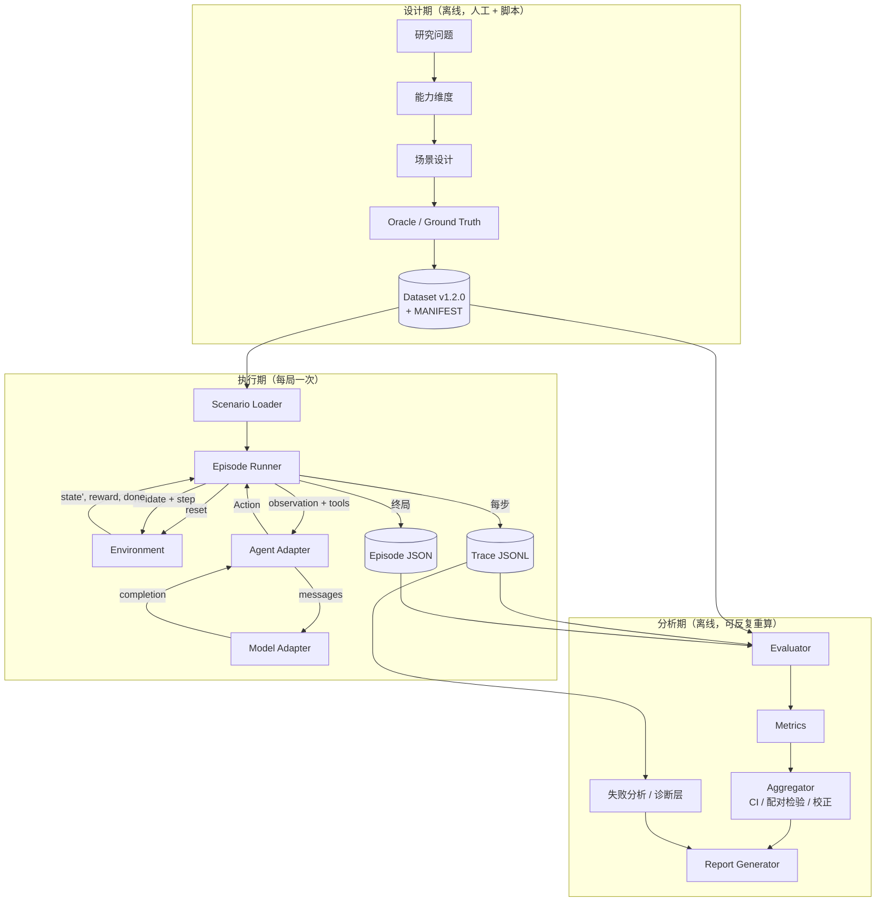
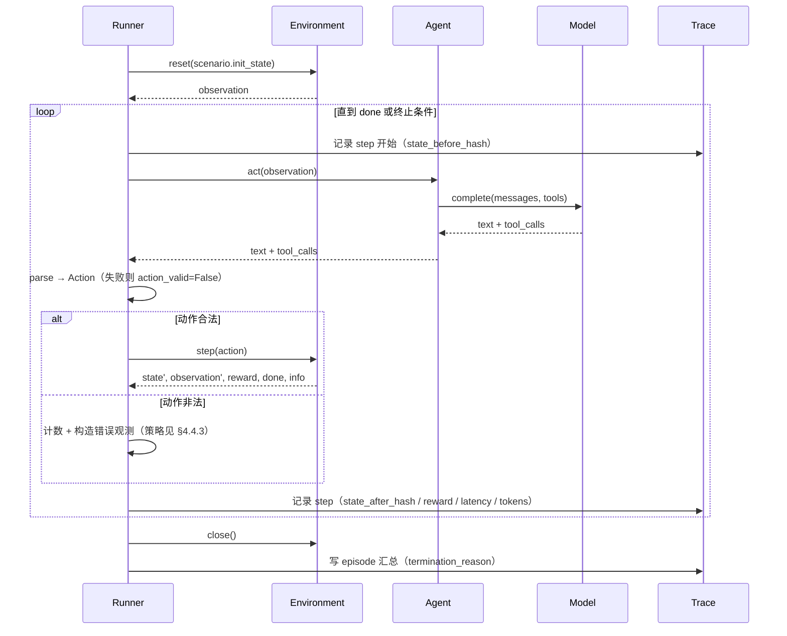
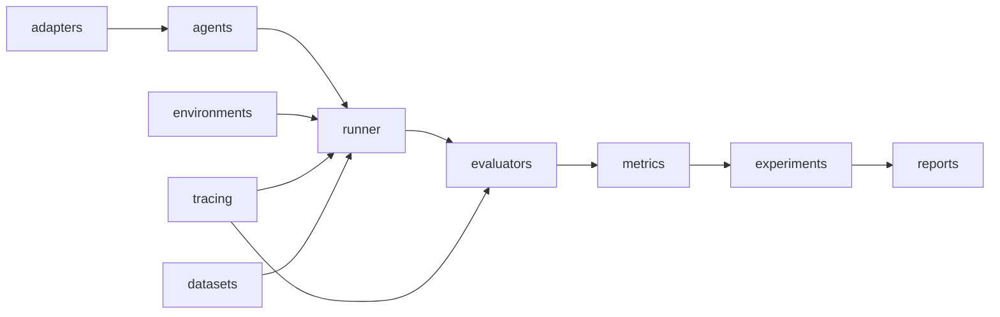

# 05 · 评测系统架构与工程实现

> 本文回答一个具体问题：**把第三部分的方法论变成代码时，模块应该怎么切、数据应该怎么流、失败应该怎么隔离、系统自身应该怎么被测试？**
>
> 读者对象：需要写/改评测框架的人（包括 AI Agent）。本文假设你已经理解 [03](03-agent-benchmark-design.md) 里的场景、Oracle 与评测协议；如果还没有，先读 03 的 §3.3、§3.5。
>
> 说明：本文代码以**标准库 dataclass + `typing.Protocol`** 为主，因为当前项目 `bench/` 是 stdlib-only（见 `pyproject.toml` 的 `dependencies = []`）。生产环境常用 Pydantic / Hydra / SQLite / Prefect 等，替换点我会标明。
>
> 本文所有代码片段都在文末 §4.9 说明"哪些是生产简化版"。它们是**可编译的骨架**，不是可直接上线的完整框架。

---

## 4.1 一个完整 Evaluation Framework 的架构

### 4.1.1 先讲问题：为什么"评测脚本"长不成"评测系统"

一个新手写评测，通常是这样的：

```python
# 反例：一次性脚本
for q in questions:
    out = model(prompt(q))
    if out == q["answer"]:
        correct += 1
print(correct / len(questions))
```

这段代码在 20 条数据上能跑，但一旦要回答"这个模型比那个模型强吗""失败是模型的问题还是我评测器的问题""三个月后还能复现吗"，它就全部失效：

1. **没有环境**：模型输出直接对着字符串比，无法评测"做动作"的 Agent；
2. **没有 trace**：只知道对错，不知道过程，失败无法分析；
3. **没有分离**：模型调用、判分、统计写在一起，换一个模型要改一遍代码；
4. **没有账本**：跑了哪版数据、哪版 prompt、哪个模型版本，全在脑子里；
5. **无法复算**：别人拿到你的分数，无法验证。

评测系统化的本质，是**把"一次实验"拆成可独立替换、可独立验证的环节，并让每个环节留下证据**。

### 4.1.2 模块清单与职责

下表是本文推荐的模块划分。注意最后两列：**输入/输出**决定接口，**是否允许有副作用**决定它能不能被单测。

| 模块 | 一句话职责 | 输入 | 输出 | 允许副作用 | 常见实现错误 |
|---|---|---|---|---|---|
| **Dataset** | 一组场景的集合 + 版本清单 | 场景文件、manifest | `Dataset`（可迭代 `Scenario`） | 否（只读） | 把 train/test 混在一个目录，靠文件名区分 |
| **Scenario Loader** | 把磁盘格式解析成内存 `Scenario` 并校验 | JSON/JSONL/YAML | `Scenario` | 否 | 校验只做"字段存在"，不做取值域校验 |
| **Environment** | 唯一的状态权威：给定状态+动作，返回新状态与奖励 | `EnvState`, `Action` | `(EnvState, Observation, reward, done)` | **是**（外部世界：容器、游戏、浏览器） | 规则实现在 adapter 里复制一份 |
| **Tool Interface** | 把环境能力暴露成 Agent 可见的工具 schema | `Environment` | 工具列表 + 调用结果 | 是（转发） | 工具描述和真实动作语义不一致 |
| **Agent Adapter** | 把"被测系统"统一成 `reset/act` 接口 | `Observation`, 工具列表 | `Action` / 原始输出 | 是（模型调用） | 把 prompt 拼装写死在 runner 里 |
| **Model Adapter** | 统一不同推理后端的调用协议 | messages, params | `ModelResponse` | 是（网络） | 在业务代码里 `if provider == "openai"` |
| **Episode Runner** | 驱动一局：观测→决策→校验→转移→记录→终止 | `Scenario`, `Environment`, `Agent` | `Episode` + `Trace` | 是（写文件） | 把判分逻辑塞进 runner |
| **Trace Recorder** | 只追加地记录每一步的原始与解析数据 | `Step` | JSONL 行 | 是（磁盘） | 把"推断"和"原始"写在同一字段 |
| **Evaluator** | 对**已完成的 trace** 计算通过/失败/Oracle 对照 | `Episode`, `Scenario`, `Oracle` | `EvalResult` | 否（理想情况纯函数） | 在 runner 里边跑边判，导致不可重算 |
| **Metrics** | 把多个 `EvalResult` 变成指标值 | `list[EvalResult]` | `MetricResult` | 否 | 指标定义散落在 notebook 里 |
| **Aggregator** | 分组、置信区间、配对检验、多重比较校正 | `list[MetricResult]` + 实验设计 | 表格数据 | 否 | 只报均值，不报 n 与区间 |
| **Experiment Manager** | 配置快照、运行 ID、断点续跑、产物布局 | `ExperimentConfig` | `run_id`, 产物目录 | 是 | 配置只存在命令行历史里 |
| **Report Generator** | 把表格 + 图 + 局限声明渲染成报告 | 结果表、模板 | Markdown/HTML/PDF | 是 | 报告数字与产物文件不一致 |

### 4.1.3 数据流图



**这张图最重要的三条边**：

1. `S5 --> EV`：**Oracle 属于数据集，不属于 runner**。runner 不知道"正确答案"，它只负责把过程跑完、记下来。
2. `T --> EV`：Evaluator 读的是**落盘的 trace**，不是内存对象。这保证"同一份 trace 可以被重算、被第三方复算、被改判分规则后重新打分"。
3. `EV --> ME --> AG`：指标与统计是两层。指标回答"这一局怎么样"，统计回答"这个差异可不可信"。

### 4.1.4 为什么这样设计（三个关键决策）

**决策 A：执行期与分析期分离。**

- 替代方案：runner 里边跑边算分，跑完直接出指标。
- 为什么不行：① 改一个指标定义就要重跑全部（昂贵，尤其真游戏/真浏览器环境）；② 无法回答"如果 Oracle 换成另一种定义，结论会变吗"；③ 无法做"只重算不重跑"的审计。
- 代价：trace 必须记全（见 §4.5）。**trace 不全是这个架构唯一的失败模式。**

**决策 B：Environment 是唯一状态权威，Agent 只能通过 Action 影响它。**

- 替代方案：让模型直接输出自然语言，由一个"解释器"去理解并执行。
- 为什么不行：无法区分"模型说错了"和"解析器理解错了"，非法动作无法定义，评测不可复现。
- 例外：像 WebArena 那类环境，动作就是"点击坐标/输入文本"，此时"解析"由浏览器完成，解析误差被环境吸收，仍然满足"唯一权威"。

**决策 C：Scenario 里区分"Agent 可见"与"评测器可见"字段。**

这是安全与效度的双重要求：`oracle.best_actions` 一旦进入 prompt，评测立刻归零。工程上必须**在类型层面**分开（见 §4.2 的 `Scenario.agent_view()`），而不是靠"记得别拼进去"。

### 4.1.5 与当前项目的关系（预告）

当前 `bench/` 只实现了图中的 **Environment** 一个模块（`engine.py` + `scoring.py` + `actions.py` + `model.py` + `rng.py`），外加一个"半成品"的 Trace（`logging.py`，缺 §4.5 中大半字段）。**Dataset Loader、Agent Adapter、Model Adapter、Episode Runner、Evaluator、Metrics、Aggregator、Experiment Manager、Report Generator 全部缺失**。具体映射与优先级见 [06](06-project-specific-analysis.md)。

---

## 4.2 数据结构设计

### 4.2.1 设计原则

1. **不可变优先**：`Scenario`、`Action`、`Step`、`EvalResult` 用 `frozen=True`。可变状态只允许出现在 `EnvState`（环境内部）与 runner 的局部变量里。
2. **每个对象都有稳定 ID**：`dataset_id`、`scenario_id`、`episode_id`、`step_id`。ID 一旦发布不得复用。
3. **每个落盘对象都有 `schema_version`**。升级 schema 时旧文件必须仍可读，或者明确声明不兼容。
4. **区分"值"和"引用"**：trace 里存 state 的**哈希**和**投影**，完整状态另存（或可重放得出）。否则 trace 会膨胀到不可用。
5. **unknown 显式化**：用 `None` + 单独字段说明原因，不要用 `-1`、`""`、`"N/A"` 混在数值字段里。

### 4.2.2 Dataset 与 Scenario

```python
from __future__ import annotations

import hashlib
import json
from dataclasses import dataclass, field, asdict
from typing import Any, Literal, Mapping

SCHEMA_VERSION = 1


@dataclass(frozen=True, slots=True)
class Provenance:
    """场景来源。评测报告里的每个结论最终都要能追到这个结构。"""

    origin: Literal["human_authored", "program_generated", "real_capture", "counterfactual", "synthetic"]
    source_uri: str | None          # 原始来源（仓库路径 / 论文 / 游戏捕获 id）
    collected_at: str               # ISO-8601
    collector: str                  # 人 or 脚本名 + 版本
    license: str = "unknown"        # 许可标识，unknown 时不得对外分发


@dataclass(frozen=True, slots=True)
class OracleSpec:
    """Oracle 的“保证范围”，不是“一个数字”。"""

    kind: Literal["exact_enumeration", "approximate", "reference_policy", "human_label", "unit_test"]
    best_actions: tuple[str, ...]
    best_value: float
    # 关键字段：exact=True 表示“在定义的动作空间内穷举过”，否则只能声明子集最优
    exact: bool
    evaluated_actions: int          # 实际评估过的动作数
    total_actions: int              # 该状态合法动作总数
    note: str = ""


@dataclass(frozen=True, slots=True)
class Scenario:
    scenario_id: str
    schema_version: int
    provenance: Provenance
    # 环境初始化：必须是“可重建”的数据，不是一段“当时内存里是这样的”描述
    init_state: Mapping[str, Any]
    goal: Mapping[str, Any]
    constraints: Mapping[str, Any] = field(default_factory=dict)
    max_steps: int = 1
    tags: Mapping[str, str] = field(default_factory=dict)     # difficulty / capability / horizon
    oracle: OracleSpec | None = None                          # 单步场景才有
    content_hash: str = ""

    def agent_view(self) -> dict[str, Any]:
        """返回可以安全拼进 prompt 的字段。**唯一**允许给 Agent 的入口。"""
        return {
            "scenario_id": self.scenario_id,
            "observation": self.init_state,
            "goal": self.goal,
            "constraints": self.constraints,
            "max_steps": self.max_steps,
        }

    def computed_hash(self) -> str:
        payload = {
            "init_state": self.init_state,
            "goal": self.goal,
            "constraints": self.constraints,
            "max_steps": self.max_steps,
            "oracle": asdict(self.oracle) if self.oracle else None,
        }
        blob = json.dumps(payload, sort_keys=True, ensure_ascii=False, separators=(",", ":"))
        return hashlib.sha256(blob.encode("utf-8")).hexdigest()[:16]
```

**为什么 `agent_view()` 是一个方法而不是"文档约定"？**

因为约定会被忘记。把它做成唯一出口后，代码审查可以只问一句"有没有别的地方直接读 `scenario.oracle`"。当前项目的 `plan/详细版/03-评测集与指标.md` §2 已经写了"Agent 可见字段只有 `initial_state` 的渲染文本；`oracle`…仅评测器使用"——**这是规范，但目前没有任何代码强制它**。强制点应该就在这里。

**为什么 `OracleSpec` 要存 `total_actions`？**

因为 `exact=False` 时，`best_value` 只是"已验证子集里的最优"。没有 `total_actions` 与 `evaluated_actions` 的对比，读者无法判断这个"最优"离全局最优可能有多远。这是本项目 `plan/详细版/03` §2.1 已经意识到的问题（`validated_actions`），本文把它上升为**类型必填字段**。

### 4.2.3 Environment 状态、Action、Observation

```python
from __future__ import annotations

import hashlib
import json
from dataclasses import dataclass
from typing import Any, Mapping, Protocol, Sequence


@dataclass(frozen=True, slots=True)
class Action:
    """规范化后的动作。这是评测系统里唯一承认的动作表示。"""

    kind: str                       # "play_cards" / "click" / "call_tool"
    args: Mapping[str, Any]         # 必须可 JSON 序列化
    raw: str = ""                   # 模型原文片段，仅用于审计，不参与判定

    def canonical(self) -> str:
        blob = json.dumps({"kind": self.kind, "args": self.args},
                          sort_keys=True, ensure_ascii=False, separators=(",", ":"))
        return blob

    def hash(self) -> str:
        return hashlib.sha256(self.canonical().encode("utf-8")).hexdigest()[:16]


@dataclass(frozen=True, slots=True)
class Observation:
    """给 Agent 看的东西。text 是渲染结果，data 是结构化投影。"""

    text: str
    data: Mapping[str, Any]
    truncated: bool = False          # 是否因超长被截断（会影响公平性）


@dataclass(frozen=True, slots=True)
class StepResult:
    state: Any                       # 新状态（不落盘，见 trace）
    observation: Observation
    reward: float
    done: bool
    info: Mapping[str, Any]          # 环境侧诊断：非法原因、超时、内部错误码


class Environment(Protocol):
    """环境契约。所有真实环境（子进程、HTTP、浏览器）都必须满足它。"""

    def reset(self, scenario: dict[str, Any]) -> Observation: ...
    def step(self, action: Action) -> StepResult: ...
    def state_hash(self) -> str: ...
    def legal_actions(self) -> Sequence[Action] | None: ...   # None = 动作空间不可枚举
    def close(self) -> None: ...
```

**为什么 `Action.raw` 不参与判定？**

因为原始文本里有措辞、标点、多余解释。判定必须基于**规范化后的 args**，否则"同一个动作不同说法"会被判成两个动作，指标立刻失真。`raw` 只用于回答"模型到底说了什么"（这是失败分析必需的一层，见 §4.5.4）。

**为什么 `Observation.truncated` 要单独记？**

上下文截断是**公平性杀手**：A 模型看到的观测被截断、B 模型没被截断，比较就不成立。这个布尔值让报告可以统计"有多少步的观测被截断"，从而判断是否需要缩短观测或加大上下文预算。

### 4.2.4 Episode、Step、Trace

```python
from __future__ import annotations

from dataclasses import dataclass, field
from typing import Any, Literal, Mapping


TerminationReason = Literal[
    "goal_reached", "max_steps", "agent_stop", "illegal_action_limit",
    "env_error", "timeout", "budget_exhausted", "harness_error",
]


@dataclass(frozen=True, slots=True)
class Step:
    episode_id: str
    step_id: int
    timestamp: str                       # ISO-8601，带时区
    observation_text: str
    agent_output: str                    # 模型原始输出（可截断，注明）
    parsed_action: Mapping[str, Any] | None
    action_valid: bool
    invalid_reason: str | None
    state_before_hash: str
    state_after_hash: str | None
    reward: float
    latency_ms: int
    token_usage: Mapping[str, int]       # {"prompt":..,"completion":..,"total":..}
    error: str | None
    extra: Mapping[str, Any] = field(default_factory=dict)


@dataclass(frozen=True, slots=True)
class Episode:
    episode_id: str
    scenario_id: str
    run_id: str
    config_hash: str
    seed: int | None
    termination_reason: TerminationReason
    steps: tuple[Step, ...]
    final_state_hash: str | None
    wall_ms: int
    total_tokens: Mapping[str, int]


@dataclass(frozen=True, slots=True)
class MetricResult:
    name: str
    value: float | None                  # None = 不可计算（例如成功率为 0 时的 regret 分母）
    n: int                               # 参与计算的样本数
    unit: Literal["episode", "step", "decision"]
    ci_low: float | None = None
    ci_high: float | None = None
    exactness: Literal["exact", "approx", "heuristic"] = "exact"
    note: str = ""


@dataclass(frozen=True, slots=True)
class EvalResult:
    episode_id: str
    scenario_id: str
    success: bool | None                 # None = 无法判定（环境错误等），必须与 False 区分
    score: float | None
    oracle_value: float | None
    regret: float | None
    illegal_actions: int
    termination_reason: TerminationReason
    diagnostics: Mapping[str, Any] = field(default_factory=dict)
```

**四个"必须区分"的字段**（这是新手最容易合并的）：

| 概念 | 用 `False` 表示 | 用 `None` 表示 | 为什么必须分开 |
|---|---|---|---|
| 成功 | 真的没达成目标 | 环境崩了/判不了 | 混在一起会把"基础设施故障"算成"模型能力差" |
| regret | 算出来是 0（与最优持平） | 分母为 0 或 oracle 缺失 | 混在一起会把"无定义"算成"完美" |
| 动作合法 | 动作非法，已计入失败 | 没解析出动作 | 二者诊断含义不同（F1 vs 格式错误） |
| 终止 | 正常结束 | 超时 | 超时率是环境可靠性指标，不是能力指标 |

当前项目的 `plan/详细版/03` §3.6 已经区分了 `timeout` 单列、`env_divergence` 单列——**思路是对的**，但缺少类型层面的强制（`bool` 无法表达"未知"）。

### 4.2.5 Schema 校验策略

三层，缺一不可：

| 层 | 做什么 | 工具 | 触发时机 |
|---|---|---|---|
| L1 结构 | 必填字段、类型、枚举取值 | `jsonschema` / Pydantic | 数据集加载时 |
| L2 语义 | ID 唯一、`max_steps>0`、`oracle.best_actions ⊆ legal_actions`、`evaluated_actions <= total_actions` | 手写 `validate_scenario()` | 数据集加载 + CI |
| L3 跨文件 | manifest 里的 hash 与实际文件一致、划分不重叠、版本号单调 | manifest 校验脚本 | CI + 出报告前 |

```python
def validate_scenario(s: dict) -> list[str]:
    """返回错误列表；空列表表示通过。L2 语义校验的最小集。"""
    errs: list[str] = []
    for key in ("scenario_id", "schema_version", "provenance", "init_state", "goal"):
        if key not in s:
            errs.append(f"missing field: {key}")
    if errs:
        return errs

    if s["schema_version"] != SCHEMA_VERSION:
        errs.append(f"schema_version mismatch: {s['schema_version']} != {SCHEMA_VERSION}")
    if not str(s["scenario_id"]).strip():
        errs.append("empty scenario_id")
    if s.get("max_steps", 0) < 1:
        errs.append("max_steps must be >= 1")

    oracle = s.get("oracle")
    if oracle is not None:
        if oracle.get("evaluated_actions", 0) > oracle.get("total_actions", 0):
            errs.append("evaluated_actions cannot exceed total_actions")
        if oracle.get("exact") and oracle.get("evaluated_actions") != oracle.get("total_actions"):
            errs.append("exact=True requires evaluated_actions == total_actions")
        if not oracle.get("best_actions"):
            errs.append("oracle.best_actions is empty")
    return errs
```

最后两条是本项目 `plan/详细版/03` §2.1 的规则（"全部 218 动作验证才 `exact: true`"）的**机器可执行版本**。规范写进文档只是第一步，写进校验函数才算数。

### 4.2.6 Dataset 版本管理

一个可用的 manifest 至少包含：

```json
{
  "dataset_id": "balatroeval-decision-points",
  "version": "0.3.0",
  "created_at": "2026-11-20T10:00:00+08:00",
  "schema_version": 1,
  "rules_version": "1.0-subset",
  "environment_version": "bench@c65fb9b",
  "split": {"train": 0, "dev": 0, "test": 0},
  "files": [
    {"path": "scenarios.jsonl", "sha256": "…", "n_records": 60}
  ],
  "changelog": [
    {"version": "0.3.0", "date": "2026-11-20", "change": "add 30 counterfactual variants"},
    {"version": "0.2.0", "date": "2026-11-18", "change": "fix duplicate card id in L2-0007"}
  ]
}
```

规则：

1. **版本号语义**：`MAJOR` = 不兼容（删场景/改判定口径）；`MINOR` = 加场景；`PATCH` = 修元数据/去重，不改判定。
2. **任何 PATCH 之后必须重算**所有已发布结果的 `dataset_hash`，并在报告里标注"结果基于 vX.Y.Z"。
3. **不要用 git 分支当版本号**。分支会移动，版本号不会。
4. **`changelog` 必须写"为什么"**，否则半年后没人知道为什么删了 5 条。

---

## 4.3 Agent 与 Model Adapter

### 4.3.1 为什么要分成两层

很多框架把"模型调用"和"Agent 逻辑"揉在一起，结果：

- 想换 vLLM → 改业务代码；
- 想加一个"先思考再行动"的 prompt → 复制一整个 runner；
- 想评测一个第三方 Agent 框架（LangGraph/AutoGen）→ 无法接入。

分成两层后：

- **Model Adapter** 只负责"messages in → completion out"，管重试、限流、token 统计、参数快照。
- **Agent Adapter** 只负责"观测 in → 动作 out"，管 prompt 模板、历史管理、工具选择策略。

### 4.3.2 接口定义

```python
from __future__ import annotations

from dataclasses import dataclass, field
from typing import Any, Mapping, Protocol, Sequence


@dataclass(frozen=True, slots=True)
class ToolSpec:
    name: str
    description: str
    parameters: Mapping[str, Any]        # JSON Schema
    required_state: str | None = None    # 前置状态说明（给模型看，也给校验器看）


@dataclass(frozen=True, slots=True)
class ModelResponse:
    text: str
    tool_calls: tuple[Mapping[str, Any], ...]
    usage: Mapping[str, int]
    model_id: str                        # 必须回填真实模型标识，不能只写 "gpt"
    finish_reason: str
    latency_ms: int
    raw: Mapping[str, Any] = field(default_factory=dict)


class ModelAdapter(Protocol):
    def complete(
        self,
        messages: Sequence[Mapping[str, Any]],
        tools: Sequence[ToolSpec] = (),
        *,
        temperature: float = 0.0,
        max_tokens: int = 1024,
        seed: int | None = None,
    ) -> ModelResponse: ...


class AgentAdapter(Protocol):
    """被测对象。runner 只知道这三个方法。"""

    def reset(self, scenario_view: Mapping[str, Any], tools: Sequence[ToolSpec]) -> None: ...
    def act(self, observation: str) -> tuple[str, Sequence[Mapping[str, Any]]]: ...
    def observe_result(self, tool_name: str, result: str, is_error: bool) -> None: ...
```

**为什么 `AgentAdapter.act` 返回 `(text, tool_calls)` 而不是直接返回 `Action`？**

因为"解析"这一步必须可观测、可失败、可归因。如果 adapter 内部解析失败却静默返回一个默认动作，runner 就永远看不到"解析失败"这个事实，而这恰恰是小模型最高频的失败模式之一（对应本项目 F1 非法动作、以及"格式不符合 schema"）。

解析放在 runner（或独立的 `ActionParser`），失败记 `action_valid=False` + `invalid_reason="unparsable"`。

**为什么 `reset` 要传 `scenario_view` 而不是完整 scenario？**

类型隔离（见 §4.2.2）。传完整 scenario 等于把 oracle 递给模型。

### 4.3.3 三种后端的适配要点

| 后端 | 关键点 | 坑 |
|---|---|---|
| 云端 API（OpenAI 兼容） | 用官方 SDK 或 `httpx`；记录 `response.model`、`system_fingerprint` | 同名模型会静默升级；`temperature=0` **不保证**逐字确定；工具调用格式各厂有差异 |
| 本地 vLLM | OpenAI 兼容端点 `/v1/chat/completions`；可传 `seed` | 批处理会改变数值结果（continuous batching 的顺序影响浮点累加）；`seed` 只在同版本同硬件可复现 |
| 其他推理服务（Ollama/llama.cpp/TGI） | 各自有原生 API，通常也提供 OpenAI 兼容层 | 上下文长度、工具调用支持程度差异大；`num_ctx` 等参数必须写进配置快照 |

**公平性提醒**：比较两个模型时，必须固定 `max_tokens`、`temperature`、`top_p`、工具 schema、系统提示词、上下文预算。如果 A 模型只能吃 8k 上下文而 B 能 128k，这本身就是能力差异的一部分——**要么在报告里承认它是被测能力的一部分，要么把两者都截到同一预算**。这个决定必须在预注册里写清楚。

### 4.3.4 配置快照

```python
from dataclasses import dataclass


@dataclass(frozen=True, slots=True)
class ModelConfig:
    provider: str
    model_id: str
    temperature: float = 0.0
    top_p: float = 1.0
    max_tokens: int = 1024
    seed: int | None = None
    context_budget: int = 8192
    extra: dict | None = None

    def fingerprint(self) -> str:
        import hashlib, json
        blob = json.dumps(self.__dict__, sort_keys=True, default=str)
        return hashlib.sha256(blob.encode()).hexdigest()[:12]
```

`fingerprint()` 要写进每一份结果文件头。**没有 fingerprint 的结果，六个月后无法解释它到底是哪个模型跑出来的。**

---

## 4.4 Episode Runner 与环境交互

### 4.4.1 执行流程



### 4.4.2 Runner 骨架

```python
from __future__ import annotations

import time
import uuid
from dataclasses import dataclass
from typing import Any, Callable, Mapping, Sequence


@dataclass(frozen=True, slots=True)
class RunLimits:
    max_steps: int = 20
    max_illegal_actions: int = 3
    step_timeout_s: float = 120.0
    episode_timeout_s: float = 900.0
    max_prompt_tokens: int = 8192


class EpisodeRunner:
    """驱动一局。**不做判分**，判分在 evaluator（见 §4.1.4 决策 A）。"""

    def __init__(
        self,
        env_factory: Callable[[], Any],     # 每局新建环境 = 状态隔离
        agent: Any,
        recorder: Any,
        limits: RunLimits,
        clock: Callable[[], float] = time.monotonic,
    ) -> None:
        self._env_factory = env_factory
        self._agent = agent
        self._recorder = recorder
        self._limits = limits
        self._clock = clock

    def run(self, scenario: Mapping[str, Any], *, run_id: str, seed: int | None) -> dict[str, Any]:
        episode_id = f"{run_id}:{scenario['scenario_id']}:{uuid.uuid4().hex[:8]}"
        env = self._env_factory()
        started = self._clock()
        illegal = 0
        steps: list[dict[str, Any]] = []
        termination = "max_steps"

        try:
            observation = env.reset(scenario["init_state"])
            self._agent.reset(scenario, self._tools())
            for step_id in range(self._limits.max_steps):
                if self._clock() - started > self._limits.episode_timeout_s:
                    termination = "timeout"
                    break

                before = env.state_hash()
                t0 = self._clock()
                try:
                    text, calls = self._agent.act(observation.text)
                except Exception as exc:                      # 模型侧错误：可重试，不算 Agent 决策
                    steps.append(self._error_step(episode_id, step_id, before, f"agent_error:{exc!r}"))
                    termination = "harness_error"
                    break
                latency_ms = int((self._clock() - t0) * 1000)

                action, parse_err = self._parse(calls)
                if action is None:
                    illegal += 1
                    steps.append(self._invalid_step(episode_id, step_id, before, text, parse_err, latency_ms))
                    observation = self._illegal_observation(parse_err)
                    self._agent.observe_result("_invalid", observation.text, True)
                    if illegal > self._limits.max_illegal_actions:
                        termination = "illegal_action_limit"
                        break
                    continue

                result = env.step(action)
                steps.append({
                    "episode_id": episode_id, "step_id": step_id,
                    "timestamp": _iso_now(), "observation_text": observation.text,
                    "agent_output": text, "parsed_action": dict(action.args),
                    "action_valid": True, "invalid_reason": None,
                    "state_before_hash": before, "state_after_hash": env.state_hash(),
                    "reward": result.reward, "latency_ms": latency_ms,
                    "token_usage": {}, "error": None,
                })
                self._agent.observe_result(action.kind, result.observation.text, False)
                observation = result.observation
                if result.done:
                    termination = "goal_reached"
                    break
        finally:
            env.close()

        episode = {
            "episode_id": episode_id,
            "scenario_id": scenario["scenario_id"],
            "run_id": run_id, "seed": seed,
            "termination_reason": termination,
            "steps": steps,
            "wall_ms": int((self._clock() - started) * 1000),
        }
        self._recorder.write_episode(episode)
        return episode

    # --- 以下为省略实现的小工具，生产版需要完整定义 ---
    def _tools(self) -> Sequence[Any]:
        return ()

    def _parse(self, calls: Sequence[Mapping[str, Any]]) -> tuple[Any, str | None]:
        return None, "not_implemented"

    def _illegal_observation(self, reason: str | None) -> Any:
        raise NotImplementedError

    def _error_step(self, *args: Any) -> dict[str, Any]:
        raise NotImplementedError

    def _invalid_step(self, *args: Any) -> dict[str, Any]:
        raise NotImplementedError


def _iso_now() -> str:
    from datetime import datetime, timezone
    return datetime.now(timezone.utc).isoformat()
```

> ⚠️ 上面 `_parse` / `_invalid_step` / `_error_step` / `_illegal_observation` 是占位，**故意保留未实现**，因为它们依赖具体环境的动作空间与错误码设计。这是"骨架代码"，不是"可直接运行的 runner"。

### 4.4.3 非法动作的处理策略（必须预注册）

| 策略 | 行为 | 适用 | 副作用 |
|---|---|---|---|
| **Strict** | 非法即终止，记失败 | 生产环境模拟（真实世界不容错） | 小模型分数可能接近 0，区分度差 |
| **Retry-N** | 返回错误观测，允许重试 N 次，超过则终止 | 大多数 Agent benchmark | 重试次数本身成为变量，必须固定并报告 |
| **Skip** | 忽略非法动作，继续下一步 | 不推荐 | 会虚构"步数"，扭曲效率指标 |
| **Repair** | 用启发式把非法动作改成最近的合法动作 | 不推荐用于主表 | 评测器替模型做决定，效度崩塌 |

**为什么必须预注册**：同一份数据，Retry-3 和 Strict 可以让两个模型的排名反过来。这不是"调参"，这是**改变被测任务**。

**当前项目的现状**：`bench/engine.py` 的 `play/discard/choose_joker` 在非法输入时直接 `raise ValueError`。这在库层面是对的（fail fast），但**在评测层面意味着没有"非法动作"这个状态**——一局会因为一个非法动作直接崩掉，而不是记一次 F1。要支持 F1 诊断，必须在 MCP 工具层把异常转换成结构化错误（`isError: true` + 错误码），而不是让异常穿透。

### 4.4.4 超时、重试与上下文过长

| 问题 | 处理 | 注意 |
|---|---|---|
| 单步模型超时 | `asyncio.wait_for`；超时记 `harness_error`，**不算 Agent 失败** | 超时阈值要写进配置并报告 |
| 模型 5xx / 限流 | 指数退避重试（最多 3 次），重试次数记入 trace | 重试成功的那一步，latency 要含重试时间 |
| 工具执行异常 | 环境侧捕获，返回结构化错误给 Agent（让它有机会恢复） | 这是"失败恢复"能力的观测点，不要吞掉 |
| 上下文过长 | ① 压缩历史（摘要）② 截断观测并记 `truncated=True` ③ 终止并记 `budget_exhausted` | 选哪种是实验设计决定，不是实现细节 |
| 断点续跑 | 每步 append 到 JSONL；重启时读最后一条，用 action 序列 replay 到该状态 | 依赖环境确定性；不确定时只能整局重跑 |

**断点续跑的正确做法**：不要 pickle 环境对象（不可移植、不可审计）。正确做法是**记录动作序列 + 初始状态**，恢复时重放。这要求环境 `reset(init_state)` + `step(action)` 是确定性的——如果环境有随机性，必须把 seed 存进 episode 并在 replay 时复用。

### 4.4.5 可复现性的四个必要条件

1. **环境确定性**：同 init_state + 同动作序列 ⇒ 同 state_hash 序列。若有随机性，seed 必须记录且 RNG 状态可序列化（本项目 `bench/rng.py` 把完整 `getstate()` 编码进状态，做法正确）。
2. **动作规范化**：等价动作必须映射到同一 canonical 形式（本项目 `actions.py` 用稳定 card_id + 排序去重，思路正确；注意 `CardAction.code` 对入参顺序敏感，去重会漏等价动作——这是已知粗糙点）。
3. **模型侧固定**：temperature/top_p/max_tokens/seed/模型版本全部进配置快照。
4. **代码版本固定**：`git commit` + 关键模块内容哈希。

缺任何一条，"可复现"就只能写成"在我们机器上大致能复现"。

---

## 4.5 Trace 与日志系统

### 4.5.1 Trace 的三种用途

| 用途 | 需要什么 | 不能有什么 |
|---|---|---|
| **复算**（重放/重打分） | 初始状态、动作序列、环境版本、seed | 事后编辑过的字段 |
| **诊断**（失败分析） | 原始输出、解析结果、状态变化、奖励、错误 | 把推断混进原始字段 |
| **审计**（第三方核查） | 时间戳、模型版本、token、代码哈希 | 只存在于内存里的中间量 |

### 4.5.2 完整 Trace 示例

```json
{
  "schema_version": 2,
  "episode_id": "run-20261120-01:L3-0007:9f3a1c2b",
  "run_id": "run-20261120-01",
  "scenario_id": "L3-0007",
  "dataset_version": "0.3.0",
  "environment": {"name": "bench", "version": "1.0-subset", "commit": "c65fb9b"},
  "agent": {"name": "react-cot", "version": "0.1.0", "prompt_hash": "a1b2c3d4"},
  "model": {"provider": "local-vllm", "model_id": "qwen3-4b-instruct", "config_fingerprint": "7c1e90ab"},
  "seed": 20261112,
  "started_at": "2026-11-20T10:00:00+08:00",
  "steps": [
    {
      "step_id": 0,
      "timestamp": "2026-11-20T10:00:02.113+08:00",
      "observation": {
        "text": "blind 1/3 target=300 score=0 hands_left=4 discards_left=2 hand=[c7h,c7d,c3s,...]",
        "truncated": false
      },
      "agent_output": "我认为应该先弃掉 3s 和 9c，保留对子。{\"tool\":\"discard_cards\",\"card_ids\":[\"c3s\",\"c9c\"]}",
      "parsed_action": {"tool": "discard_cards", "args": {"card_ids": ["c3s", "c9c"]}},
      "action_valid": true,
      "state_before": {"hash": "s_5b2c9e", "total_score": 0, "hands_left": 4, "discards_left": 2},
      "state_after": {"hash": "s_71f0aa", "total_score": 0, "hands_left": 4, "discards_left": 1},
      "reward": 0.0,
      "score_delta": 0,
      "latency_ms": 2113,
      "token_usage": {"prompt": 812, "completion": 96, "total": 908},
      "error": null,
      "extra": {"tool_roundtrips": 1}
    },
    {
      "step_id": 1,
      "timestamp": "2026-11-20T10:00:04.890+08:00",
      "observation": {"text": "…", "truncated": false},
      "agent_output": "{\"tool\":\"play_cards\",\"card_ids\":[\"c7h\",\"c7d\",\"c11s\"]}",
      "parsed_action": {"tool": "play_cards", "args": {"card_ids": ["c7h", "c7d", "c11s"]}},
      "action_valid": true,
      "state_before": {"hash": "s_71f0aa", "total_score": 0},
      "state_after": {"hash": "s_0d4e12", "total_score": 84},
      "reward": 84.0,
      "score_delta": 84,
      "latency_ms": 1877,
      "token_usage": {"prompt": 905, "completion": 41, "total": 946},
      "error": null,
      "extra": {"tool_roundtrips": 1}
    }
  ],
  "termination_reason": "max_steps",
  "final_state_hash": "s_0d4e12",
  "totals": {"steps": 2, "illegal_actions": 0, "wall_ms": 4890,
             "tokens": {"prompt": 1717, "completion": 137, "total": 1854}}
}
```

### 4.5.3 分层：原始 / 解析 / 推断必须分文件

```text
runs/<run_id>/
├── raw/
│   └── <episode_id>.jsonl        # 每次模型调用的原样请求与响应（含 header、finish_reason）
├── trace/
│   └── <episode_id>.json         # 规范化后的 step 序列（上面那个结构）
├── eval/
│   └── <episode_id>.json         # evaluator 的输出：success/regret/…
└── diagnosis/
    └── <episode_id>.json         # 失败归因（F1–F4 等）+ 证据链 + 置信度
```

**为什么必须分文件**：

- `raw` 会很大（含完整 prompt），只在需要深挖时读；
- `trace` 是复算与分析的**唯一事实来源**；
- `eval` 会因为指标定义变化而重算，不能被当成原始数据；
- `diagnosis` 是**推断**，如果和 `trace` 混在一起，三个月后没人分得清哪句是"模型说了什么"、哪句是"我们认为它为什么错"。

这正是本项目 `plan/详细版/04-失败归因器.md` 强调的"区分观察、推断、机制解释"在工程上的落地方式。

### 4.5.4 用 Trace 重建 Episode

```python
def replay(env, init_state: dict, trace: dict) -> list[str]:
    """按 trace 重放，返回 state_hash 序列；与记录不一致即说明环境/解析/版本有问题。"""
    env.reset(init_state)
    observed: list[str] = []
    for step in trace["steps"]:
        if not step["action_valid"]:
            observed.append(step["state_before"]["hash"])
            continue
        action = step["parsed_action"]
        env.step(action)                      # action 必须是 canonical 形式
        observed.append(env.state_hash())
    return observed


def verify_replay(trace: dict, replayed: list[str]) -> list[int]:
    """返回不一致的 step_id 列表。空列表 = 重放一致。"""
    bad: list[int] = []
    for step, got in zip(trace["steps"], replayed):
        want = (step.get("state_after") or {}).get("hash") or step["state_before"]["hash"]
        if want != got:
            bad.append(step["step_id"])
    return bad
```

**重放不一致时的排查顺序**（不要一上来就怀疑模型）：

1. 环境版本是否一致（commit / rules_version）；
2. 动作是否被规范化过（同一动作两种写法）；
3. 是否有未记录的随机性（时间、`random` 未播种、字典顺序、并发）；
4. 浮点/分数运算是否可交换（本项目用 `Fraction` 避免了这个坑）；
5. 最后才怀疑"模型输出被截断/改写"。

### 4.5.5 用 Trace 做失败分析

Trace 能回答的问题，按可信度从高到低：

| 层级 | 问题 | 证据 | 可信度 |
|---|---|---|---|
| 观察 | 第 3 步调用的工具名是什么？参数是什么？返回了什么？ | `trace.steps[3]` | 事实 |
| 观察 | 这一步动作是否合法？reward 是多少？ | `action_valid`, `reward` | 事实 |
| 行为推断 | 它是不是在"只看眼前收益"？ | 与 oracle 最优动作对比 + 历史步模式 | 推断（需多次一致才可信） |
| 行为推断 | 它是不是忘了目标？ | 上下文里目标是否还在 + 后续动作是否偏离 | 推断 |
| 机制解释 | 模型内部哪层注意力导致了错误？ | **trace 无法提供** | 不可得 |

**这张表就是"不能把 Trace 行为归因等同于机制可解释性"的工程表述**：trace 是行为层证据，它的上限是"一致的行为模式"，不是"内部因果"。

---

## 4.6 并发和可靠性

### 4.6.1 什么可以并发，什么必须串行

| 操作 | 能否并发 | 原因 |
|---|---|---|
| 不同 episode | ✅ 可以 | 每局独立环境、独立随机数 |
| 同一 episode 的多个 step | ❌ 不行 | 状态依赖，必须顺序 |
| 同一环境的多个 episode | ⚠️ 视实现 | 若环境是"单例游戏进程"（如真游戏），只能串行 |
| 同一模型的多个请求 | ✅ 可以，但需限流 | 否则触发 429，重试风暴 |
| 判分 / 统计 | ✅ 可以 | 纯函数，读 trace |

### 4.6.2 asyncio 并发骨架

```python
import asyncio
import random
from typing import Awaitable, Callable, Sequence


class TokenBucket:
    """简单限流：每秒最多 rate 个请求，允许 burst。"""

    def __init__(self, rate: float, burst: int) -> None:
        self._rate = rate
        self._capacity = burst
        self._tokens = float(burst)
        self._last = asyncio.get_event_loop().time()
        self._lock = asyncio.Lock()

    async def acquire(self) -> None:
        async with self._lock:
            while True:
                now = asyncio.get_event_loop().time()
                self._tokens = min(self._capacity, self._tokens + (now - self._last) * self._rate)
                self._last = now
                if self._tokens >= 1:
                    self._tokens -= 1
                    return
                await asyncio.sleep((1 - self._tokens) / self._rate)


async def retry_with_backoff(
    fn: Callable[[], Awaitable[object]],
    *,
    attempts: int = 3,
    base_s: float = 1.0,
    max_s: float = 20.0,
    retry_on: tuple[type[BaseException], ...] = (TimeoutError, ConnectionError),
) -> object:
    """指数退避 + 抖动。抖动是为了避免所有 worker 同时重试。"""
    for i in range(attempts):
        try:
            return await fn()
        except retry_on:
            if i == attempts - 1:
                raise
            delay = min(max_s, base_s * (2 ** i)) * (0.5 + random.random())
            await asyncio.sleep(delay)
    raise RuntimeError("unreachable")


async def run_all(
    episodes: Sequence[dict],
    run_one: Callable[[dict], Awaitable[dict]],
    *,
    concurrency: int = 4,
) -> list[dict | BaseException]:
    sem = asyncio.Semaphore(concurrency)

    async def guarded(ep: dict) -> dict:
        async with sem:
            return await run_one(ep)

    return await asyncio.gather(*(guarded(e) for e in episodes), return_exceptions=True)
```

**`return_exceptions=True` 是关键**：一局失败不应该让整批任务消失。但**必须在汇总时把异常单独计数**，否则"失败被吞掉"会变成"成功率虚高"。

### 4.6.3 幂等性与结果缓存

- **幂等键**：`(scenario_hash, agent_config_hash, model_fingerprint, env_version, seed)`。
- **缓存命中条件**：五元组完全一致。任何一项变化都必须重跑。
- **不要缓存"部分成功"的结果**：超时/中断的 episode 不写缓存，否则续跑会跳过它。
- **缓存目录要与报告绑定**：报告里写 `cache_hit_rate`，让读者知道有多少结果是复用的。

```python
import hashlib
import json


def idempotency_key(scenario: dict, agent_cfg: dict, model_fp: str, env_version: str, seed: int | None) -> str:
    payload = {
        "scenario": scenario.get("content_hash") or hashlib.sha256(
            json.dumps(scenario, sort_keys=True, default=str).encode()).hexdigest()[:16],
        "agent": agent_cfg,
        "model": model_fp,
        "env": env_version,
        "seed": seed,
    }
    blob = json.dumps(payload, sort_keys=True, default=str)
    return hashlib.sha256(blob.encode()).hexdigest()[:24]
```

### 4.6.4 异常隔离的四个边界

1. **进程边界**：真游戏/浏览器可能崩溃、泄漏内存。用子进程 + 超时 kill，不要在同进程里 try/except 硬扛。
2. **Episode 边界**：一局的异常不污染其他局（`gather(return_exceptions=True)`）。
3. **Step 边界**：一步的模型异常不终止整局（除非策略规定）。
4. **评测器边界**：Evaluator 崩了不能让 trace 丢。先落盘，再判分。

### 4.6.5 断点续跑的工程细节

- 每步 append 一行到 `trace/<episode_id>.jsonl`（不要等整局结束才写）。
- 整局结束后再写一个 `trace/<episode_id>.json` 作为"封口"文件，包含总步数与最终 hash。
- 续跑时：有封口文件 → 跳过；只有 jsonl → 重放最后一条动作序列继续，或整局重跑（二选一，写进配置）。
- **`append` 模式下不要用 `json.dump` 整个列表**，那是覆盖写，断电就全丢。

---

## 4.7 自动化测试和质量保证

### 4.7.1 七类测试

| 类型 | 测什么 | 例子（针对评测框架自身） |
|---|---|---|
| **Unit** | 单个纯函数 | `regret(best=100, actual=80) == 0.2`；`regret(best=0, actual=0) is None` |
| **Integration** | 2–3 个模块协作 | Loader → Runner → Recorder 跑完 1 个假场景，产物文件结构正确 |
| **End-to-End** | 全链路（含假模型） | 用 `ScriptedModel` 回放固定输出，跑完 3 局，指标与手算一致 |
| **Golden** | 固定输入的输出快照 | 固定 seed 的 13 步 demo，逐步 `state_hash` 与 golden 文件一致 |
| **Regression** | 历史 bug 不再复现 | 曾经"discard 后手牌少一张"的 bug，加一条断言 |
| **Property-based** | 不变量 | 任意合法动作序列：`len(hand)+len(deck)+len(discard) == 52` |
| **Determinism** | 同输入同输出 | 同 seed 跑两遍，整局 `state_hash` 序列相同 |
| **Schema** | 落盘格式 | 每行 JSONL 都能被 `validate_trace()` 通过 |

### 4.7.2 必须先测的"评测器不变量"

这些是**评测框架的核心正确性**，比"模型跑通"重要得多：

```python
def test_regret_bounds() -> None:
    from math import isclose
    assert isclose(regret(100, 100), 0.0)
    assert isclose(regret(100, 0), 1.0)
    assert regret(0, 0) is None          # 分母为 0：无定义，不是 0
    assert regret(100, 120) is not None  # 超额完成：允许 negative regret，但需在报告里说明


def regret(best: float, actual: float) -> float | None:
    if best <= 0:
        return None
    return (best - actual) / best
```

> ⚠️ `regret(100, 120) = -0.2`。很多实现会 `max(0, ...)` 截断，这**改变了指标定义**：截断后"超过 oracle"与"刚好等于 oracle"无法区分，而"超过 oracle"恰恰说明 **oracle 不是最优**（或环境有 bug），是重要信号，不该被抹掉。

### 4.7.3 负对照（Negative Controls）

这是最容易被忽略、但最能证明"评测真的在测东西"的一组测试：

| 对照 | 期望 | 若不满足说明什么 |
|---|---|---|
| **Random agent** | 分数显著低于 oracle，regret 明显 > 0 | 指标没有区分度（任务太简单 / 指标饱和） |
| **Oracle agent**（直接读 oracle 动作） | regret == 0，success == 1 | oracle 与 evaluator 不一致（实现 bug） |
| **Scripted-wrong agent**（固定选最差动作） | regret 接近 1 | regret 方向写反了 |
| **Timeout agent** | `termination_reason == "timeout"`，且**不进**能力指标分母 | 超时被算成能力失败 |
| **Shuffled labels** | 指标退化到随机水平 | 存在标签泄漏 |

**"Oracle agent 得 0 regret"这条测试，本质是在测"评测器与 oracle 是否自洽"**。本项目 `plan/详细版/05` §2 已经写了"Greedy-Oracle 跑通 = 整条链路正确（若它的 regret 不接近 0，说明 oracle 或评分有 bug）"——这正是该测试，但目前**没有代码实现**。

### 4.7.4 测试评测系统的"元评测"

除了单元测试，还要回答"这个评测系统给出的结论可信吗"：

1. **已知差异对（known-gap pairs）**：构造两个必然有差异的 agent（如 oracle vs random），系统必须能检出差异。检不出 = 灵敏度不足。
2. **重测一致性**：同一配置跑两次（不同日），结论方向应一致；不一致要报告方差。
3. **判分器校准**：若用 LLM Judge，需人工标注一批，算与人的 Cohen's κ（见 [04](04-metrics-and-statistics.md)）。
4. **注入故障**：故意让环境返回错误状态，看系统是否把它记成 `env_error` 而不是 Agent 失败。

### 4.7.5 CI 里跑什么

```yaml
# 建议的 CI 分层（示意，不是完整配置）
fast:      # 每次 push，< 60s
  - unit tests
  - schema validation on all scenario files
  - import/lint
medium:    # 每次 PR，< 10min
  - integration (fake model + real env)
  - determinism (same seed twice)
  - golden snapshot for the demo episode
slow:      # 每晚 / 发版前
  - e2e with a real small model
  - property-based test with 1000 random action sequences
  - cross-version replay of archived traces
```

---

## 4.8 工程项目目录设计

### 4.8.1 推荐结构

```text
project/
├── pyproject.toml
├── README.md
├── configs/
│   ├── models/            # 每个模型的调用配置（provider/model_id/params）
│   ├── agents/            # prompt 模板、历史策略、工具子集
│   ├── experiments/       # 一次实验 = 数据集版本 + 模型 × agent × 重复次数
│   └── schema/            # JSON Schema 文件（可选）
├── datasets/
│   ├── <name>/
│   │   ├── MANIFEST.json
│   │   ├── scenarios.jsonl
│   │   └── rejected.jsonl        # 未入集 + 原因（可审计）
├── environments/
│   ├── base.py            # Environment Protocol + 通用工具
│   ├── <env_name>/        # 每个环境一个包：状态、动作、转移、渲染
│   └── registry.py        # name -> factory
├── agents/
│   ├── base.py            # AgentAdapter Protocol
│   ├── direct.py          # 直接输出动作
│   ├── react.py           # 思考-行动循环
│   └── scripted.py        # 测试用：固定脚本 / oracle / random
├── adapters/
│   ├── model_base.py      # ModelAdapter Protocol + 重试/限流
│   ├── openai_compat.py   # 云端 + vLLM + Ollama 兼容层
│   └── local_vllm.py
├── runner/
│   ├── episode.py         # EpisodeRunner
│   ├── parser.py          # 输出 → Action（含失败原因）
│   └── limits.py          # RunLimits / 预算
├── evaluators/
│   ├── base.py            # Evaluator Protocol
│   ├── oracle_eval.py     # 与 oracle 对比
│   └── programmatic.py    # 状态断言 / 单测式判定
├── metrics/
│   ├── definitions.py     # 每个指标：公式 + 适用条件 + exactness
│   ├── aggregate.py       # 分组、CI、配对检验
│   └── stats.py           # bootstrap / wilcoxon / mcnemar / holm
├── tracing/
│   ├── recorder.py        # append-only JSONL
│   ├── schema.py          # Trace schema + validate_trace()
│   └── replay.py
├── experiments/
│   ├── manager.py         # run_id、配置快照、续跑、缓存
│   └── registry.py        # 已跑实验的索引（JSON/SQLite）
├── reports/
│   ├── templates/
│   └── build.py
├── runs/                  # 产物（通常 gitignore；只提交 manifest 与脱敏样例）
├── tests/
│   ├── unit/
│   ├── integration/
│   ├── e2e/
│   ├── golden/
│   └── fixtures/
└── tools/
    ├── validate_dataset.py
    └── check_replay.py
```

### 4.8.2 依赖分层（避免循环依赖）



规则：

1. **上层可以 import 下层，反之不行**。`environments` 不知道 `runner` 存在；`metrics` 不知道 `adapters` 存在。
2. **协议（Protocol）放最底层**：`Environment`、`AgentAdapter`、`ModelAdapter` 三个 Protocol 应放在被所有层依赖的 `base.py` 里（或各自包内的 `base.py`，由上层 import）。
3. **注册表打破硬编码**：`environments/registry.py` 用字符串名字映射工厂，避免 runner 里写 `if env_name == "balatro"`。
4. **配置是数据，不是代码**：`configs/` 里不写 Python 表达式（否则无法被非程序员审计，也无法安全加载）。

### 4.8.3 与本项目现有结构的关系

当前项目：

```text
bench/          # 环境（model/cards/rng/scoring/jokers/actions/engine/oracle/logging/__main__）
bridge/         # MCP 薄壳（目前只有 get_state 占位）
tests/          # 25 项规则测试
scenarios/      # RULES_VERSION（YAML 片段）；scenarios/v3/ 未创建
data/           # 实验产物
evidence/       # 验收证据
```

映射到上面的推荐结构：

| 推荐目录 | 当前对应 | 状态 |
|---|---|---|
| `environments/balatro/` | `bench/` | ✅ 已有（L0 子集） |
| `evaluators/` | `bench/oracle.py` 只有"参照策略"，没有 evaluator | ⚠️ 部分 |
| `metrics/` | 无 | ❌ 缺失 |
| `runner/` | 无 | ❌ 缺失 |
| `agents/` | 无（`bridge/server.py` 只是工具壳，不是 agent） | ❌ 缺失 |
| `adapters/` | 无（dsh 作为外部进程调用 MCP） | ❌ 缺失（可接受：dsh 承担） |
| `tracing/` | `bench/logging.py`（schema 1，字段不足） | ⚠️ 部分 |
| `datasets/` | `scenarios/v3/` 规划中 | ❌ 未创建 |
| `experiments/` | 无 | ❌ 缺失 |
| `reports/` | 无 | ❌ 缺失 |
| `tests/` | 25 项规则测试 | ⚠️ 只有 unit，缺 integration/e2e/golden |

结论：**当前项目 ≈ 只有"环境"这一层**。这不是缺陷本身（项目按周推进），但意味着现在**还不能产出任何 Agent 能力结论**——没有 runner 就没有 episode，没有 metrics 就没有分数。详见 [06](06-project-specific-analysis.md) 的 P0 清单。

---

## 4.9 代码示例的边界说明

本文代码是**可编译的骨架**，为可读性省略了以下生产必需项：

| 省略项 | 生产环境需要 |
|---|---|
| 结构化日志 | `structlog` / `logging` + 请求 ID 贯穿 |
| 配置加载与校验 | Pydantic Settings / Hydra，含环境变量覆盖 |
| 数据库 | SQLite/Postgres 存 episode 索引（大跑批时 JSON 文件太多） |
| 分布式执行 | 任务队列（Celery/RQ/Prefect），worker 心跳与回收 |
| 凭证管理 | 密钥不进配置文件、不进 trace |
| 成本跟踪 | 按 token 计价、按实验汇总预算 |
| 权限与脱敏 | trace 可能含用户数据；导出前需脱敏 |
| 版本迁移 | schema 升级时的读取兼容层 |
| 精确超时 | 子进程级 kill、SIGKILL 兜底、僵尸进程清理 |

另外，本文用 `dataclass` 而非 Pydantic 是**为了与当前项目 stdlib-only 约束一致**。如果你要新建独立框架，Pydantic v2 的校验、序列化、JSON Schema 生成会省很多代码——但**不要**因此把校验逻辑只写在 Pydantic 里：跨文件的一致性（manifest hash、划分不重叠）仍然需要独立脚本。

---

## 4.10 本章应该掌握什么

读完本章，你应当能够：

1. 画出评测框架的模块图，并说清"执行期"与"分析期"为什么必须分开。
2. 为一个新环境写出 `Environment` / `AgentAdapter` / `ModelAdapter` 三个 Protocol，并解释每个方法的输入输出。
3. 说明 `Scenario.agent_view()` 为什么是方法而不是文档约定。
4. 设计一份 trace，使其同时支持"复算""诊断""审计"，并说清哪些字段属于推断、不能与原始数据混放。
5. 解释非法动作的四种处理策略及其对结论的影响，并说明为什么必须预注册。
6. 写出 `regret` 的边界处理，并说明为什么 `best=0` 时应返回 `None` 而不是 `0`。
7. 列出至少 5 个"评测器自身"的测试，包括负对照。
8. 说明跨 episode 并发与 episode 内串行的边界，以及断点续跑为什么不能 pickle 环境。

### 常见误区（本章范围）

| 误区 | 为什么错 | 正确做法 |
|---|---|---|
| "先把模型跑通，框架以后再说" | 跑通的是一次性脚本，之后每个结论都无法复算 | 先写 trace schema 与 evaluator 接口，再跑 |
| "trace 记最终结果就够了" | 没有中间步就无法做失败分析，也无法重放 | 每步都记，且区分原始/解析/推断 |
| "评测器不用测，模型对就行" | 评测器的 bug 会系统性地抬高或压低所有模型 | 负对照 + oracle 自洽 + 已知差异对 |
| "并发数越高越快" | 限流触发重试风暴，延迟与失败率反而上升 | 令牌桶 + 退避 + 抖动 |
| "用 pickle 存环境就能续跑" | 不可移植、不可审计、版本一变就崩 | 存动作序列，重放恢复 |
| "非法动作直接抛异常最干净" | 会让整局崩溃，丢失"非法动作"这一诊断信号 | 环境层 fail fast，工具层转结构化错误 |

---

## 导航

- 上一篇：[04 指标与统计](04-metrics-and-statistics.md)
- 下一篇：[06 当前项目方法论映射](06-project-specific-analysis.md)
- 返回：[README](README.md)
