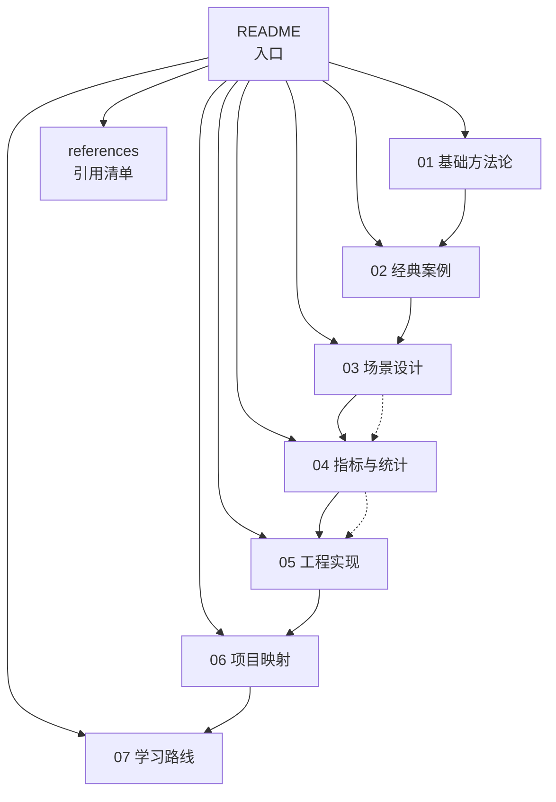

# Agent 评测方法论知识库

> **一句话**：这套文档把"大模型 Agent 评测集怎么设计、怎么实现、怎么判断结论可不可信"整理成一套可执行的规范，用于指导 `BalatroEval` 项目的评测集建设，也用于开发者系统补齐评测领域知识。
>
> **调研日期**：2026-11-17 ｜ **资料核验截止**：2026-11-17 ｜ **代码快照**：2026-11-17 22:38（工作树；HEAD `0e403cf`，`AGENTS.md` 声明 `c65fb9b`，三者不同）
>
> ⚠️ **调研期间仓库被并发修改**：22:33 之后 `bench/` 新增 `errors.py`/`hand_eval.py`/`rules_version.py`/`serialize.py`/`environment.py`/`observation.py`/`tools.py`，`model.py`/`jokers.py`/`engine.py` 被重写为 vanilla 子集；截至 22:38，`python -m unittest` 报 7 个 error，`bench demo` 因签名不匹配不可运行（22:45 复核：测试模块导入即失败）。**详见 [06](06-project-specific-analysis.md) §0**。所有涉及代码状态的结论都以该快照为准，复核时请先跑 §0 的两条命令。
>
> **这不是**：一个新 benchmark、一套已实现的评测系统、或对当前项目的验收报告。**这是方法论参考 + 现状诊断。**

---

## 1. 这套文档解决什么问题

设计 Agent 评测集时，最常见的失败不是"代码写不出来"，而是：

1. **测错了东西**：想测"长期规划"，实际测的是"单步算分"；
2. **结论过头**：样本 12 个，却写"显著优于"；
3. **无法复现**：三个月后不知道跑的是哪版数据、哪个模型；
4. **无法诊断**：只知道 60 分，不知道错在哪；
5. **框架耦合**：换一个模型要改一遍 runner。

这五件事分别对应五份文档的核心内容：

| 问题 | 对应文档 | 关键答案 |
|---|---|---|
| 测错了东西 | [01](01-evaluation-fundamentals.md)、[03](03-agent-benchmark-design.md) | 效度、可观测行为、机制是否支持 |
| 结论过头 | [04](04-metrics-and-statistics.md) | CI、效应量、功效、结论边界 |
| 无法复现 | [05](05-evaluation-framework-engineering.md) | 版本快照、trace、重放 |
| 无法诊断 | [05](05-evaluation-framework-engineering.md)、[04](04-metrics-and-statistics.md) | trace 分层、四层证据 |
| 框架耦合 | [05](05-evaluation-framework-engineering.md) | 模块划分、adapter、Protocol |

---

## 2. 文档地图

| 文件 | 主要解决什么问题 | 适合谁 | 篇幅 |
|---|---|---|---|
| [01-evaluation-fundamentals.md](01-evaluation-fundamentals.md) | 评测是什么；十个术语的区别；十项质量标准（效度/信度/可复现/区分力/覆盖/难度/鲁棒/公平/可扩展/抗污染）；从能力到指标的推导；十类常见错误 | 所有人（**从这里开始**） | 长 |
| [02-classic-benchmarks.md](02-classic-benchmarks.md) | GLUE/SuperGLUE/BIG-bench/HELM/MMLU/GPQA/GSM8K/HumanEval/SWE-bench 的设计史；AgentBench/AgentBoard/BALROG/WebArena/OSWorld/BrowserGym/GAIA/τ-bench/ToolBench 的十二个设计问题；MT-Bench/G-Eval/JudgeBench/AlpacaEval/Error Bars/AgentRewardBench 的方法论；对比表与迁移结论 | 想"抄设计"的人 | 长 |
| [03-agent-benchmark-design.md](03-agent-benchmark-design.md) | 从研究问题到可测能力的八步链条；能力 Taxonomy；场景十构件；两个完整场景示例（单步 / 跨阶段资源）；数据集设计（来源/样本量/难度/去重/划分/污染/版本）；Oracle 六种类型与保证范围；评测协议预注册 | 要自己设计评测集的人 | 长 |
| [04-metrics-and-statistics.md](04-metrics-and-statistics.md) | 指标定义卡（accuracy/success/pass@k/pass^k/reward/regret/optimality/legality/效率/成本/鲁棒/恢复/一致性/校准）；五组易混概念；配对实验、CI、Wilcoxon、McNemar、Holm、效应量、功效；一个可复现的完整算例；失败分析四层证据 | 要算分、要下结论的人 | 长 |
| [05-evaluation-framework-engineering.md](05-evaluation-framework-engineering.md) | 13 模块架构与数据流；dataclass Schema；三层 Adapter；Episode Runner；Trace schema 与分层；并发/限流/断点续跑；七类测试与负对照；目录与依赖分层 | 要写框架的人 | 长 |
| [06-project-specific-analysis.md](06-project-specific-analysis.md) | 当前项目能测什么/不能测什么；Oracle 保证范围；Trace 缺口；统计矛盾；架构缺口；映射表；**P0/P1/P2 建议**；**文档-代码冲突清单** | 项目开发者、接手者 | 长 |
| [07-learning-roadmap.md](07-learning-roadmap.md) | 九阶段学习路线；每阶段的目标/概念/阅读/必答问题/实践任务/完成标准；6 周排期；面试映射；自检清单 | 转型中的开发者 | 中 |
| [references.md](references.md) | 全部论文/项目/仓库/内部依据；状态（已核验/部分/待核验）；**待核验清单**；引用格式 | 要引用的人 | 中 |

---

## 3. 推荐阅读顺序

### 路线 A：我想快速判断"这个评测靠不靠谱"（约 2 小时）

1. [01](01-evaluation-fundamentals.md) §1.2（十项标准）+ §1.4（常见错误）；
2. [04](04-metrics-and-statistics.md) §4.6（结论边界）；
3. [02](02-classic-benchmarks.md) §2.4（对比表与迁移结论）。

### 路线 B：我要给当前项目做评测集（约 1 天）

1. [01](01-evaluation-fundamentals.md) 全文（建立词汇）；
2. [03](03-agent-benchmark-design.md) §3.1–§3.5（研究问题→Oracle）；
3. [04](04-metrics-and-statistics.md) §4.2、§4.4（指标与统计）；
4. [06](06-project-specific-analysis.md) 全文（现状与 P0）。

### 路线 C：我要写评测框架（约 2 天）

1. [05](05-evaluation-framework-engineering.md) §4.1–§4.5（架构、数据结构、runner、trace）；
2. [05](05-evaluation-framework-engineering.md) §4.7（测试自身）；
3. [06](06-project-specific-analysis.md) §6.8（缺哪些模块）；
4. [02](02-classic-benchmarks.md) §2.2（环境设计参照）。

### 路线 D：我是转型中的开发者，要补系统知识（约 6 周）

按 [07](07-learning-roadmap.md) 的九阶段走。每周有产出物，可自我验收。

### 路线 E：我是 AI Agent，被要求改这个项目

跳到 [§5 Instructions for AI Agents](#5-instructions-for-ai-agents)，然后按任务查表。

---

## 4. 本知识库的核心结论（便于快速对齐）

> 以下是**跨文档的十个判断**。每条都能在对应文档找到论证与出处。

### 关于方法论

1. **效度是第一性问题**：效度错了，统计再严谨也没用（[01](01-evaluation-fundamentals.md) §1.2.1）。
2. **单步指标不能论证长程能力**：单步指标的参照是"当前状态最优"，定义上不含未来（[04](04-metrics-and-statistics.md) §4.3.1）。
3. **pass@k 与 pass^k 方向相反**：前者随 k 上升（发现能力），后者随 k 下降（可靠性）；不能混用（[02](02-classic-benchmarks.md) §2.2.9、[04](04-metrics-and-statistics.md) §4.2.2）。
4. **Oracle 只在定义的目标函数内最优**：换目标函数，同一个 oracle 会把正确动作标成错误（[03](03-agent-benchmark-design.md) §3.5.4）。
5. **判定强度决定架构**：DB 状态 > 执行测试 > locator 断言 > 精确匹配 > LLM judge；弱判定必须有校准证据（[02](02-classic-benchmarks.md) §2.4.2）。
6. **样本量决定主张强度**：n=30、σ_d=0.25 只能检测 Δ≥0.13；检测不到不等于没有差异（[04](04-metrics-and-statistics.md) §4.4.7）。
7. **聚类会让 CI 变宽**：同模板/同来源的样本不是独立样本（本报告算例：朴素 SE 0.0170 vs 聚类 SE 0.0307）（[04](04-metrics-and-statistics.md) §4.5.3）。

### 关于当前项目

8. **四个目标能力里只有"多步决策"有部分可操作定义**；跨回合资源分配、长期构建、失败恢复在机制层就被排除（[06](06-project-specific-analysis.md) §6.1）。
9. **在当前规则下贪心近似最优**：资源每盲注重置、无金钱、无跨期累积 ⇒ 环境不需要规划，因此测不出规划（[06](06-project-specific-analysis.md) §6.2.2、[03](03-agent-benchmark-design.md) §3.3.4）。
10. **评测闭环还缺一半**：环境层与工具层正在成形（`environment.py`/`tools.py`/`serialize.py`），但仍没有 Dataset/Loader、Runner、Evaluator、Metrics/Aggregator，因此还产不出任何 Agent 能力结论；`bridge/server.py` 仍只暴露一个占位 `get_state`；且截至 22:38，测试有 7 个 error、`bench demo` 因签名不匹配不可运行（[06](06-project-specific-analysis.md) §0、§6.8、C1/C11/C12）。

---

## 5. Instructions for AI Agents

> 这一节是给**后续参与本项目的 AI Agent** 的使用规范。它是操作约束，不是背景介绍。

### 5.1 强制流程

1. **设计新评测场景前**，先读 [03](03-agent-benchmark-design.md) §3.1–§3.5 与 [01](01-evaluation-fundamentals.md) §1.2。必须能回答："这个场景测的是哪个可观测行为？贪心策略在它上面是否近似最优？"
2. **修改评测指标前**，先查 [04](04-metrics-and-statistics.md) §4.2 的定义卡与 §4.3 的五组区分。必须写清：方向、单位、精确性（exact/approx/heuristic）、适用条件、不适用场景。
3. **修改 Oracle 前**，先读 [03](03-agent-benchmark-design.md) §3.5.4 与 [06](06-project-specific-analysis.md) §6.4。必须写明"保证范围"与"不保证什么"，不得把局部最优写成全局最优。
4. **新增数据前**，先查 [03](03-agent-benchmark-design.md) §3.4（来源/去重/划分/污染）与 [05](05-evaluation-framework-engineering.md) §4.2.6（版本管理）。必须有 `dataset_version`、`content_hash`、`provenance`。
5. **运行实验前**，先查 [04](04-metrics-and-statistics.md) §4.4 与 [03](03-agent-benchmark-design.md) §3.6.2。必须确认：配对键、预算、工具权限、环境版本、统计方法、α 与校正方式都已固定。
6. **分析失败时**，遵守 [04](04-metrics-and-statistics.md) §4.7.2 的四层证据：观察（trace 事实）→ 行为推断（跨样本模式）→ 干预验证（ablation/counterfactual）→ 机制解释（本知识库不涉及）。**不得从观察直接跳到机制。**
7. **修改评测框架时**，遵守 [05](05-evaluation-framework-engineering.md) §4.1 的模块职责与 §4.8.2 的依赖分层。不得让 `environments` 依赖 `runner`，不得在 runner 里做判分。
8. **不得把未验证的假设写成实验结论。** 没跑过的命令不写"通过"；没测过的能力不写"已覆盖"；没核验的论文不写"已证明"。
9. **不得为了提高分数而修改任务、指标或规则**，除非有明确的版本变更记录与研究依据（写清：为什么改、改了会影响哪些历史结果、是否需要重跑）。
10. **如果本知识库没有覆盖某个问题**，先查 [references.md](references.md) 与一手资料，再补充文档。**不得自行编造规范**，也不得把"某篇论文大概是这样"当成依据。

### 5.2 任务 → 文档速查

| 你要做的事 | 先读 | 再读 |
|---|---|---|
| 设计新场景 | [03](03-agent-benchmark-design.md) §3.3 | [06](06-project-specific-analysis.md) §6.2 |
| 定义新指标 | [04](04-metrics-and-statistics.md) §4.2 | [04](04-metrics-and-statistics.md) §4.3 |
| 改 Oracle | [03](03-agent-benchmark-design.md) §3.5 | [06](06-project-specific-analysis.md) §6.4 |
| 造数据集 / 划分 | [03](03-agent-benchmark-design.md) §3.4 | [05](05-evaluation-framework-engineering.md) §4.2.6 |
| 写 runner / trace | [05](05-evaluation-framework-engineering.md) §4.4–§4.5 | [06](06-project-specific-analysis.md) §6.6 |
| 做统计比较 | [04](04-metrics-and-statistics.md) §4.4 | [04](04-metrics-and-statistics.md) §4.6 |
| 做失败归因 | [04](04-metrics-and-statistics.md) §4.7 | `plan/详细版/04-失败归因器.md` |
| 判断能否声称某结论 | [06](06-project-specific-analysis.md) §6.12 | [README 红线](../../README.md#L174-L191) |
| 接入新模型 | [05](05-evaluation-framework-engineering.md) §4.3 | — |
| 写测试 | [05](05-evaluation-framework-engineering.md) §4.7 | — |

### 5.3 表述红线（与项目 `README`/`AGENTS.md` 一致）

| ❌ 不要写 | ✅ 应该写 |
|---|---|
| "已覆盖长线规划" | "目标能力，尚未覆盖，登记为候选" |
| "Local Regret 证明规划能力" | "Local Regret 衡量单步决策与即时最优的差距" |
| "Oracle 是最优解" | "Oracle 在当前动作空间与即时得分目标下最优" |
| "n=12 显著优于" | "n=12，只做描述统计 + 95% CI" |
| "trace 显示模型内部…" | "trace 显示行为模式…（行为层推断，非机制解释）" |
| "已对齐 / 已终验" | "L0 未对齐；真游戏终验未执行" |
| "4 个 MCP 工具" | "计划 4 个；当前 `bridge/server.py` 只有 `get_state` 占位" |

### 5.4 本知识库的定位（重要）

> **本知识库是设计和实现评测系统的方法论参考，不是不可修改的绝对规范。新的设计需要结合研究目标、环境特性和实验证据进行判断。**

具体含义：

- 文档里的"建议"不是命令。若你有证据表明某条建议不适用于当前场景，**写出理由并更新文档**，而不是默默违反。
- 文档里的数字（如 n≈50）是基于特定假设（σ_d=0.25、Δ=0.10）的算例，不是通用常数。换假设要重算。
- 文档标 ❓ 的内容（见 [references.md](references.md) §F）不得当作事实。要用就先核验。
- 本文档的判断基于 2026-11-17 的工作树状态。代码一变，[06](06-project-specific-analysis.md) 的结论可能过期——**改代码后请回来更新对应行号与判断**。

---

## 6. 资料版本与时效性

| 项 | 值 |
|---|---|
| 调研执行日期 | 2026-11-17 |
| 论文元数据核验方式 | arXiv 摘要/HTML、ACL Anthology、PMLR、NeurIPS/ICLR 官方页 |
| 代码事实核验方式 | 直接读工作树文件；`git log`/`git diff` 确认版本 |
| 已核验论文数 | 29 篇（A 组 9 + B 组 9 + C 组 11） |
| 明确标"待核验"的字段 | 17 项（[references.md](references.md) §F） |
| 已知的抓取限制 | arXiv 长文 HTML 会在 ~45–55k 字符处截断，导致部分 Limitations 章节未读到；`github.com` 访问不稳定，部分仓库未确认可解析 |
| 版本提示 | τ-bench 官方仓库提示任务已更新（建议用新版）；WebArena/OSWorld 等有后续维护版本，引用具体数字时须写明版本 |

---

## 7. 维护约定

1. **新增引用**：先加到 [references.md](references.md)，标状态，再在正文引用编号。
2. **修改结论**：同时更新引用它的其他文档（尤其是 [06](06-project-specific-analysis.md) 与本节 §4）。
3. **代码变更后**：[06](06-project-specific-analysis.md) 的行号引用需要复核。
4. **不要复制大段内容到多个文档**：用一个文档做"单一事实来源"，其他地方链接过去。
5. **术语一致**：本知识库统一用"场景（scenario）""episode""trace""Oracle""regret""判定（evaluation/judging）"，不要混用同义词。

---

## 8. 读完这套文档，你应该掌握什么

- **判断**：拿到一份评测方案（或本项目的方案），能指出它的效度边界、样本量是否支撑结论、判定是否可靠。
- **设计**：把一个模糊的研究兴趣变成"环境 + 场景 + Oracle + 指标 + 统计"的可执行方案。
- **实现**：画出评测框架的模块图，并写出可运行的 trace schema、runner、evaluator 骨架。
- **诊断**：用 trace 做四层证据的失败分析，不把行为推断说成机制解释。
- **守住边界**：明确说出"这个结论只在哪条件下成立"，并拒绝为了好看而放宽口径。

如果做不到其中任何一条，回到对应章节（见 §3 的路线图）。

---

## 9. 快捷入口

- 我是新手，从哪开始？→ [01](01-evaluation-fundamentals.md) §1.1
- 我只想知道项目有什么问题？→ [06](06-project-specific-analysis.md) §6.11（P0/P1/P2）
- 我要设计一个测规划的基准？→ [03](03-agent-benchmark-design.md) §3.3.4 + §3.3.5
- 我要算 CI 和 p 值？→ [04](04-metrics-and-statistics.md) §4.4–§4.5
- 我要写 trace？→ [05](05-evaluation-framework-engineering.md) §4.5
- 我要引用论文？→ [references.md](references.md)
- 我要 6 周学会？→ [07](07-learning-roadmap.md)
