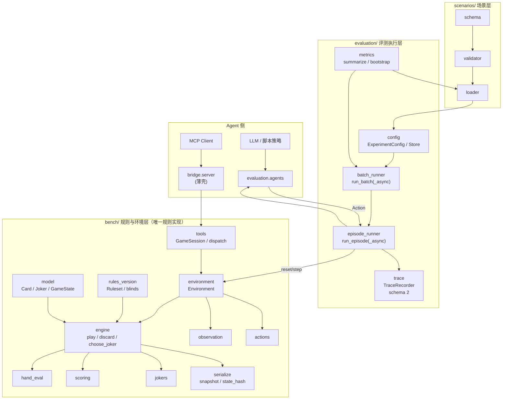
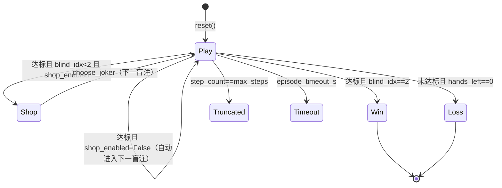

# 架构：规则、环境、工具与评测执行

> 本文描述**实际代码**的分层、调用关系与生命周期。所有模块都可从仓库根直接 import（无第三方依赖，除 bridge 运行时的 MCP SDK）。

## 1. 分层图



**依赖方向（单向，无环）**：
- `bench` 不 import `evaluation` / `scenarios` / `bridge`；
- `scenarios` import `bench`（场景要校验规则兼容性）；
- `evaluation` import `bench` + `scenarios`；
- `bridge/server.py` 只 import `bench.tools`，MCP SDK **延迟导入**（无 SDK 时仍可静态检查/测试工具函数）；
- 规则只有一份实现：`scenarios`/`evaluation`/`bridge` 均**不**复算分数。

## 2. 模块职责（实际文件）

| 模块 | 职责 | 不做什么 |
|---|---|---|
| `bench/errors.py` | 统一错误码（11 个）与异常类型 | 不做 IO |
| `bench/rules_version.py` | 规则声明（唯一机器可读来源）、Ante 1 盲注、牌型基础分表、`ruleset_for` 扩展解析 | 不读文件 |
| `bench/model.py` | `Card`/`Joker`/`GameState` 值对象与校验、`state_summary` | 不推进状态 |
| `bench/cards.py` | 52 张标准牌、稳定 ID 查找、剩余牌堆 | 不含随机性 |
| `bench/hand_eval.py` | 牌型识别、基础分、计分牌筛选、contains | 不应用 Joker |
| `bench/jokers.py` | 8 个具名 Joker 目录 + 条件判定 | 不含数值以外的规则 |
| `bench/scoring.py` | 等级 1 计分流水线 + trace | 不改状态 |
| `bench/actions.py` | `Action` 值对象、合法动作枚举（218+218） | 不校验状态阶段（engine 做） |
| `bench/engine.py` | 状态初始化与转移（play/discard/choose_joker） | 不写文件、不读全局 |
| `bench/serialize.py` | 完整快照/还原/稳定 hash | 不缓存 |
| `bench/observation.py` | Agent 可见 observation + 紧凑文本 | 不暴露牌堆顺序/oracle |
| `bench/environment.py` | reset/observe/legal_actions/step/snapshot/restore/terminated/truncated | 不写 trace |
| `bench/tools.py` | 工具层：参数校验、错误 JSON、session | 不实现规则 |
| `bench/oracle.py` | O1 精确局部 argmax / O2 近似 EV / O3 贪心参照 | 不声称全局最优 |
| `bench/logging.py` | **LEGACY** W2 日志写入器（新链路不调用） | — |
| `bench/__main__.py` | `rules/demo/verify/ev` CLI | — |
| `scenarios/schema.py` | Scenario/Goal/InitialState/Constraints 数据类 | 不做规则校验 |
| `scenarios/validator.py` | 规则兼容性校验（版本/ID/资源/Boss/扩展/未知字段） | 不执行游戏 |
| `scenarios/loader.py` | JSON/JSONL/目录加载、`to_reset_spec`、场景 hash | 不生成假捕获 |
| `evaluation/agents.py` | Agent 协议、脚本/随机/Oracle/HTTP 适配器、缓存、限流 | 不直接改状态 |
| `evaluation/episode_runner.py` | 单 episode 执行、指标、trace、状态/超时/错误隔离 | 不做并发调度 |
| `evaluation/batch_runner.py` | 任务展开、并发、重试、断点续跑 | 不实现规则 |
| `evaluation/trace.py` | 逐步 JSONL（schema 2）读写与摘要 | 不丢证据 |
| `evaluation/config.py` | 实验配置、run 目录、manifest、code hash、results 索引 | 不做统计 |
| `evaluation/metrics.py` | 分组统计、bootstrap CI、Markdown 表 | 不做显著性主张 |

## 3. 一次动作的完整调用链（MCP 示例）

```text
MCP tools/call play_cards {"card_ids":["c7h","c7d"]}
  → bridge.server.play_cards(...)
    → bench.tools.dispatch_tool(session, "play_cards", args)
      → bench.tools.play_cards → Environment.step({"kind":"play",...})
        → Action.from_dict                 # 形状校验（1..5 张、无重复）
        → 场景 allowed_action_kinds 校验   # 违反 → NOT_ALLOWED，状态不变
        → 补 hand_indices_snapshot         # trace 证据
        → engine.apply_action → engine.play
            → cards_by_ids                 # 未知/重复 → UNKNOWN_CARD/DUPLICATE_CARD
            → copy.deepcopy(state)         # 入参永不被修改
            → scoring.score_hand
                → hand_eval.evaluate_hand  # 牌型、基础分、计分牌、contains
                → 逐张计分牌加 chips
                → 按槽位顺序应用 8 类 Joker（条件不满足只记 trace）
                → floor(chips×mult)        # 仅末尾一次
            → 扣手数、补牌、打出的牌进弃牌堆
            → _after_play                  # 达标→过关/胜利；手数耗尽→失败
            → _check_state                 # 52 张守恒等不变量
        → Environment 组装 StepResult（observation/reward/terminated/truncated/info）
      → tools 包装为 {ok, observation, text, reward, terminated, truncated, info}
  → MCP 返回 JSON 字符串
```

评测链路：

```text
evaluation.run_batch(scenarios, config)
  → ExperimentStore.write_manifest（config + rules + code hash + 场景 hash）
  → build_tasks（scenario × repeats，task_id = hash(experiment, scenario_hash, agent, repeat, config_hash)）
  → 跳过已记录 task（断点续跑）
  → asyncio.gather：每个 task
      → run_episode_async(scenario, agent, config, store, task_id)
          → Environment.reset(to_reset_spec(scenario))
          → TraceRecorder.start
          → loop: agent.decide_async → env.step → TraceRecorder.step
                   （可选：best_play 计算局部 oracle → regret/optimality → decision_metric 事件）
          → TraceRecorder.end → ExperimentStore.append_result
```

## 4. Episode 生命周期



- **terminated**：规则内结束（win/loss）；
- **truncated**：`max_steps` 截断（决策点场景在完成 1 次决策后按 `completed` 计入场景完成，见 episode_runner）；
- **timeout**：墙钟超时（由 runner 的 `asyncio.timeout` 产生，trace 记 `status=timeout`）；
- **agent_error / invalid_action_limit / env_error**：失败隔离状态，不算成功。

## 5. 并发模型（三层）

| 层级 | 是否并行 | 机制 | 说明 |
|---|---|---|---|
| 单 episode 内 | ❌ 严格顺序 | 直接 await | 下一步依赖上一状态 |
| episode 之间 | ✅ 逻辑并发 | `asyncio.Semaphore(max_concurrency)` | 每个 episode 独立 Environment/Agent/trace |
| 模型调用 | ✅ 额外限流 | `asyncio.Semaphore(agent_concurrency)` + `TokenBucket` | 与环境调度解耦 |
| CPU 密集规则计算 | ❌ 单进程内受 GIL/事件循环限制 | 同步执行 | 实测并发不提升 CPU 吞吐；需要时用多进程分片 |
| Trace 写入 | 每 task 独立文件 | 文件 append | 结果行由 `ExperimentStore` 线程锁保护 |

**为什么不用多进程**：当前环境单步 ~1ms、Episode ~20ms，进程启动与序列化成本更高；先以 asyncio + 单进程跑通，扩展到上千 Episode 时按 task 分片多进程即可（`run_batch` 可按切片独立调用，结果文件 append）。模型等待型并发已实测有效（4 并发 ≈ 2.3× 吞吐，见性能文档）。

## 6. 确定性与状态所有权

1. 每个 Episode 一个 `Environment`；**禁止**跨任务共享 `GameState`（runner 每次 reset）。
2. 随机性只来自 `GameState.rng_state`（`random.Random.getstate()` 的 JSON 编码）；洗牌/商店抽样都先还原、再写回。
3. 状态转移一律 `deepcopy` 后修改，入参状态不被污染（测试覆盖）。
4. `state_hash` = 规范化 JSON（含全部 52 张牌顺序、Joker、资源、RNG 状态）的 sha256；trace 每步记录 before/after hash。
5. 相同 scenario seed + 相同动作序列 ⇒ 相同状态哈希（测试覆盖）。
6. Trace 含时间戳/延迟，属于**非确定性元数据**；比较确定性时只比较 action/reward/state_hash。

## 7. 关键设计取舍

| 取舍 | 选择 | 原因 |
|---|---|---|
| 规则层是否写日志 | 不写（纯函数） | 规则可单测、可复用；trace 归评测层 |
| 商店是否默认开启 | 默认关闭；`free_joker_choice` 显式扩展 | 金钱被排除；免费选 Joker 不是 vanilla，不能悄悄进训练集 |
| Boss 效果 | **不实现**，场景必须声明 `effect=null` | 避免“静默忽略未实现规则”；Ante 1 Boss 仍按 600 分建模 |
| 弃牌价值 | O2 近似 EV，不冒充精确 | 抽样模型与真实发牌不一致；报告必须带 K |
| 局部 regret | 只在 play 决策上定义；discard 单列 `action_type_mismatch` | 避免旧实现“正确弃牌被记最大 regret” |
| Trace schema | 升到 2，逐步一行 | 流式写入、失败定位、断点续跑、诊断需要 |
| 旧 `bench/logging.py` | 保留但标 LEGACY | 不删除历史；新链路不再调用 |
